

This introduction explains how the mesh sorter sorts, mostly with small examples. To keep the ideas clear it simplifies some details: sizes, timing and the exact register sequences. Where it differs from `spec/machine-spec.md` or the documents in `sw/`, those are authoritative. Where a simplification matters, the text says so and points to the section that has the full story. Section numbers such as §4.9 are the spec's; "diagram 7.4" is a figure in the release's `diagrams/`.

# 1. The idea, on a toy example

The mesh sorter is 64 tiles on an 8 × 8 mesh. Each tile has its own memory (4 MB of "big SRAM", §4.1), a small RV32 controller, and a handful of engines that stream data in and out of that memory. Every tile starts with some records, each a 32-bit key with a value of 32 or 128 bits. The reference job is 65,536 records per tile, 4,194,304 in all.

At the end, tile *q* holds one contiguous range of the global order, sorted, and by default every tile holds the same number of records. Equal keys keep their input order: first by tile, then by position on the tile. So the global order is by (key, tile, position).

The keys are sorted in four steps:

1. each tile sorts its own records;
2. the tiles agree on **split points**: where each tile's share of the global order begins;
3. one **all-to-all** moves every record to the tile that owns its rank;
4. each tile sorts what it received.

Each record crosses the network once, except on the two-hop paths of section 4. (The values follow their keys with two more local steps, section 2; the full sort has six steps, section 3.)

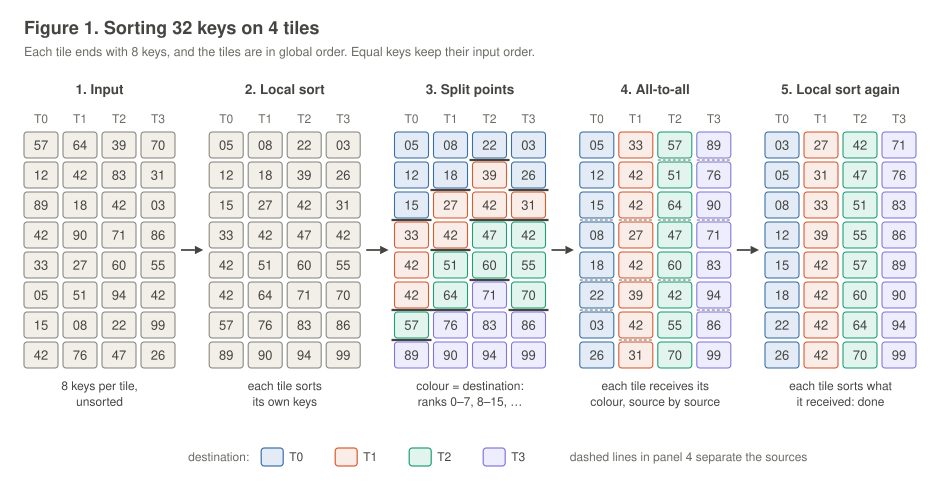

Figure 1 runs the four steps on 4 tiles with 8 keys each:

1. **Input.** Each tile holds 8 unsorted keys, 32 in all.
2. **Local sort.** Each tile sorts its own keys. Nothing crosses the network.
3. **Split points.** With 8 keys per tile as the target, T0 gets global ranks 0–7, T1 ranks 8–15, T2 ranks 16–23 and T3 ranks 24–31. Each tile finds where those rank boundaries fall in its sorted run. That cuts the run into four contiguous **slices**, one per destination (the colours). The cuts differ from tile to tile: T0 has 3 keys for T0, T2 only 1.
4. **All-to-all.** Every tile sends each slice to its destination. Each tile receives exactly 8 keys, slice by slice in source order.
5. **Local sort again.** Each tile sorts what it received. The tiles are now in global order: the last key on one tile is no larger than the first key on the next.

The slice sizes are what the all-to-all moves:

| from \\ to | T0 | T1 | T2 | T3 |
|:---:|:---:|:---:|:---:|:---:|
| T0 | 3 | 3 | 1 | 1 |
| T1 | 2 | 2 | 2 | 2 |
| T2 | 1 | 2 | 2 | 3 |
| T3 | 2 | 1 | 3 | 2 |

Every row sums to 8, the tile's input, and every column to 8, the balanced target.

What the toy hides, and the rest of this introduction covers:

- the records carry an **ordinal**, which is how ties are kept in order and how each key finds its value (section 2);
- the local sorts are radix passes over 8-bit digits, run by the tile's engines (section 3, step 1);
- the split points are found by a parallel bisection, not by looking at every key (step 3);
- the all-to-all runs on a fixed 16-group schedule that keeps every link busy (step 4);
- on skewed data one destination can become a hot spot, and the sort then picks another way to move the data (section 4).

# 2. Records, ties and values

## Records: (key, ordinal)

On the machine every key travels as a 64-bit **record**: the 32-bit key in the low word and a 32-bit **ordinal** in the high word (bits 63–32). The ordinal is not computed by software. The tile's write engine stamps it as the record lands in memory, by **augmenting**: a packet sent in mode 4 is written at its landing address, with its high word replaced by

> ordinal = (landing address − `DMA_RECORD_BASE_ADDRESS`) / 2

(§3.1, §4.9). Addresses count 32-bit chunks and a record is two chunks, so the ordinal is simply the record's position in the receiving buffer: 0, 1, 2, …

With 128-bit values the sort augments twice:

- **Step 1** brings the raw 32-bit keys into the tile in mode 4, one key per packet, into a fresh buffer. Each key becomes (key, *j*), *j* its input position.
- **The keys all-to-all** sends the records in mode 4 again. Each record arrives with the ordinal of its position in the receiver's buffer, replacing the one it had.

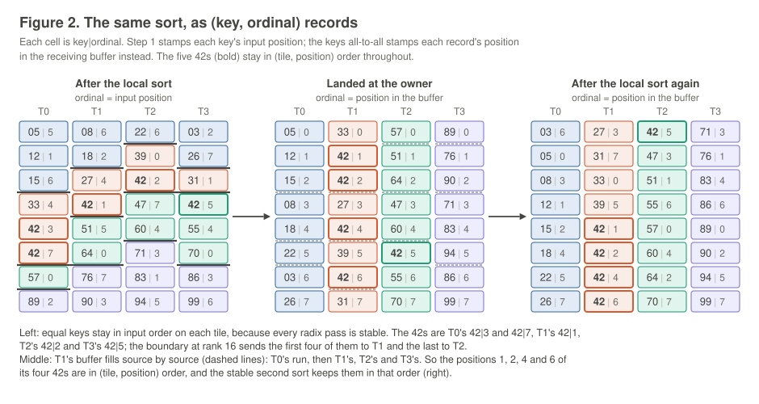

## Ties

Equal keys are ordered by (tile, position), and no step ever compares ordinals to achieve it. The order comes from where records sit:

- **every radix pass is stable**, so equal keys on a tile stay in input order through the first local sort (figure 2, left);
- **the receiver's buffer fills source by source**: each sender's slice lands in its own contiguous run, T0's first, then T1's, and so on (section 3, step 4). So equal keys from different tiles sit in tile order, and within a tile in position order (figure 2, middle);
- the second local sort is stable too, so it keeps that order (figure 2, right);
- the split counts ranks in the same (key, tile, position) order, so every tile agrees where a boundary inside a run of equal keys falls (section 3, step 3).

In the toy, key 42 appears five times, at global ranks 12–16. The boundary at rank 16 falls inside that run: T0's two 42s, T1's and T2's go to T1, and T3's goes to T2.

## How a key finds its value

Values are not sorted directly. They move with the help of the ordinal.

**Landing by source.** In an all-to-all, the receiving tile decides where each sender's records go. It sets one pointer per sender, `PTR[src]`, to the start of that sender's run in its buffer; every packet from that sender lands at `PTR[src]`, which then advances by one record (§4.9). Senders carry no addresses. Figure 3 shows this at T1 in the toy: packets from four senders arrive interleaved, and each lands in its sender's run.

![Tile T1 in the keys all-to-all: packets from four senders interleave, and each lands at PTR\[src\] with its position as the ordinal](../svg/fig03-augmenting.svg)

**Why a position, and not an arrival count.** The values all-to-all lands each sender's values the same way, in mode 2 (no augmenting), at the `PTR[src]` of a second buffer. A sender sends its keys and its values in the same order, so the key at position *i* of the key buffer and the value at position *i* of the value buffer belong together. An arrival count would not have that property, because packets from different senders interleave (figure 3, grey).

**The gather.** After the second local sort, each key's ordinal says where its value is. A **gather** streams the sorted (key, ordinal) records past the tile's GATHER engine, which reads value *ordinal* and writes the values out in key order (figure 4; §4.4, diagram 7.4).

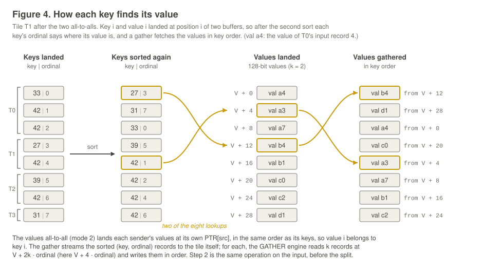

The same operation runs once more, earlier: after the first local sort, a gather puts each tile's values into the order of its sorted keys (step 2), so the values all-to-all can send them slice by slice, exactly like the keys.

**With 32-bit values** the value fits in the record's high word, so it travels with its key. There is no augmenting and no gather; steps 2 and 6 drop out, and the keys all-to-all runs in mode 2.

# 3. The six steps at full scale

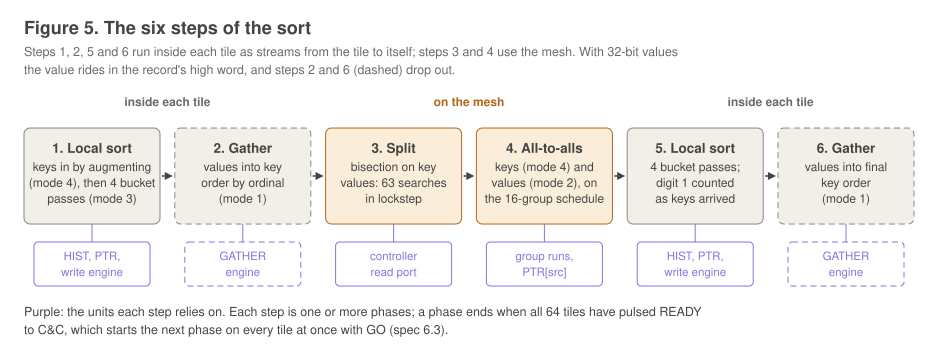

With 128-bit values the sort has six steps (figure 5; §14, diagram 1.0). Steps 1, 2, 5 and 6 are streams from a tile to itself: the tile's address generator reads its memory, the packets loop back through the tile's own router, and the write engine or the GATHER engine takes them (diagram 1.3). Steps 3 and 4 use the mesh. C&C, the machine's command-and-control unit, runs the sort as a fixed sequence of **phases**. Each tile pulses READY when it has finished a phase, and when all 64 have, C&C answers with one GO that starts the next phase on every tile on the same cycle (§6.3). (Simplified: the command convention is in `sw/CONVENTIONS.md`.)

The times quoted below are for the reference job, 64 × 65,536 records with 128-bit values on uniform keys, measured on the cycle-level simulator; section 5 has the full table.

## Step 1: the local sort

Each tile sorts its records with an LSD (least significant digit first) radix sort on the key's four bytes. The spec calls them **digits 1–4**, digit 1 the least significant byte (§4.15). Five passes, each about one record per cycle:

- **Pass 1, the input.** The raw keys are streamed to the tile itself, one 32-bit key per packet, in mode 4, so each lands as (key, *j*) (section 2; with 32-bit values it is a plain copy in mode 2). As they land, the write engine also counts digit 1: **count-on-arrival** adds one to `HIST[digit 1 of the key]` for every record written (§4.9, §4.10).
- **Passes 2–5, the bucket passes.** Each streams the records from one buffer to another in **mode 3**: a record lands at `PTR[t]`, *t* being its digit *d*, and `PTR[t]` advances by one record. In the same cycle, count-on-arrival adds one to `HIST` at digit *d* + 1, for the next pass. The last pass counts nothing.
- **Between passes** the controller turns the counts into bucket starts: it reads the 256 counts in `HIST`, writes their exclusive prefix sum into `PTR` (as chunk addresses in the next buffer), and clears `HIST`. No record moves. There is no separate counting pass: every count is taken while the previous pass writes.

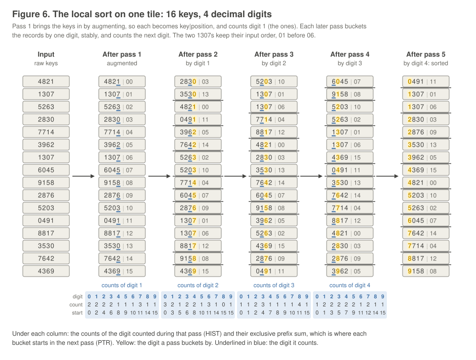

**Why it works.** After the pass that buckets by digit *d*, the records are sorted by digits 1 to *d*: each pass is stable, so records with the same digit keep the order the previous pass left them in. After the pass on digit 4 they are sorted by the whole key, and equal keys are still in input order (figure 6: the two 1307s, 01 before 06).

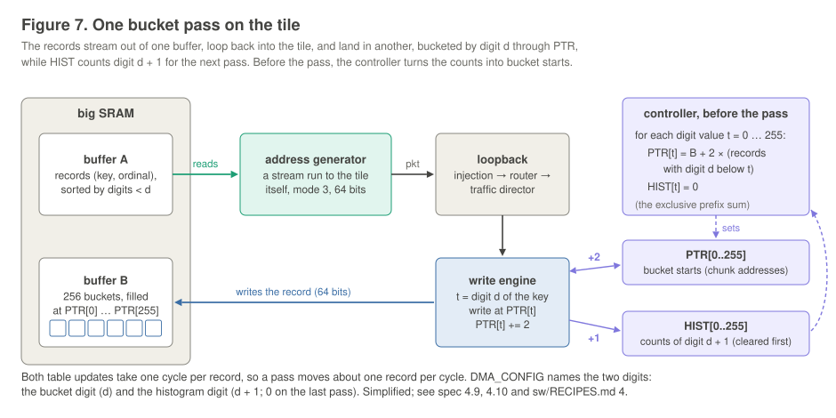

**On the tile** (figure 7). A pass is one **stream run** of the address generator: it reads the source buffer in order and sends every record to the tile itself (§4.2). The write engine looks up `PTR` and updates `HIST` once per record, each in its own table memory, so a pass keeps up with the stream (§4.10, diagram 5.2). The passes ping-pong between two buffers in different memory areas, because within one run no buffer may be both read and written (§4.1). (Simplified: mode 3 uses all 256 `PTR` entries, including one that C&C relies on, which the program restores; see `sw/RECIPES.md` §4.)

**Cost:** 335.0K cycles for the five passes at 65,536 records, about 67K per pass: 65,536 records plus the prefix sum and the start of the run.

## Step 2: the first gather

The values are put into the order of the sorted keys, so that each tile's values for destination *q* form one contiguous slice, as its keys do. The address generator streams the sorted (key, ordinal) records to the tile itself in **mode 1**. For each one, the GATHER engine reads *k* records of value (*k* = 2 for 128 bits) at `DMA_RECORD_BASE_ADDRESS` + 2*k* · ordinal, and sends them back to the tile in mode 2, where they land in order at `PTR[me]` (§4.4, diagrams 7.4, 7.5).

**Cost:** about *k* + 1 cycles per value, 196.7K at *k* = 2: every value costs one request and *k* value packets through the tile's one injection point. This step disappears with 32-bit values.

## Step 3: the split

Owner *q* (tiles 1–63; tile 0 owns nothing) looks for the key at which global rank *R*~q~ = ⌊*q* · *N* / 64⌋ falls. When it is found, every tile knows how many of its records go to each owner. The owners search by **bisection on key values**, all 63 in lockstep (`sort/split/BINDING.md`, `split.c`):

- **The seed bracket.** Each tile reads one sample per owner from its sorted run, the key at position ⌊*q* · *n*~p~ / 64⌋, with one batch of 64 reads, and sends sample *q* to owner *q*. The smallest and largest samples an owner receives bracket its boundary: there are at most *R*~q~ keys below the smallest, and more than *R*~q~ up to the largest. An owner uses the bracket when it is narrow (at most 2^26^ wide); otherwise it searches the whole 32-bit key range.
- **A round** is two exchanges. First every owner sends its probe, the midpoint of its bracket, to every tile (one-word mode-7 packets). Then every tile counts, for each new probe, how many of its keys are below it (lb) and up to it (ub), and sends each owner its (lb, ub) pair as one 64-bit mode-5 packet. The owner sums the pairs: too many keys below means the boundary is lower, too few that it is higher, and if the target rank falls among the keys equal to the probe, the owner is done (the equal keys are shared out in tile order). Each round halves the brackets.
- **Counting** is binary searches of the tile's sorted run, through the **controller read port**: the controller queues reads of big SRAM by stores, the results land in its data memory, and one step issues one read for every search still running (§4.3, diagram 3.3). Each tile keeps a bracket per owner, so later searches cover only a small part of the run.
- **Lockstep and exit.** Each exchange starts at a barrier, a READY/GO round with C&C, and runs in the 16-group order (step 4), so each step of an exchange is a permutation of the tiles. The rounds are fixed at 32, enough for a 32-bit key, but once every owner is done the remaining rounds are empty barriers. An owner that is done repeats its last probe, which tells the tiles to skip it. At the end, each owner sends every tile its cut.

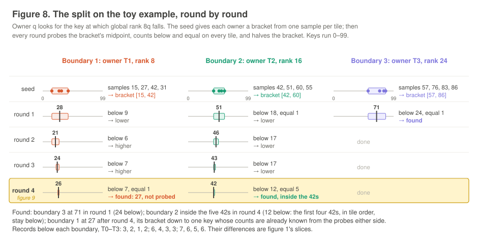

Figure 8 runs this on the toy: the seed brackets come from the keys at positions 2, 4 and 6 of each run; boundary 3 is found in round 1, boundaries 1 and 2 in round 4. Figure 9 shows round 4 close up. The read port and the network share the tile's eject path and the network has no flow control, so a tile never searches while packets are arriving for it: the exchanges and the searching alternate (§4.3).

(Simplified: an owner whose bracket shrinks to one key it has not probed can finish without probing it, as boundary 1 does; the exact rules are in `split.c`.)

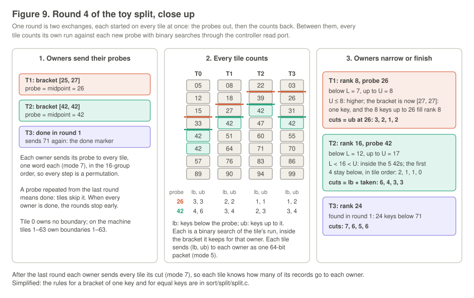

**Cost:** 208.9K cycles on uniform keys, of which the search itself is about 200.7K and the rest its barriers and the next step's code load. The split depends on the data: 24.6K when most owners have nothing to search (all equal, 99 % one value), 171–223K on uniform, sorted and raw Zipf keys, and 268–376K on hashed Zipf keys and the trace sets, which need more search steps.

## Step 4: the all-to-alls

### What has to move

After the split, tile *p* holds one contiguous slice of its sorted records for every destination *q*: 64 × 64 = 4,096 **streams**, about 1,024 records each on uniform keys. Two small exchanges prepare the transfer (13.0K together):

- **Counts to the owners.** Every tile sends each owner the size of its slice. The owner sets `PTR[p]` for each source *p*, by a prefix sum, to the start of *p*'s run in its receive buffer. That is all the addressing there is: senders never say where their records go (§4.9).
- **The group maxima.** Each tile takes its largest stream in each of the 16 groups below, and a reduction over the mesh (each row collects to its column-0 tile, column 0 collects to tile 0, which broadcasts) gives every tile the same 16 maxima (§14). The skew switch (section 4) starts from them.

There are then two all-to-alls on the same streams: the **keys** in mode 4, augmented on arrival and with digit 1 of the next sort counted on arrival; and the **values** in mode 2, 128 bits per element, as two packets.

### The network

Each tile has four links: right and left (±1), which make one ring through all 64 tiles in index order, and down and up (±8), which wrap around the columns (§2). A link carries one 102-bit packet per cycle in each direction: a 64-bit payload plus the source, the destination, a 4-bit mode and an address field (§3.1). Every link takes 3 cycles and a hop 4 (§3.2). The route to a destination depends only on the offset *k* = (destination − source) mod 64: a fixed number of hops along the row, then along the column, at most 7 in all (§4.6, `spec/schedule.md` 1). Routes never change, so the packets of one stream arrive in the order they were sent. The links have **no flow control**: a full queue drops a packet, and that is an error. So the traffic must be planned so that no queue fills, and the schedule is that plan.

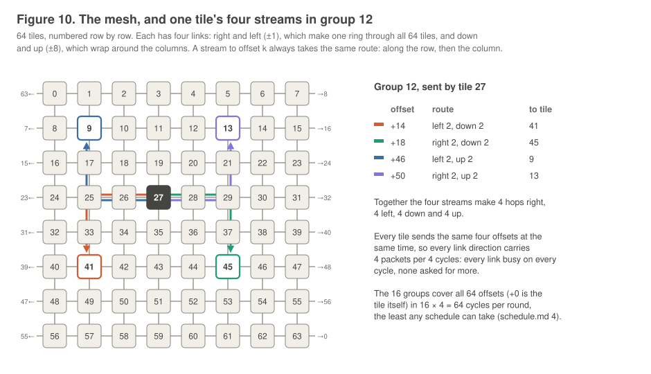

### Sixteen groups of four

The 64 offsets are split into 16 groups of four (`spec/schedule.md`). The groups run one after another. Within a group, every tile sends to the same four offsets at the same time, one packet to each every 4 cycles. The four streams of every group together make 4 hops in each direction (figure 10; group 15, which holds the tile's stream to itself, makes none upward), so every link direction carries 4 packets every 4 cycles: busy on every cycle, never asked for more. Over all 64 offsets the busiest link directions must carry 64 packets for each round of the 16 groups, so 64 cycles is the least any schedule can take; the 16 groups take exactly 64 (`spec/schedule.md` 4).

Each stream below is +*k* [*h*, *v*]: offset *k*, then *h* hops along the row (+ is right) and *v* along the column (+ is down).

| g | streams | g | streams |
|:--:|:--|:--:|:--|
| 0 | +1 [1,0], +29 [−3,4], +35 [3,−4], +63 [−1,0] | 8 | +10 [2,1], +26 [2,3], +38 [−2,−3], +54 [−2,−1] |
| 1 | +2 [2,0], +30 [−2,4], +34 [2,−4], +62 [−2,0] | 9 | +11 [3,1], +25 [1,3], +39 [−1,−3], +53 [−3,−1] |
| 2 | +3 [3,0], +31 [−1,4], +33 [1,−4], +61 [−3,0] | 10 | +12 [4,1], +24 [0,3], +40 [0,−3], +52 [−4,−1] |
| 3 | +5 [−3,1], +23 [−1,3], +41 [1,−3], +59 [3,−1] | 11 | +13 [−3,2], +15 [−1,2], +49 [1,−2], +51 [3,−2] |
| 4 | +6 [−2,1], +22 [−2,3], +42 [2,−3], +58 [2,−1] | 12 | +14 [−2,2], +18 [2,2], +46 [−2,−2], +50 [2,−2] |
| 5 | +7 [−1,1], +21 [−3,3], +43 [3,−3], +57 [1,−1] | 13 | +16 [0,2], +20 [4,2], +44 [−4,−2], +48 [0,−2] |
| 6 | +8 [0,1], +28 [4,3], +36 [−4,−3], +56 [0,−1] | 14 | +17 [1,2], +19 [3,2], +45 [−3,−2], +47 [−1,−2] |
| 7 | +9 [1,1], +27 [3,3], +37 [−3,−3], +55 [−1,−1] | 15 | +0 (the tile itself), +4 [4,0], +32 [0,4], +60 [−4,0] |

### Group runs

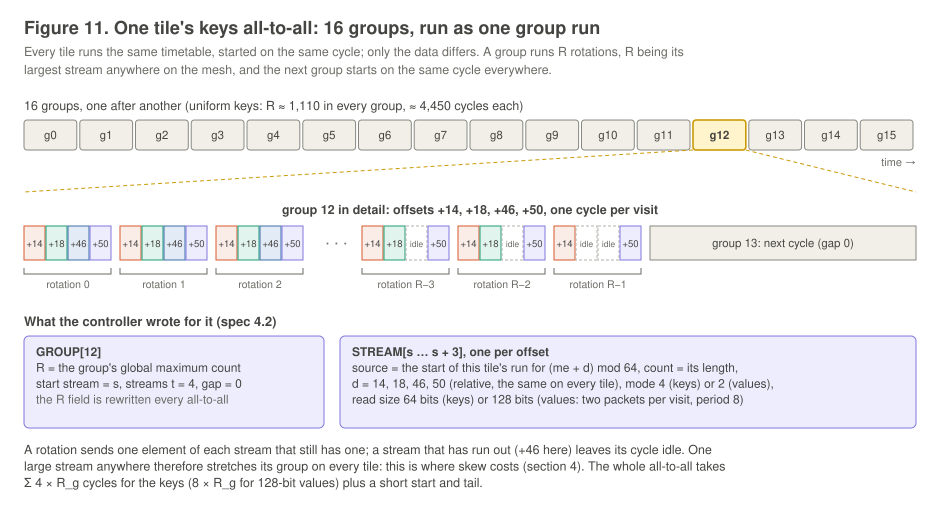

The whole all-to-all is one **group run** of the address generator (§4.2, diagrams 6.1–6.4). The controller writes one `STREAM` entry per stream (where this tile's slice starts, how long it is, the offset *d*, the mode and the read size) and one `GROUP` entry per group (its four streams and its rotation count *R*). A group runs for *R* **rotations**; in each, the address generator sends one element of each of the group's streams that still has one, and the visit of a stream that has run out is an idle cycle (figure 11). The next group follows with no gap.

*R* is the group's largest stream anywhere on the mesh, the group maximum computed above, so that every tile finishes the group on the same cycle and the next group starts everywhere at once. A tile that moved on early would put the next group's traffic onto links still busy with this one, and the balance would break. The price is that *R* is the worst stream, not the average: about 1,100 on uniform keys against an average of 1,024.

Every tile starts the run on the same cycle, after GO, and follows the same timetable. The offsets are relative, so every tile's tables have the same shape; only the slice addresses and counts differ (§4.2). Because the load is balanced, the queues stay shallow: over every full-size run on the direct and LB paths, at most 7 of a link queue's 16 entries and 5 of a receiver's 16 eject entries were ever in use.

**Cost:** Σ 4*R*~g~ cycles for the keys and Σ 8*R*~g~ for the 128-bit values, plus a short start and tail: 71.7K and 142.2K on uniform keys.

## Steps 5 and 6: sort and gather again

The received records are sorted again with the bucket passes of step 1. Digit 1 was already counted while the keys arrived, so four passes suffice: 268.5K. A second gather then puts the values into the final key order: 196.7K. Each tile now holds its share of the global order, keys sorted, each value in its key's place. (The exact output format is still open: §13, item 13.)

# 4. Skewed data

## Why skew hurts

A group runs as long as its largest stream anywhere, and every tile waits for it. On uniform keys every stream is about 1,024 records and every group about 1,100 rotations. On skewed data a few streams can be enormous:

- **sorted input:** each tile's whole run belongs to the tile itself, so the offset-0 stream on every tile holds all 65,536 records, and group 15 runs 65,536 rotations of 4 cycles for the keys and of 8 for the values: about 787K cycles for the two all-to-alls, where uniform keys take 213K [model];
- **reverse sorted:** each tile's whole run goes to one other tile, at a different offset on each tile, so every group is stretched: about 6.3M cycles [model];
- **frequent keys** (Zipf, the trace sets, 99 % one value): a few owners receive large slices from many tiles.

The second local sort doesn't care: each owner still receives exactly its share. Only the transfer does.

## Four paths, one choice

The group maxima that set the groups' lengths also price the direct all-to-all before a single record moves. The sort has four ways to move the data, and a **switch** that every tile evaluates from the same reduced values, so every tile makes the same choice without a message (`sort/skew/skew-v2.md`; §14):

- **Direct:** the 16-group all-to-all of section 3.
- **LB, loopback as a local copy:** each tile's records for itself (the offset-0 stream, huge on sorted or all-equal data) are taken out of group 15 and run as their own extra one-stream group at full rate, one element per visit instead of one per 4 cycles. They no longer stretch group 15 on every tile; that group's *R* is set by its other three streams.
- **TH, two hops through windows:** each owner's receive buffer is cut into 64 equal windows, each carried by a different tile. In hop 1 every source sends each piece of its slices to the tile carrying that piece's window; in hop 2 every carrier sends each owner its one window, so hop 2 is exactly balanced. TH is used only when hop 1 fits in one "layer": no source has two pieces for one carrier.
- **BT, the balanced two hops:** every stream is cut into pieces of *w* records, and a planning sweep gives each piece an intermediate tile, so that no (source, intermediate) or (intermediate, destination) pair carries too many. Both hops then run in a few layers, every layer at *R* = *w*, whatever the distribution.

Two-hop paths move every record twice, but hop 2 lands each record exactly where the direct path would have, with its digit counted on arrival (and augmented, when the values travel separately), so steps 5 and 6 don't change. They run with a gap of 4 cycles after each group: their streams all run full to the end of the group, and without the pause the receivers' queues would overflow at the group boundaries (§4.2).

**The switch** (figure 12) spends on planning only what the data calls for:

1. **Stage 1, every sort (about 1K cycles):** price direct and LB from the group maxima, and compute a floor, a lower bound on any two-hop path. If the cheaper of direct and LB is at or below the floor, take it. Uniform data, Zipf up to 0.8, sorted and all-equal data stop here.
2. **Stage 2 (about 15–19K):** build TH's window table. If TH needs one layer its cost is exact; take it if it is the cheapest. Otherwise estimate BT, and stop at direct or LB unless BT would win.
3. **Stage 3 (BT's planning, about 150K):** the sweep and the per-layer descriptors; take BT if its exact cost wins.

(Simplified: the cost formulas, the floor and BT's limits are in `skew-v2.md` §2 and §6.)

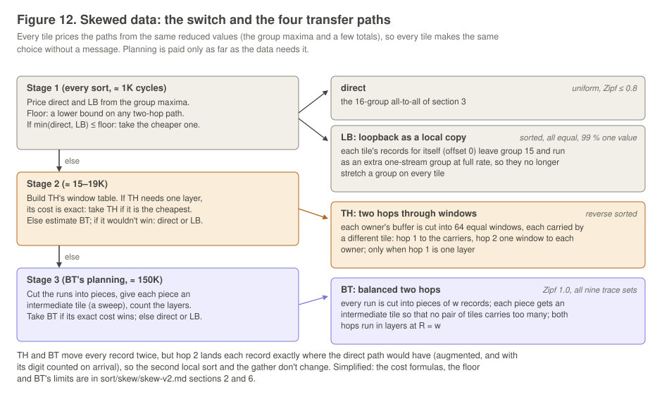

With 128-bit values the switch picks, on the reference job's data sets [measured, transfer including all planning]:

| data set | path | keys + values, measured | direct would take [model] |
|---|---|--:|--:|
| uniform | direct | 215.1K | 213.4K |
| sorted, all equal | LB | 198.5K | 786.9K |
| reverse sorted | TH | 422.9K | 6,291.8K |
| 99 % one value | LB, after stage 2 | 743.9K | 1,303.7K |
| Zipf 1.0 | BT | 797.9K | 915.6K |
| trace (nine sets) | BT | 793.1–806.0K | 1.76–3.00M |

The switch knows the record format. With 32-bit values there is no values all-to-all, so planning has to pay for itself on the keys alone: Zipf 1.0 then stays direct, the trace sets still take BT, and reverse sorted TH.

# 5. The numbers
Cycles from the first step's GO to the last step's READY, the split and all planning included. At 1 GHz, 1,000K cycles is 1 ms. Each column runs from one step's GO to the next step's GO, so the columns add up to the total, apart from 0.3–1.2K cycles of empty commands (the fixed command sequence runs every command on every path).

**128-bit values** (K: thousands of cycles):

| data set | path | local sort 1 + gather | split | counts, maxima | skew planning | keys | values | local sort 2 + gather | **total** |
|---|---|--:|--:|--:|--:|--:|--:|--:|--:|
| uniform | direct | 531.7K | 208.9K | 13.0K | — | 71.7K | 142.2K | 465.1K | **1,433,804** |
| Zipf 0.8 | direct | 531.7K | 311.0K | 13.0K | — | 80.0K | 159.0K | 465.1K | **1,560,992** |
| Zipf 1.0 | BT | 531.7K | 352.8K | 13.2K | 153.8K | 240.1K | 403.7K | 465.1K | **2,160,842** |
| trace, hot 100, 30 % | BT | 531.7K | 360.6K | 13.2K | 156.1K | 240.4K | 404.0K | 465.1K | **2,171,583** |
| sorted | LB | 531.7K | 222.6K | 13.1K | — | 66.1K | 131.1K | 465.1K | **1,431,047** |
| reverse sorted | TH | 531.7K | 222.6K | 13.2K | 16.8K | 138.9K | 266.3K | 465.1K | **1,655,602** |
| all equal | LB | 531.7K | 24.6K | 13.1K | — | 66.1K | 131.1K | 465.1K | **1,233,033** |
| 99 % one value | LB | 531.7K | 24.6K | 13.2K | 15.3K | 242.9K | 484.7K | 465.1K | **1,778,625** |

Local sort 1 is 335.0K of passes plus the 196.7K gather; local sort 2 is 268.5K plus the same gather. Every BT set sorts in 1.98–2.19M cycles.

**32-bit values** (no gathers, no values all-to-all):

| data set | path | local sort 1 | split | counts, maxima | skew planning | keys | local sort 2 | **total** |
|---|---|--:|--:|--:|--:|--:|--:|--:|
| uniform | direct | 335.0K | 208.9K | 12.3K | — | 71.1K | 268.5K | **896,537** |
| Zipf 1.0 | direct | 335.0K | 352.8K | 12.6K | 19.1K | 305.2K | 268.5K | **1,293,864** |
| trace, hot 100, 30 % | BT | 335.0K | 360.6K | 12.6K | 125.5K | 230.8K | 268.5K | **1,333,350** |
| sorted | LB | 335.0K | 222.6K | 12.4K | — | 65.6K | 268.5K | **904,845** |
| reverse sorted | TH | 335.0K | 222.6K | 12.6K | 16.5K | 135.0K | 268.5K | **990,757** |
| all equal | LB | 335.0K | 24.6K | 12.4K | — | 65.6K | 268.5K | **706,831** |

**Where the time goes.**

- **The local sorts** are fixed costs: 997K per sort with 128-bit values, 604K with 32-bit. They are 70 % of a uniform 128-bit sort and about 45 % of a BT sort. Each pass moves one record per cycle; the gathers move one value per *k* + 1 cycles.
- **The split** depends on the data: from 24.6K to 376K, 1–28 % of a sort.
- **The transfer** is 9–16 % on uniform data and up to 43 % on skewed data (99 % one value), planning included.
- **The machine's open timing** barely matters: sweeping every uncertain parameter (memory latency, queue depths, link latency, the control latencies) moves the totals by −0.05 % to +0.22 %.

The full table, every data set in both formats, is in `results/`.
