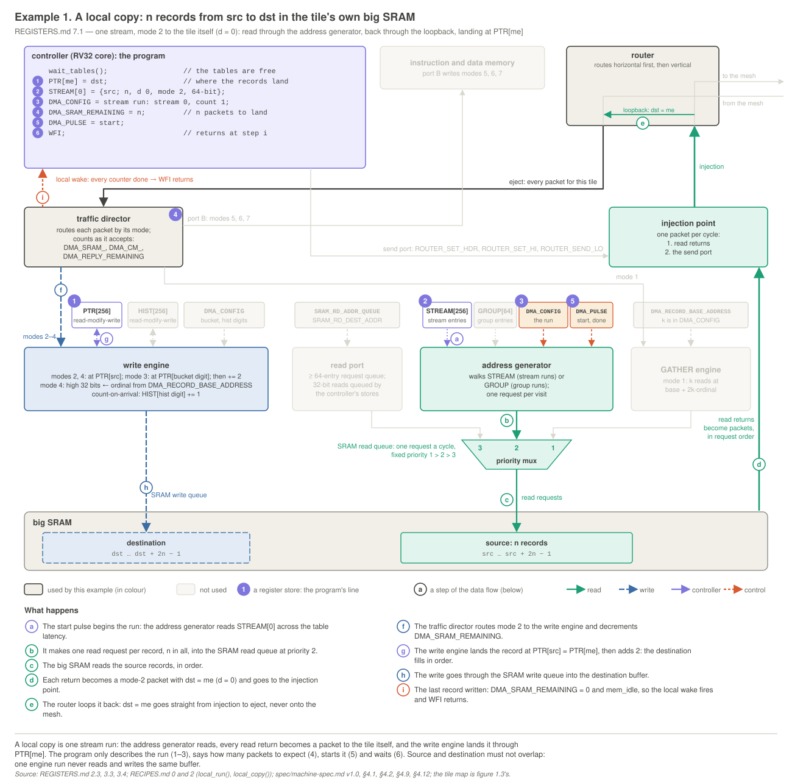
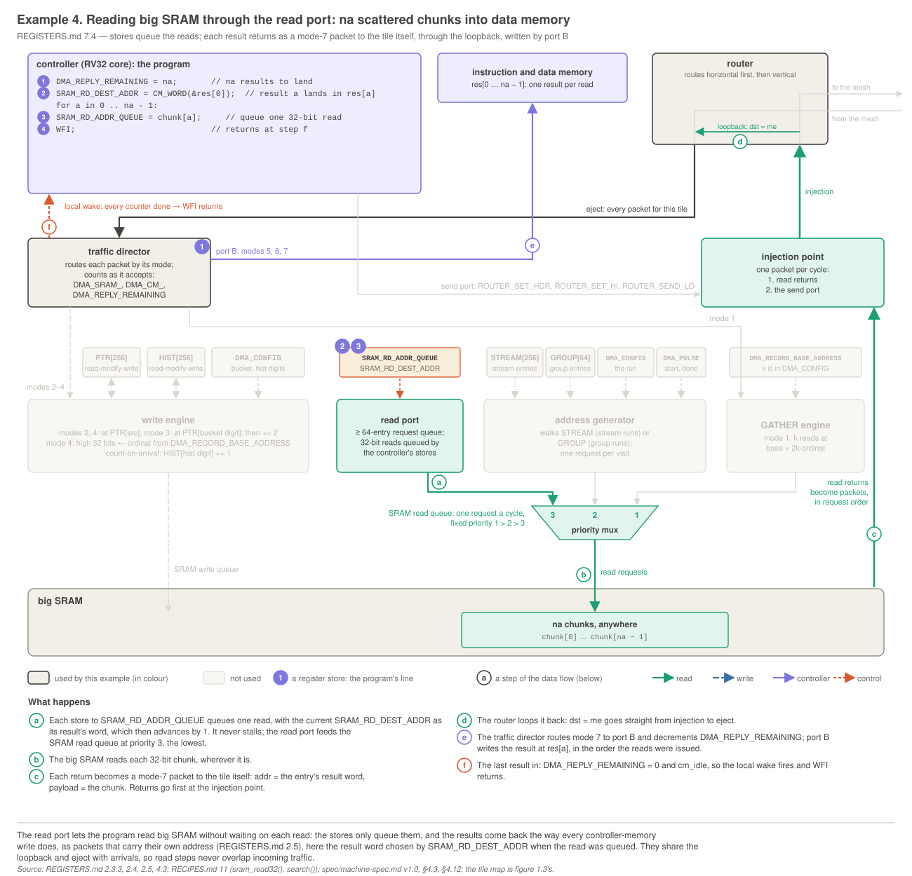

# Tile registers: the programmer's reference (v1.0)

**v1.0 (`mesh.h` 1.0, meshsim v1.0).** This is everything a tile program reaches with loads and stores: the address map, the 13 registers, the table window, and the packets and mailbox words that programs build. `spec/machine-spec.md v1.0` is the source of truth. This document is its programmer's view, and where the two differ, this document is wrong.

## 0. About this document

**Generated tables.** Each block between `<!-- generated: … -->` and `<!-- end generated -->` (visible in the Markdown source) is written by `meshsim/src/RegDoc.java`, from the register table in `meshsim/src/Registers.java` that also generates `mesh.h`. Don't edit these blocks by hand; run `java -cp build RegDoc` in `meshsim/`. `RegDocTest` fails if any block differs from the generator, or if `mesh.h`, the simulator and this document disagree on a name, offset, field, width or reset value. The prose around the blocks is hand-written.

**This folder.** `regdoc/` holds the worked examples' diagrams (`svg/`, `png/`), their scripts and the PDF build (`src/`): `regdoc/src/build_pdf.sh` redraws the diagrams and writes `Reference.pdf` at the release's top level (see `regdoc/README.md`).

**Names.** Register, field and table names are `mesh.h`'s; the field tables' `mesh.h` column gives each field's macro (`NAME_SHIFT`, `NAME_MASK`, `NAME(v)`).

**Notation.**
- **Bits** are written [*hi*:*lo*]. Diagrams put bit 31 on the left; field tables list bit 0 first. A field's value is unsigned.
- **Access:** R (read-only), W (write-only), R/W.
- **Reset** is the value at chip reset: *undef* means undefined, and — means the field holds no state.
- **Chunk:** a 32-bit word of big SRAM, named by a 20-bit **chunk address**. A record is 2 chunks; a 128-bit row is 4.
- **Packed word:** a 12-bit controller-memory word address (section 4.3).
- ***L*** is `ts_engine_latency`, the one-way latency between the table memories and the engines (default 1).
- **Timing.** A store executed in cycle *t* takes effect at the end of *t*: a load at *t* + 1 and the unit that owns the register both see it. A load at *t* returns the state at the end of *t* − 1. Loads and stores take one cycle, and only a `ROUTER_SEND_LO` store can stall (2.2).

## 1. Address map and access rules

The controller is strictly Harvard: instructions come only from instruction memory, and data accesses go to the table window, data memory and the registers. Figure 3.2 draws the decode and every register's bit layout.

<!-- generated: addressmap -->
| address | size | contents | data access |
|---|---|---|---|
| `0x00000000`–`0x00001EFF` | 7936 B | instruction memory: code (fetched; written only by mode 5) | bus error |
| `0x00001F00`–`0x00001FFF` | 256 B | instruction memory: the resident loader | bus error |
| `0x00002000`–`0x000023FF` | 1 KB | table window: `HIST` | `lw`, `sw` |
| `0x00002400`–`0x000027FF` | 1 KB | table window: `PTR` | `sw` only |
| `0x00002800`–`0x00002FFF` | 2 KB | table window: `STREAM` | `sw` only |
| `0x00003000`–`0x000031FF` | 512 B | table window: `GROUP` | `sw` only |
| `0x00003200`–`0x00003FFF` | 3584 B | unmapped | bus error |
| `0x00004000`–`0x00005BFF` | 7 KB | data memory: `.rodata`, `.data`, `.bss`, stack | any width |
| `0x00005C00`–`0x00005FFF` | 1 KB | data memory: the mailbox, 256 slots | any width |
| `0x00006000`–`0xFFFFF7FF` | ≈ 4 GB | unmapped | bus error |
| `0xFFFFF800`–`0xFFFFF833` | 52 B | registers: 13 words (section 2) | `lw`, `sw` per register |
| `0xFFFFF834`–`0xFFFFFFFF` | 1996 B | unmapped | bus error |
<!-- end generated -->

**Access rules.**
1. **Registers and the table window take `lw` and `sw` only.** `lb`, `lh`, `lbu`, `lhu`, `sb` and `sh` there are bus errors. Data memory takes every width.
2. **A load from a write-only register returns 0.**
3. **A store to a read-only register is a bus error.** So is a load from `PTR`, `STREAM` or `GROUP`, which the controller only writes.
4. **Unmapped addresses are bus errors:** register offsets `0x834`–`0xFFC`, the window's `0x3200`–`0x3FFF`, and everything else outside the map. So are misaligned accesses and any data access to instruction memory.
5. **Spare and reserved bits** are ignored on a store and read 0.
6. **Registers are one instruction each:** `lw`/`sw` with `rs1` = `x0` reaches every register.

**A bus error** sets the bus-error condition (2.1.2) and halts the controller; the tile's engines and router keep running. The next HALT → RUN restarts it at the loader.

**Reset.** At chip reset the down-counters, `TILE_CONDITIONS`, the local-wake latch and the read port's queue are 0 or empty, and `TILE_STATUS` shows the idle machine. The configuration registers (`DMA_CONFIG`, `DMA_RECORD_BASE_ADDRESS`, `ROUTER_SET_HDR`, `ROUTER_SET_HI` and `SRAM_RD_DEST_ADDR`) are undefined at chip reset and keep their values across HALT → RUN; a program writes each one before it relies on it. The tables' contents are undefined at reset.

**The registers** sit at `0xFFFFF800` + the offset, in four families named by owner: `TILE_` for the whole tile, `ROUTER_` for the send port, `DMA_` for the engines and their arrival counters, and `SRAM_` for the read port.

<!-- generated: summary -->
| offset | register | access | a load returns | reset | entry |
|---|---|---|---|---|---|
| `0x800` | `TILE_STATUS` | R | live bits, tile index, size | the idle machine | [2.1.1](#tile-status) |
| `0x804` | `TILE_CONDITIONS` | R | the conditions | 0 | [2.1.2](#tile-conditions) |
| `0x808` | `ROUTER_SET_HDR` | W | 0 | undefined; kept across HALT → RUN | [2.2](#send-port) |
| `0x80C` | `ROUTER_SET_HI` | W | 0 | undefined; kept across HALT → RUN | [2.2](#send-port) |
| `0x810` | `ROUTER_SEND_LO` | W | 0 | — (no state) | [2.2](#send-port) |
| `0x814` | `DMA_CONFIG` | W | 0 | undefined; kept across HALT → RUN | [2.3.1](#dma-config) |
| `0x818` | `DMA_PULSE` | W | 0 | — (no state) | [2.3.2](#dma-pulse) |
| `0x81C` | `DMA_SRAM_REMAINING` | R/W | the count | 0 | [2.3.3](#down-counters) |
| `0x820` | `DMA_CM_REMAINING` | R/W | the count | 0 | [2.3.3](#down-counters) |
| `0x824` | `DMA_REPLY_REMAINING` | R/W | the count | 0 | [2.3.3](#down-counters) |
| `0x828` | `DMA_RECORD_BASE_ADDRESS` | W | 0 | undefined; kept across HALT → RUN | [2.3.4](#record-base) |
| `0x82C` | `SRAM_RD_ADDR_QUEUE` | R/W | free entries | queue empty | [2.4](#read-port) |
| `0x830` | `SRAM_RD_DEST_ADDR` | W | 0 | undefined; kept across HALT → RUN | [2.4](#read-port) |
<!-- end generated -->

## 2. Registers

### 2.1 `TILE_`: the whole tile

Two read-only registers describe the whole tile: **`TILE_STATUS`**, what it is doing now (live bits, its tile index and its big-SRAM size), and **`TILE_CONDITIONS`**, the errors it has seen. Programs read them; nothing a program does can write them.

<a id="tile-status"></a>
#### 2.1.1 `TILE_STATUS`: what the tile is doing

<!-- generated: reg TILE_STATUS -->
| register | address | access | a load returns | reset |
|---|---|---|---|---|
| `TILE_STATUS` | `0xFFFFF800` | R | live bits, tile index, size | the idle machine |

```text
 31    29 28   27 26        21 20   10 9                 0
+--------+-------+------------+-------+-------------------+
| size-1 | spare | tile index | spare | live bits (table) |
+--------+-------+------------+-------+-------------------+
    3        2         6         11            10
```

| bits | field | width | reset | `mesh.h` | meaning |
|---|---|---|---|---|---|
| [0] | rd running | 1 | 0 | `TILE_ST_RD_RUNNING` | live: the address generator is running (from the start, lead-in included) |
| [1] | rd done | 1 | 0 | `TILE_ST_RD_DONE` | live: the last run has walked its last entry (cleared by the next start) |
| [2] | spare | 1 | 0 | — | reads 0 |
| [3] | send busy | 1 | 0 | `TILE_ST_SEND_BUSY` | live: the send holding register is occupied |
| [4] | ts busy | 1 | 0 | `TILE_ST_TS_BUSY` | live: a table memory is in use by an engine |
| [5] | mem idle | 1 | 1 | `TILE_ST_MEM_IDLE` | live: the big-SRAM write path is empty |
| [6] | cm idle | 1 | 1 | `TILE_ST_CM_IDLE` | live: the port-B pipeline is empty |
| [7] | done | 1 | 1 | `TILE_ST_DONE` | live: done pulsed since the last GO or HALT -> RUN (forced to 1 in HALT) |
| [8] | landed | 1 | 0 | `TILE_ST_LANDED` | live: a mode-6 write to mailbox slot 0 since the last GO or HALT -> RUN |
| [9] | gather busy | 1 | 0 | `TILE_ST_GATHER_BUSY` | live: the GATHER engine has work |
| [20:10] | spare | 11 | 0 | — | reads 0 |
| [26:21] | tile index | 6 | index | `TILE_ST_TILE` | this tile's index, 0-63 (fixed) |
| [28:27] | spare | 2 | 0 | — | reads 0 |
| [31:29] | size-1 | 3 | device | `TILE_ST_SIZE` | big-SRAM size in 512 KB areas, minus 1 (fixed per device) |
<!-- end generated -->

**A load** returns the state at the end of the previous cycle. **A store is a bus error.**

**The live bits:**
- **`rd_running`**: the address generator has a run: from the start (its lead-in included) until it has walked the run's last entry.
- **`rd_done`**: the last run has finished. Cleared by the next start; 0 before a tile's first run. It does not mean the packets have arrived anywhere: that is what the counters are for (2.3.3).
- **[2]** is spare and reads 0.
- **`send_busy`**: the send port's holding register is occupied, so a `ROUTER_SEND_LO` store now would stall (2.2).
- **`ts_busy`**: an engine is using a table memory: it issued a table request within the last *L* + 1 cycles, or `PTR` or `HIST` has a request arriving, queued, or too recent to read back.
- **`mem_idle`**: the big-SRAM write path is empty: the write engine's input FIFO, its pointer stage and every area's queue.
- **`cm_idle`**: the controller memories' port-B pipeline is empty.
- **`done`**: done was pulsed since the last GO or HALT → RUN. Forced to 1 in HALT.
- **`landed`**: a mode-6 write to mailbox slot 0 since the last GO or HALT → RUN.
- **`gather_busy`**: the GATHER engine's request queue is non-empty, or a request is part-way through its *k* reads. Reads issued but not yet landed are not included (`DMA_SRAM_REMAINING` covers their landing).

**Fixed fields.** The tile index is 0–63. The size field is the big SRAM's size in 512 KB areas, minus 1: the big SRAM holds (size + 1) × 2^17 chunks (`sram_chunks()`).

**The table window is free** when `rd_running` and `ts_busy` are both 0: `wait_tables()` polls them (3.1).

<a id="tile-conditions"></a>
#### 2.1.2 `TILE_CONDITIONS`: errors

<!-- generated: reg TILE_CONDITIONS -->
| register | address | access | a load returns | reset |
|---|---|---|---|---|
| `TILE_CONDITIONS` | `0xFFFFF804` | R | the conditions | 0 |

```text
 31      11 10                 0
+----------+--------------------+
| reserved | conditions (table) |
+----------+--------------------+
     21              11
```

| bits | field | width | reset | `mesh.h` | meaning |
|---|---|---|---|---|---|
| [0] | drift | 1 | 0 | `TILE_COND_DRIFT` | **P** in a group run, the SRAM read queue refused an address-generator request: the tile fell behind its timetable |
| [1] | router overflow | 1 | 0 | `TILE_COND_ROUTER_OVF` | **P** a link, eject or C&C FIFO of this tile's router overflowed |
| [2] | write-engine input overflow | 1 | 0 | `TILE_COND_WE_IN_OVF` | **P** a mode-2, 3 or 4 packet found the write engine's input FIFO full |
| [3] | read-port overflow | 1 | 0 | `TILE_COND_RDPORT_OVF` | **P** a `SRAM_RD_ADDR_QUEUE` store found no free entry |
| [4] | unexpected arrival | 1 | 0 | `TILE_COND_UNEXPECTED` | **P** a packet arrived for a down-counter already at 0 |
| [5] | table request overflow | 1 | 0 | `TILE_COND_TABLE_OVF` | **H** the `PTR` or `HIST` request FIFO overflowed |
| [6] | bus error | 1 | 0 | `TILE_COND_BUS_ERROR` | **P (or H)** a load or store broke the access rules (section 1); the controller halts |
| [7] | illegal instruction | 1 | 0 | `TILE_COND_ILLEGAL` | **P (or H)** a divide opcode or a CSR instruction; the controller halts |
| [8] | GATHER queue overflow | 1 | 0 | `TILE_COND_GATHER_OVF` | **H** a mode-1 packet found the GATHER engine's 16-entry request queue full |
| [9] | bad mode | 1 | 0 | `TILE_COND_BAD_MODE` | **P** a packet with mode 0 or 8-15 arrived; it was dropped |
| [10] | done early | 1 | 0 | `TILE_COND_DONE_EARLY` | **P** done was pulsed while a down-counter was non-zero |
| [31:11] | reserved | 21 | 0 | — | reserved: reads 0 |
<!-- end generated -->

**A condition means something went wrong** (figure 2.4). In a correct program on correct hardware this register reads 0 for ever, so the test is `conditions() == 0`. **A store is a bus error** (and sets the bus-error condition). Nothing in RUN clears a condition; **entering HALT** (the RUN → HALT edge, and chip reset) clears them all, and a condition set in the same cycle is cleared too. **Any non-zero condition raises the tile's error line to C&C.** A program sees what a phase caused by comparing `conditions()` at its start and its end.

**Kinds** (in the table): **P** a program error, which a program can cause; **H** a hardware-fault detector, which no program on a correct design can cause; **P (or H)** a program error that a corrupted image can also cause. All raise the error line alike.

**On every overflow the arriving item is dropped** (the packet, write, request or gather request), and only the condition records it. A FIFO is full by its count before the cycle's pop, so a push into a full FIFO overflows even if an entry leaves in the same cycle. **Setting a condition stops nothing,** except that bus error and illegal instruction halt the controller (as do `ecall` and `ebreak`, which set no condition).

<a id="send-port"></a>
### 2.2 `ROUTER_`: the send port

<!-- generated: reg ROUTER_SET_HDR ROUTER_SET_HI ROUTER_SEND_LO -->
| register | address | access | a load returns | reset |
|---|---|---|---|---|
| `ROUTER_SET_HDR` | `0xFFFFF808` | W | 0 | undefined; kept across HALT → RUN |
| `ROUTER_SET_HI` | `0xFFFFF80C` | W | 0 | undefined; kept across HALT → RUN |
| `ROUTER_SEND_LO` | `0xFFFFF810` | W | 0 | — (no state) |

**`ROUTER_SET_HDR`, store.**

```text
   31    30   11 10   7 6   0
+-------+-------+------+-----+
| spare | addr  | mode | dst |
+-------+-------+------+-----+
    1      20      4      7
```

| bits | field | width | reset | `mesh.h` | meaning |
|---|---|---|---|---|---|
| [6:0] | dst | 7 | undef | `ROUTER_HDR_DST` | destination: tile 0-63, 64 C&C, 126 broadcast |
| [10:7] | mode | 4 | undef | `ROUTER_HDR_MODE` | packet mode, 4 bits: 1-7 (0 and 8-15 are bad modes) |
| [30:11] | addr | 20 | undef | `ROUTER_HDR_ADDR` | the packet's addr: modes 5-7 only (0 otherwise); after each send +2 (mode 5) or +1 (modes 6, 7) |
| [31] | spare | 1 | — | — | ignored on a store |

**`ROUTER_SET_HI`, store.**

```text
 31              0
+-----------------+
| payload [63:32] |
+-----------------+
        32
```

| bits | field | width | reset | meaning |
|---|---|---|---|---|
| [31:0] | payload [63:32] | 32 | undef | the next packet's payload bits 63-32; 0 after each send |

**`ROUTER_SEND_LO`, store.**

```text
 31             0
+----------------+
| payload [31:0] |
+----------------+
        32
```

| bits | field | width | meaning |
|---|---|---|---|
| [31:0] | payload [31:0] | 32 | the packet's payload bits 31-0; the store sends |
<!-- end generated -->

**A store to `ROUTER_SEND_LO`** (figure 3.4) sends one packet: dst, mode and addr from `ROUTER_SET_HDR`, payload = `ROUTER_SET_HI`:value. The router adds src. Then:
- `ROUTER_SET_HI` becomes 0, so a 32-bit send after a 64-bit one carries a high word of 0;
- `ROUTER_SET_HDR`'s addr advances by **2 for mode 5** and **1 for modes 6 and 7**, and stays put for the other modes, so a run of consecutive words needs one `ROUTER_SET_HDR` store.

**`ROUTER_SET_HDR` and `ROUTER_SET_HI` are sticky**: they hold until the next store (or, for `ROUTER_SET_HI`, the next send).

**Timing.** The packet goes into a one-packet holding register in the store's cycle. **The store stalls only if the holding register is full and is not being injected in that cycle**, so a program can send one packet per cycle; `send_busy` (2.1.1) says the register is full. The injection point takes one packet per cycle, and big-SRAM read returns go first, so the send port gets one packet per cycle only while no read return is waiting.

**Rules.**
- **dst** is absolute: a tile 0–63, 64 for C&C, 126 for broadcast. C&C's port ignores mode and addr.
- **mode** is 1–7 (4.2). Never send mode 0 or 8–15: the receiver drops it and sets bad mode. Mode 1 goes only to the tile itself.
- **addr** is used by modes 5–7 only, as a packed word (4.3); put 0 otherwise.
- **Order:** packets from one sender to one tile arrive in the order sent if they are all unicast or all broadcast. A unicast and a broadcast may overtake each other.
- **No flow control:** many-to-one traffic must be paced by the program (spec/machine-spec.md v1.0, §3.2, the fan-in table).
- **Writing big SRAM** from the controller is mode 2 to the tile itself, landing at `PTR[me]`.

### 2.3 `DMA_`: the engines and their arrival counters

The DMA engine's registers: **`DMA_CONFIG`** describes the next run and how arriving packets are treated, **`DMA_PULSE`** starts the run and signals `done`, the three **down-counters** track the arrivals a phase expects, and **`DMA_RECORD_BASE_ADDRESS`** sets the run's record buffer for augmenting and gathers.

<a id="dma-config"></a>
#### 2.3.1 `DMA_CONFIG`: the run and the receive-side settings

<!-- generated: reg DMA_CONFIG -->
| register | address | access | a load returns | reset |
|---|---|---|---|---|
| `DMA_CONFIG` | `0xFFFFF814` | W | 0 | undefined; kept across HALT → RUN |

```text
 31   27 26   24 23        21 20          18 17    9 8     1   0
+-------+-------+------------+--------------+-------+-------+------+
| spare |  k-1  | hist digit | bucket digit | count | start | kind |
+-------+-------+------------+--------------+-------+-------+------+
    5       3         3             3           9       8      1
```

| bits | field | width | reset | `mesh.h` | meaning |
|---|---|---|---|---|---|
| [0] | kind | 1 | undef | `DMA_CFG_KIND` | run kind: 0 stream run, 1 group run |
| [8:1] | start | 8 | undef | `DMA_CFG_START` | first stream (0-255) or first GROUP entry (0-63) |
| [17:9] | count | 9 | undef | `DMA_CFG_COUNT` | streams (1-256) or groups (1-64) |
| [20:18] | bucket digit | 3 | undef | `DMA_CFG_BUCKETDIG` | bucket digit (mode 3): 0 none, 1-4 key byte, 1 least significant |
| [23:21] | hist digit | 3 | undef | `DMA_CFG_HISTDIG` | histogram digit (count-on-arrival): 0 off, 1-4 |
| [26:24] | k-1 | 3 | undef | `DMA_CFG_KM1` | gather value size k - 1, in records (k = 1-8) |
| [31:27] | spare | 5 | — | — | ignored on a store |
<!-- end generated -->

**A store** sets the next engine run and how arriving packets are treated. Nothing happens until a pulse:
- **kind, start and count** describe the address generator's next run, which the start (2.3.2) loads.
  - **Stream run** (kind 0): streams *start* … *start* + *count* − 1, one after another; *start* 0–255, *count* 1–256.
  - **Group run** (kind 1): groups *start* … *start* + *count* − 1; *start* 0–63, *count* 1–64.
  - A **count of 0** is a run with no entries: it ends at once (`rd_done`), with no requests. Stream or group numbers past the table's end **wrap within the table** (meshsim flags them).
- **bucket digit** selects the byte of the key (payload bits [31:0]) that indexes `PTR` for mode-3 packets: 1 is bits [7:0], 2 bits [15:8], 3 bits [23:16], 4 bits [31:24]; 0 when no mode-3 packet is expected. Values 5–7 are reserved and treated as 0 (meshsim flags them), for both digits.
- **hist digit** turns count-on-arrival on: every payload of mode 2, 3 or 4 that the write engine accepts increments `HIST[`its byte`]`, with the same byte numbering; 0 is off.
- **k − 1** is the gather value size in records, for mode-1 requests (2.3.4): *k* = 1–8.

**Rules.** Write it once per engine run, before the start, and don't store it again while the run is running or the phase's arrivals are still landing: the write engine and the GATHER engine read the digits and *k* as packets arrive. A one-command local phase rewrites it between passes.

<a id="dma-pulse"></a>
#### 2.3.2 `DMA_PULSE`: start and done

<!-- generated: reg DMA_PULSE -->
| register | address | access | a load returns | reset |
|---|---|---|---|---|
| `DMA_PULSE` | `0xFFFFF818` | W | 0 | — (no state) |

```text
 31    4 3        2    1      0
+-------+----------+-------+------+
| spare | reserved | start | done |
+-------+----------+-------+------+
   28        2         1      1
```

| bits | field | width | `mesh.h` | meaning |
|---|---|---|---|---|
| [0] | done | 1 | `DMA_PULSE_DONE` | done (READY fires when a command has landed) |
| [1] | start | 1 | `DMA_PULSE_START` | start: load the run from DMA_CONFIG and begin it (the first request when its table entries are in) |
| [3:2] | reserved | 2 | — | reserved: ignored (meshsim flags a 1) |
| [31:4] | spare | 28 | — | ignored on a store |
<!-- end generated -->

**A store** fires each bit written as 1 for one cycle; a 0 does nothing. **Start and done in one store act in that order: start, then done.**

- **Start** loads the run in `DMA_CONFIG`, clears `rd_done`, sets `rd_running` and begins the read-ahead of `STREAM` and `GROUP` entries. It is the only way to start a run; GO does not. **The first request is offered as soon as its entries are in** (the lead-in), with *L* = `ts_engine_latency`:

  | run | first request, cycles after the start store | after the cycle the start takes effect | at the default (*L* = 1), from the store |
  |---|---|---|---|
  | group run (the `GROUP` read, then the `STREAM` read) | 4*L* + 3 | 4*L* + 2 | 7 |
  | stream run (one `STREAM` read) | 2*L* + 2 | 2*L* + 1 | 4 |

  A store at cycle *t* takes effect at *t* + 1. S₀, the start of a group run's timetable, is the first-request cycle. The lead-in has no counter of its own: it depends only on the run kind, the tables and *L*, so it is the same on every tile and a synchronised start stays in lockstep. `rd_running` = 1 and `rd_done` = 0 from the end of the start store's cycle (the next instruction's load of `TILE_STATUS` already sees them), through the lead-in, until the run has walked its last entry; so `wait_tables()` right after `start_run()` waits for the run.
- **A start while a run is running** (its lead-in included) is ignored; meshsim flags it.
- **The run ends** when the address generator has walked its last entry, trailing count-0 streams and R = 0 groups included; the last entry's gap-after is not waited out. Then `rd_running` = 0 and `rd_done` = 1, until the next start.
- **Done** declares the tile finished with its command: `done` = 1, and READY goes to C&C once a command has also landed (`landed`, 2.1.1). Done also clears the local-wake latch, and from then until GO only GO can wake `WFI` (the done gate, 2.3.3). **Done while a down-counter is non-zero sets done early.**
- **[3:2]** are reserved and ignored (meshsim flags a 1 there).

An ignored pulse sets no condition: the run the program expected never happens, and the tile hangs where C&C's watchdog sees it.

**Synchronised starts** (spec/machine-spec.md v1.0, §6.3). A run that must start in step on every tile (an all-to-all) is configured (tables and `DMA_CONFIG`) in one command and started by the next, right after GO. Every core leaves `WFI` on the same cycle, so **the path from `WFI` to the start store must be identical code on every tile**, with no stalling store (no `ROUTER_SEND_LO`). A tile that receives stores its counters in that path, then pulses start. `start_run()` is the start store, and `wait_for_command()` is the done pulse followed at once by `WFI`.

<a id="down-counters"></a>
#### 2.3.3 The down-counters and the local wake: `DMA_SRAM_REMAINING`, `DMA_CM_REMAINING`, `DMA_REPLY_REMAINING`

<!-- generated: reg DMA_SRAM_REMAINING DMA_CM_REMAINING DMA_REPLY_REMAINING -->
| register | address | access | a load returns | reset |
|---|---|---|---|---|
| `DMA_SRAM_REMAINING` | `0xFFFFF81C` | R/W | the count | 0 |
| `DMA_CM_REMAINING` | `0xFFFFF820` | R/W | the count | 0 |
| `DMA_REPLY_REMAINING` | `0xFFFFF824` | R/W | the count | 0 |

```text
 31   20 19    0
+-------+-------+
| spare | count |
+-------+-------+
   12      20
```

| bits | field | width | reset | meaning |
|---|---|---|---|---|
| [19:0] | count | 20 | 0 | arrivals still expected |
| [31:20] | spare | 12 | 0 | ignored on a store, reads 0 |
<!-- end generated -->

**A store** of *N* sets the count to *N* (20 bits; up to 1,048,575) and clears the local-wake latch and its qualifier (below). **A load** returns the count.

**Counting.** The traffic director decrements a counter by 1 for each packet of its kind it accepts:

| counter | counts | done when |
|---|---|---|
| `DMA_SRAM_REMAINING` | modes 2, 3 and 4, gather values included | 0 and `mem_idle` |
| `DMA_CM_REMAINING` | mode 5 (a 64-bit packet counts 1) | 0 and `cm_idle` |
| `DMA_REPLY_REMAINING` | mode 7, read-port results included | 0 and `cm_idle` |

- **Never counted:** modes 1 and 6, and every packet from C&C (src 64).
- **An arrival at a counter already at 0** leaves it at 0 and sets unexpected arrival.
- **A store and an arrival in the same cycle:** the store wins, and the arrival is judged against the old count: next = store ? *N* : (arrive ? max(count − 1, 0) : count), unexpected = arrive & (count = 0).

**The local wake** (figure 2.3). The local-wake latch is set on the rising edge of "every counter is done": all three at 0 with `mem_idle` and `cm_idle`, **counted only if some counter has been non-zero since the latch last fired** (the qualifier).
- The latch holds an edge until a `WFI` consumes it, so a wait that finishes before the `WFI` is not lost.
- **Cleared** by any counter store (which also clears the qualifier), by the done pulse and by HALT → RUN. A set and a clear in the same cycle: the clear wins.
- **A count of 0 never makes an edge;** a phase that expects nothing must not `WFI` for a local wake.
- **The done gate:** from the done pulse until GO the latch cannot be set (an edge then is ignored), so `wait_for_command()` is only ever woken by GO.

**`WFI`** completes on GO or when the local-wake latch is set: wake = GO | local. A wake consumes the latch. A latch set at the end of cycle *t* releases a waiting `WFI` in *t* + 1, and so does GO at *t*.

**Rules.**
- A phase that sets counters ends with a `WFI` before it pulses done.
- The local wake waits for every counter: to wait for one class while another is outstanding, poll that counter (and its idle bit) instead.
- Store the counters before the arrivals can begin: before the start store, or before the command that makes others send.

<a id="record-base"></a>
#### 2.3.4 `DMA_RECORD_BASE_ADDRESS`: the run's record buffer

<!-- generated: reg DMA_RECORD_BASE_ADDRESS -->
| register | address | access | a load returns | reset |
|---|---|---|---|---|
| `DMA_RECORD_BASE_ADDRESS` | `0xFFFFF828` | W | 0 | undefined; kept across HALT → RUN |

```text
 31   20 19            0
+-------+---------------+
| spare | chunk address |
+-------+---------------+
   12          20
```

| bits | field | width | reset | meaning |
|---|---|---|---|---|
| [19:0] | chunk address | 20 | undef | the run's record buffer: augment's landing buffer or gather's value buffer |
| [31:20] | spare | 12 | — | ignored on a store |
<!-- end generated -->

**A store** sets the base, a chunk address; a load returns 0. It holds for the phase, like `DMA_CONFIG`. **One base per run:** augment and gather both use it, and no run uses both.
- **Augment** (mode 4): the base is the start of the buffer the packets land in. A mode-4 payload landing at chunk *a* has its bits [63:32] replaced by the **ordinal** (*a* − base) / 2, so the records of the buffer get ordinals 0, 1, 2, … by position, whatever order they arrive in.
- **Gather** (mode 1): the base is the start of the value buffer. For a request whose payload bits [63:32] hold ordinal *o*, the GATHER engine reads the *k* records at base + 2*k*·*o* + 2*e*, *e* = 0 … *k* − 1 (*k* from `DMA_CONFIG`), and sends each to the tile itself as mode 2, landing at `PTR[me]`.

<a id="read-port"></a>
### 2.4 `SRAM_`: the read port

<!-- generated: reg SRAM_RD_ADDR_QUEUE SRAM_RD_DEST_ADDR -->
| register | address | access | a load returns | reset |
|---|---|---|---|---|
| `SRAM_RD_ADDR_QUEUE` | `0xFFFFF82C` | R/W | free entries | queue empty |
| `SRAM_RD_DEST_ADDR` | `0xFFFFF830` | W | 0 | undefined; kept across HALT → RUN |

**`SRAM_RD_ADDR_QUEUE`, store.**

```text
 31   20 19            0
+-------+---------------+
| spare | chunk address |
+-------+---------------+
   12          20
```

| bits | field | width | meaning |
|---|---|---|---|
| [19:0] | chunk address | 20 | the big-SRAM chunk to read (32 bits) |
| [31:20] | spare | 12 | ignored on a store |

**`SRAM_RD_ADDR_QUEUE`, load.**

```text
 31           0
+--------------+
| free entries |
+--------------+
       32
```

| bits | field | width | reset | meaning |
|---|---|---|---|---|
| [31:0] | free entries | 32 | depth | free entries in the request queue (at least 64 when empty) |

**`SRAM_RD_DEST_ADDR`, store.**

```text
 31   12 11          0
+-------+-------------+
| spare | packed word |
+-------+-------------+
   20         12
```

| bits | field | width | reset | meaning |
|---|---|---|---|---|
| [11:0] | packed word | 12 | undef | packed data-memory word (0x800-0xEFF) for the next result; +1 per queued read, wrapping in 12 bits |
| [31:12] | spare | 20 | — | ignored on a store |
<!-- end generated -->

**A store to `SRAM_RD_ADDR_QUEUE`** (figure 3.3) queues a 32-bit read of the chunk written, with the current `SRAM_RD_DEST_ADDR` as its result's address, then advances `SRAM_RD_DEST_ADDR` by 1 (wrapping within 12 bits). **It never stalls.** With no free entry the read is dropped and read-port overflow is set; `SRAM_RD_DEST_ADDR` still advances by 1, so the reads after a dropped one keep their result positions.

**A load from `SRAM_RD_ADDR_QUEUE`** returns the free entries in the request queue. The queue holds **at least 64** entries, so a program can always issue 64 reads into an empty queue without checking.

**A store to `SRAM_RD_DEST_ADDR`** sets the packed data-memory word for the next result: `CM_WORD(&results[0])`.

**The results.** The queue drains into the SRAM read queue at the lowest priority, below the GATHER engine and the address generator. Each return becomes a **mode-7 packet to the tile itself** (addr = the entry's word, payload = the 32 bits), which loops back through the router and lands in data memory, counting `DMA_REPLY_REMAINING`. Results land in the order the reads were issued. An entry is freed when its return is injected, so 64 free entries do not mean the results have landed: only `DMA_REPLY_REMAINING` says that.

**Rules.**
- The result word must be in data memory and outside the mailbox: packed `0x800`–`0xEFF`.
- **Read-port results and incoming packets don't mix:** issue no reads while packets are arriving for this tile, and start no receiving phase while results are outstanding. C&C's command words are the exception.
- **Never between `WFI` and a synchronised start store:** that path must be identical code on every tile (2.3.2). Read-port traffic belongs before done or after the start.

<a id="cm-writes"></a>
### 2.5 Writes into controller memory

**Every controller-memory write (mode 5, mode 7) is a packet whose link word carries its destination address.** The receiving side (the traffic director, port B) just writes there and counts it: `DMA_CM_REMAINING` for mode 5, `DMA_REPLY_REMAINING` for mode 7. The address is chosen on the sending side, by whichever unit produces the packet:
- the address generator, from the `STREAM` entry's cm word, advancing per packet;
- the send port, from `ROUTER_SET_HDR`'s addr, advancing per packet;
- the read port, from `SRAM_RD_DEST_ADDR`, advancing per read.

One write path, three address sources; nothing on the write side chooses addresses.

<!-- generated: cmwrites -->
| producer | packets | typical use | the address comes from | advances | counted in |
|---|---|---|---|---|---|
| the address generator | mode 5 (from a `STREAM` entry) | block copies and vector exchanges | the `STREAM` entry's cm word | +2 per packet | `DMA_CM_REMAINING` |
| the send port | mode 5 or 7 | words or vectors sent by a program | `ROUTER_SET_HDR`'s addr | +2 (mode 5) or +1 (mode 7) per packet | `DMA_CM_REMAINING` or `DMA_REPLY_REMAINING` |
| the read port | mode 7, to the tile itself | scattered reads: searches, hashing | `SRAM_RD_DEST_ADDR` | +1 per read | `DMA_REPLY_REMAINING` |
<!-- end generated -->

Mode 6 (the mailbox) also writes data memory, by slot: it carries C&C's commands and is not counted (section 5).

## 3. The table window

<a id="table-window"></a>
### 3.1 Map and access

<!-- generated: window -->
| table | window | entries | entry | index from the address | load | store |
|---|---|---|---|---|---|---|
| `HIST` | `0x2000`–`0x23FF` | 256 | one word, 17 bits | *i* = addr[9:2] | the count | the count |
| `PTR` | `0x2400`–`0x27FF` | 256 | one word, 20 bits | *i* = addr[9:2] | bus error | the pointer |
| `STREAM` | `0x2800`–`0x2FFF` | 256 | two words: low, high | *i* = addr[10:3]; addr[2]: 0 low, 1 high | bus error | one word |
| `GROUP` | `0x3000`–`0x31FF` | 64 | two words: low, high | *g* = addr[8:3]; addr[2]: 0 low, 1 high | bus error | one word |
| — | `0x3200`–`0x3FFF` | — | unmapped | — | bus error | bus error |
<!-- end generated -->

**Each table is its own memory**, with a controller side (this window, one cycle per access) and an engine side.

**When to touch it.** Only while no engine is using that table: the address generator not running (its lead-in included), and `ts_busy` = 0 (`wait_tables()`). The counters alone don't say so: a tile's arrivals can finish before its own address generator does.

**A window access that meets an engine access** is a programming error with no hardware check. For `PTR` and `HIST` the engine's increment wins (figure 5.2): a controller store is lost, and a controller load from `HIST` returns the engine's value at the engine's address. For `STREAM` and `GROUP` the result is undefined.

**There is no clear.** The controller writes zeros.

<a id="hist"></a>
### 3.2 `HIST[0..255]`: the histogram

<!-- generated: entry HIST -->
```text
 31   17 16    0
+-------+-------+
| spare | count |
+-------+-------+
   15      17
```

| bits | field | width | reset | meaning |
|---|---|---|---|---|
| [16:0] | count | 17 | undef | count-on-arrival's count for this digit value |
| [31:17] | spare | 15 | 0 | ignored on a store, reads 0 |
<!-- end generated -->

Count-on-arrival (`DMA_CONFIG`'s hist digit) adds 1 to `HIST[`*t*`]` for each accepted payload whose histogram digit is *t*. Loads and stores are both allowed: a program clears the entries before a counting pass and reads all 256 for the prefix sum after it. A count above 17 bits is an error (spec/machine-spec.md v1.0, §9, invariant 6).

<a id="ptr"></a>
### 3.3 `PTR[0..255]`: landing pointers

<!-- generated: entry PTR -->
```text
 31   20 19            0
+-------+---------------+
| spare | chunk address |
+-------+---------------+
   12          20
```

| bits | field | width | reset | meaning |
|---|---|---|---|---|
| [19:0] | chunk address | 20 | undef | where the next packet for this entry lands; +2 per packet |
| [31:20] | spare | 12 | — | ignored on a store |
<!-- end generated -->

Store only. Every big-SRAM write lands through `PTR`: the write engine writes the payload at `PTR[`*i*`]`, then adds 2.
- **Modes 2 and 4:** *i* = the packet's src: 0–63 for tiles, 64 for C&C. Mode-2 and mode-4 packets may share a phase.
- **Mode 3:** *i* = the payload's bucket digit, 0–255. A phase uses either `PTR[src]` or `PTR[`bucket digit`]`, never both.
- **`PTR[64]` is C&C's staging pointer.** The loader sets it; a mode-3 pass overwrites it, so a program restores it after any phase with mode 3.
- **`PTR[me]`** is where the tile's own mode-2 packets land: local copies, gather values and controller writes to big SRAM.

<a id="stream"></a>
### 3.4 `STREAM[0..255]`: streams

Entry *i* is two words: the low word at `0x2800` + 8*i*, the high word at `0x2804` + 8*i*. Store both (`set_stream()`); the address generator reads the pair as one access (figure 6.1). It never writes `STREAM`, so a run leaves the entries as the program wrote them.

**Low word** (rewritten every round):

<!-- generated: entry STREAM_LO -->
```text
 31     20 19     0
+---------+--------+
| cm word | source |
+---------+--------+
    12        20
```

| bits | field | width | reset | `mesh.h` | meaning |
|---|---|---|---|---|---|
| [19:0] | source | 20 | undef | `STREAM_LO_SRC` | source chunk address |
| [31:20] | cm word | 12 | undef | `STREAM_LO_CM` | mode 5: the first controller-memory word, packed map; +2 per packet. Other modes: ignored |
<!-- end generated -->

**High word:**

<!-- generated: entry STREAM_HI -->
```text
 31   29 28   27 26   24 23   18 17    0
+-------+-------+-------+-------+-------+
|  gap  | size  | mode  |   d   | count |
+-------+-------+-------+-------+-------+
    3       2       3       6      18
```

| bits | field | width | reset | `mesh.h` | meaning |
|---|---|---|---|---|---|
| [17:0] | count | 18 | undef | `STREAM_HI_COUNT` | elements in the stream (0: the stream sends nothing) |
| [23:18] | d | 6 | undef | `STREAM_HI_D` | destination offset: dst = (me + d) mod 64 |
| [26:24] | mode | 3 | undef | `STREAM_HI_MODE` | packet mode, zero-extended to 4 bits: 1-5 (0, 6, 7 reserved) |
| [28:27] | size | 2 | undef | `STREAM_HI_SIZE` | read size: 1 32-bit, 2 64-bit, 3 128-bit (0 reserved) |
| [31:29] | gap | 3 | undef | `STREAM_HI_GAP` | stream runs: idle cycles after the stream (group runs ignore it) |
<!-- end generated -->

**Fields.**
- **source** is the chunk address of element 0. Element *e* is read at source + *e* × (1, 2 or 4 chunks for read size 32, 64 or 128 bits).
- **cm word** is used by mode 5 only: the packed word of element 0's first packet, + 2 per packet after it.
- **count** is the number of elements, 0 to 262,143. A count-0 stream sends nothing and takes only its gap after.
- **d** is the destination as an offset: the packets go to tile (`me` + *d*) mod 64; *d* = 0 is the tile itself.
- **mode** is the packet mode, zero-extended to 4 bits: 1–5. **0, 6 and 7 are errors**, even at count 0. Mode 1 needs *d* = 0.
- **size** is the read size: 1 = 32 bits (one chunk, in the payload's low half, high half 0), 2 = 64 bits (one record), 3 = 128 bits (one row, sent as two packets on consecutive cycles, low half first). **0 is an error**, even at count 0.
- **gap** applies to stream runs only: idle cycles after the stream's last element. Group runs ignore it.

**One read per element.** Each element is one request to the SRAM read queue; its return becomes a packet with dst = (`me` + *d*) mod 64, the stream's mode, addr = 0 (mode 5: the current cm word) and the element as payload. The address generator sends only to tiles 0–63.

<a id="group"></a>
### 3.5 `GROUP[0..63]`: groups

Entry *g* is two words: the low word at `0x3000` + 8*g*, the high word at `0x3004` + 8*g* (`set_group()`).

**Low word** (rewritten every pass: one store per group):

<!-- generated: entry GROUP_LO -->
```text
 31   18 17   0
+-------+------+
| spare |  R   |
+-------+------+
   14      18
```

| bits | field | width | reset | `mesh.h` | meaning |
|---|---|---|---|---|---|
| [17:0] | R | 18 | undef | `GROUP_LO_R` | rotations: the group's maximum count over all tiles |
| [31:18] | spare | 14 | — | — | ignored on a store |
<!-- end generated -->

**High word:**

<!-- generated: entry GROUP_HI -->
```text
 31   20 19   12 11   8 7     0
+-------+-------+------+-------+
| spare |  gap  | t-1  | start |
+-------+-------+------+-------+
   12       8      4       8
```

| bits | field | width | reset | `mesh.h` | meaning |
|---|---|---|---|---|---|
| [7:0] | start | 8 | undef | `GROUP_HI_START` | first stream of the group (0-255) |
| [11:8] | t-1 | 4 | undef | `GROUP_HI_TM1` | streams in the group, minus 1 (t = 1-16) |
| [19:12] | gap | 8 | undef | `GROUP_HI_GAP` | idle cycles after the group |
| [31:20] | spare | 12 | — | — | ignored on a store |
<!-- end generated -->

**A group** is *t* consecutive streams, *start* … *start* + *t* − 1, visited round-robin for R rotations, then *gap* idle cycles.
- **R** is the group's largest count over all tiles, so every tile runs the same timetable. In rotation *r* each stream with *r* < its count sends element *r*; the others' visits are idle.
- **Every stream of a group has the same read size,** which sets the period: *t* cycles, or 2*t* for 128 bits. A different size is a programming error with no hardware check.
- **Timing.** Group *g* begins at S_g = S_{g−1} + max(R_{g−1}·P_{g−1}, 1) + gap_{g−1}, with S_0 the cycle the run's first request is offered: 4L + 3 cycles after the start store (2.3.2). **R = 0** sends nothing and takes 1 cycle plus its gap.
- Groups name their own streams, so several programs can sit in the tables at once and groups can share streams.

## 4. Packets

<a id="link-word"></a>
### 4.1 The link word

<!-- generated: linkword -->
| field | width | set by | from a program |
|---|---|---|---|
| src | 7 | the injecting tile's router (127: idle packet) | — |
| dst | 7 | the sender: tile 0–63, 64 C&C, 126 broadcast | `ROUTER_SET_HDR`.dst; `STREAM`: (`me` + *d*) mod 64 |
| mode | 4 | the sender | `ROUTER_SET_HDR`.mode; `STREAM`.mode, zero-extended |
| addr | 20 | the sender, for modes 5–7; 0 otherwise | `ROUTER_SET_HDR`.addr; `STREAM`: the cm word for mode 5, else 0; the read port: `SRAM_RD_DEST_ADDR` |
| payload | 64 | the sender | `ROUTER_SET_HI`:`ROUTER_SEND_LO`; `STREAM`: the element; the read port: the chunk read |
| **total** | **102** | | |
<!-- end generated -->

A program never sees the link word as bits: it supplies the fields through the send port (2.2), or a stream (3.4) or the read port (2.4) supplies them.

<a id="modes"></a>
### 4.2 Packet modes

<!-- generated: modes -->
| mode | `mesh.h` | packet | lands | uses addr | `ROUTER_SET_HDR` addr after a send | counted in | in `STREAM` |
|---|---|---|---|---|---|---|---|
| 0 | — | invalid | dropped; bad mode | no | unchanged | — | no |
| 1 | `MODE_GATHER` | gather request (to the tile itself) | the GATHER engine | no | unchanged | — (its values count) | yes, *d* = 0 |
| 2 | `MODE_SRC` | write by source | big SRAM at `PTR[src]` | no | unchanged | `DMA_SRAM_REMAINING` | yes |
| 3 | `MODE_BUCKET` | bucket write | big SRAM at `PTR[bucket digit]` | no | unchanged | `DMA_SRAM_REMAINING` | yes |
| 4 | `MODE_AUG` | augmented write | big SRAM at `PTR[src]`, ordinal in [63:32] | no | unchanged | `DMA_SRAM_REMAINING` | yes |
| 5 | `MODE_CMEM` | controller-memory write, two words | instruction or data memory at addr | yes | +2 | `DMA_CM_REMAINING` | yes |
| 6 | `MODE_MBOX` | mailbox write, low word | mailbox slot addr[7:0] | yes | +1 | — (slot 0: command landed) | no |
| 7 | `MODE_REPLY` | reply, low word | data memory at addr (outside the mailbox) | yes | +1 | `DMA_REPLY_REMAINING` | no |
| 8–15 | — | reserved | dropped; bad mode | no | unchanged | — | no |
<!-- end generated -->

- **The modes** are figure 1.4's.
- **`ROUTER_SET_HDR`'s mode is 4 bits; `STREAM`'s is 3**, zero-extended, so a stream can send modes 1–5 only. Modes 6 and 7 come only from the send port (and mode 7 also from the read port, 2.4).
- **Digits** (mode 3 and count-on-arrival): selector *s* = 1–4 picks payload bits [8*s* − 1 : 8(*s* − 1)] of the key in bits [31:0].
- **Augmenting** (mode 4): the payload's bits [63:32] are replaced by the ordinal (2.3.4) as it lands.

<a id="packed-words"></a>
### 4.3 Packed controller-memory words

Modes 5 and 7, `STREAM`'s cm word and `SRAM_RD_DEST_ADDR` address controller memory by 12-bit **packed word**: `CM_WORD(byte_address)`.

<!-- generated: cmword -->
| packed word | byte address | memory |
|---|---|---|
| `0x000`–`0x7FF` | `0x0`–`0x1FFC` | instruction memory (mode 5 only) |
| `0x800`–`0xEFF` | `0x4000`–`0x5BFC` | data memory below the mailbox (modes 5 and 7) |
| `0xF00`–`0xFFF` | `0x5C00`–`0x5FFC` | the mailbox (mode 6 writes it by slot; modes 5 and 7 must not) |
<!-- end generated -->

- **Mode 5** writes two consecutive words at any packed word in instruction or data memory, outside the mailbox.
- **Mode 7** writes one word in data memory, outside the mailbox.
- **Mode 6** addresses the mailbox by slot, addr[7:0], not by packed word.
- A mode-5 or mode-7 address outside these ranges is a programming error with no hardware check (meshsim checks it).

## 5. The mailbox and the command word

<a id="mailbox"></a>
The mailbox is 256 32-bit slots at the top of data memory: slot *s* is the word at `0x5C00` + 4*s* (`MBOX[s]`), packed word `0xF00` + *s*. **Only mode 6 writes it** (addr[7:0] = the slot), and **a mode-6 write to slot 0 sets `landed`** (2.1.1). Mode 6 is not counted. The program reads the mailbox with ordinary loads.

The rest is software convention (`mesh.h`, CONVENTIONS 4), not hardware. C&C writes a command's arguments first, then the command word to slot 0:

<!-- generated: command -->
```text
 31   24    23    22       0
+-------+--------+----------+
| type  | parity | argument |
+-------+--------+----------+
    8       1         23
```

| bits | field | width | `mesh.h` | meaning |
|---|---|---|---|---|
| [22:0] | argument | 23 | `CMD_ARG(w)` | the command's own argument |
| [23] | parity | 1 | `CMD_PARITY(w)` | 0: arguments in slots 1-31; 1: slots 32-63 |
| [31:24] | type | 8 | `CMD_TYPE(w)` | the command (jump, report, the program's own) |

| mailbox slots | use |
|---|---|
| 0 | the command word, written last |
| 1–31 | arguments of an even command |
| 32–63 | arguments of an odd command |
| 64–255 | free for other mode-6 uses |
<!-- end generated -->

`wait_for_command()` pulses done, executes `WFI`, and on waking returns the command word; `CMD_ARGS(w)` is its argument block. Even and odd commands alternate blocks, so the next command can never overwrite the arguments of the one still being read.

## 6. Common sequences

Each is a tested recipe in `sw/RECIPES.md`; the rules that bite are its section 15.

| sequence | registers | recipe |
|---|---|---|
| boot and the command loop | mailbox, `DMA_PULSE` (done) | 1 |
| a local run into big SRAM (`local_run()`) | `STREAM`, `PTR[me]`, `DMA_CONFIG`, `DMA_SRAM_REMAINING`, `DMA_PULSE` (start) | 0, 2 |
| a block copy into controller memory | `STREAM` (mode 5), `DMA_CM_REMAINING` | 3 |
| histogram, prefix sum and bucket passes | `DMA_CONFIG` digits, `HIST`, `PTR` | 4 |
| augmented transfers | `DMA_RECORD_BASE_ADDRESS`, mode 4 | 5 |
| a gather | `DMA_RECORD_BASE_ADDRESS`, `DMA_CONFIG` (*k*), mode 1, `PTR[me]` | 6 |
| a one-word exchange; words to one tile | send port, `DMA_REPLY_REMAINING` | 7 |
| a vector exchange with the neighbours | stream run, `PTR[src]` | 8 |
| an all-to-all on the 16-group schedule | `GROUP`, `STREAM`, `DMA_CONFIG` at configure, start after GO | 9 |
| a mesh reduction | send port, mode 7 | 10 |
| reading big SRAM | `SRAM_RD_DEST_ADDR`, `SRAM_RD_ADDR_QUEUE`, `DMA_REPLY_REMAINING` | 11 |
| status and conditions | `TILE_STATUS`, `TILE_CONDITIONS` | 12 |
| a synchronised start by identical code | the counters, then `DMA_PULSE` (start), right after GO | 13 |
| a block from data memory into big SRAM | `PTR[me]`, send port (mode 2 to itself) | 17 |
| REPORT | send port to C&C | 20 |

## 7. Worked examples

Each example is a program of register accesses, followed by a diagram of the tile's data path. All the diagrams use the same map of the tile (figure 1.3's, with the controller and the router added on top):
- **In colour:** the units and paths the example uses. Everything else is drawn faint.
- **Purple numbered circles:** the program's register stores, each on the register or table it writes. The numbers are the program's line numbers.
- **Lettered circles:** the steps of the data flow, explained under the diagram.

The program block here is the diagram's source: the diagram script (`regdoc/src/ex`*N*`_*.py`) reads it from this file.

<a id="ex-local-copy"></a>
### 7.1 A local copy

**What it does.** Copies *n* 64-bit records from `src` to `dst` in the tile's own big SRAM. It is one stream run: the address generator reads each record, each read return becomes a mode-2 packet to the tile itself, and the write engine lands it through `PTR[me]`. This is `local_copy()` in RECIPES 2, with `local_run()` (RECIPES 0) as lines 3–6.

<!-- program: ex1 -->
```text
   wait_tables();                  // the tables are free
1  PTR[me] = dst;                  // where the records land
2  STREAM[0] = {src; n, d 0, mode 2, 64-bit};
3  DMA_CONFIG = stream run: stream 0, count 1;
4  DMA_SRAM_REMAINING = n;         // n packets to land
5  DMA_PULSE = start;
6  WFI;                            // returns at step i
```

<div class="figpage"></div>

**Rules it relies on.**
- **`src` and `dst` don't overlap:** one engine run never reads and writes the same buffer (spec/machine-spec.md v1.0, §4.1).
- **`wait_tables()` comes before the `PTR` and `STREAM` stores:** an earlier run may still be using the tables (3.1).
- **The counter is stored before the start** (line 4 before line 5), so no arrival can beat it (2.3.3).
- ***n* > 0:** a count of 0 makes no local-wake edge, and the `WFI` would wait for the next GO (2.3.3).
- **Afterwards** `PTR[me]` = `dst` + 2*n*, and `rd_done` = 1 until the next start.

<a id="ex-cm-copy"></a>
### 7.2 A block copy into controller memory

**What it does.** Copies *n* 64-bit records (2*n* words) from big SRAM at `src` into the controller's own memory at the byte address `dst`: parameters into data memory, or an overlay into instruction memory. It is example 1's run with mode 5 instead of mode 2. Each read return becomes a mode-5 packet to the tile itself, carrying the `STREAM` entry's cm word as its address. The traffic director sends it to port B, which writes its two words there. This is `cmem_copy()` in RECIPES 3.

<!-- program: ex2 -->
```text
   wait_tables();                  // the tables are free
1  STREAM[0] = {src, CM_WORD(dst); n, d 0, mode 5, 64-bit};
2  DMA_CONFIG = stream run: stream 0, count 1;
3  DMA_CM_REMAINING = n;           // n packets (2n words) to land
4  DMA_PULSE = start;
5  WFI;                            // returns at step g
```

<div class="figpage"></div>

**Rules it relies on.**
- **The address is the packet's, chosen when it is sent** (2.5). Port B writes where the cm word says: element *e*'s packet goes to packed word `CM_WORD(dst)` + 2*e*.
- **`dst` is outside the mailbox,** in instruction memory (packed `0x000`–`0x7FF`) or data memory (`0x800`–`0xEFF`) (4.3).
- **The code doing the copy lies outside `dst`'s range:** an overlay must not overwrite the loop that loads it.
- **Mode 5 counts in `DMA_CM_REMAINING`,** 1 per 64-bit packet, and the local wake waits for `cm_idle` too. So when `WFI` returns, every word is in memory and an overlay can be called at once.
- As in 7.1: `wait_tables()` first, the counter before the start, and *n* > 0.

<a id="ex-exchange"></a>
### 7.3 A one-word exchange

**What it does.** Every tile sends one word to every tile, itself included: `out[d]` goes to tile *d* and lands in `in[me]` there. Afterwards, `in[s]` holds tile *s*'s word to this tile. It is the first example on the mesh, and it uses no engine: the send port sends, and the traffic director hands each arriving word to port B. Every tile sends and receives at the same time, so the diagram shows both on one tile's map, outgoing and incoming in two colours. This is `xchg()` in RECIPES 7.

<!-- program: ex3 -->
```text
1  DMA_REPLY_REMAINING = 64;       // first: 64 words will land here
   at = CM_WORD(&in[me]);          // the same word on every tile
   for each d, in the schedule's order {
2      ROUTER_SET_HDR = {d, mode 7, at};
3      ROUTER_SEND_LO = out[d];    // one word to tile d
   }
4  WFI;                            // returns at step g
```

<div class="figpage"></div>

**Rules it relies on.**
- **The counter is the first store of the command,** made by identical code on every tile. A fast sender's word can arrive a few cycles after GO, and it must find the counter already set (2.3.3).
- **The address is chosen by the sender** (2.5): every tile's `in` array is at the same address, so the sender's `in[me]` is the right word at the receiver.
- **The schedule's order** makes each step a permutation of the tiles, so no link carries more than its share. There is no flow control (2.2).
- **`ROUTER_SET_HI` is 0 after each send,** so a 32-bit word needs no `ROUTER_SET_HI` store.
- **One `ROUTER_SET_HDR` per destination.** For several words to one tile, one `ROUTER_SET_HDR` serves them all, because its addr advances by 1 per mode-7 send (RECIPES 7, `send_words()`).

<a id="ex-read-port"></a>
### 7.4 Reading big SRAM through the read port

**What it does.** Reads *na* scattered 32-bit chunks of big SRAM into data memory, for example one step of several binary searches: result *a* lands in `res[a]`. The program never waits for a read: each store queues one, and one `WFI` waits for all the results. Each result comes back as a mode-7 packet to the tile itself, through the loopback and port B, like example 3's incoming words. This is one step of `search()` in RECIPES 11.

<!-- program: ex4 -->
```text
1  DMA_REPLY_REMAINING = na;       // na results to land
2  SRAM_RD_DEST_ADDR = CM_WORD(&res[0]);  // result a lands in res[a]
   for a in 0 .. na - 1:
3      SRAM_RD_ADDR_QUEUE = chunk[a];     // queue one 32-bit read
4  WFI;                            // returns at step f
```

<div class="figpage"></div>

**Rules it relies on.**
- **The read port's results and incoming packets don't mix** (2.4). Results share the loopback and the eject with arrivals, and the network has no flow control. So reads run in steps of their own: every expected arrival has landed before a read step, and every result has landed before the next exchange.
- **The result address is chosen when the read is queued** (2.5). `SRAM_RD_DEST_ADDR` advances by 1 per read, and results land in the order the reads were issued.
- **The result words are in data memory, outside the mailbox:** packed `0x800`–`0xEFF`.
- **Up to 64 reads go into an empty queue without checking.** A free entry doesn't mean its result has landed: only `DMA_REPLY_REMAINING` says that.
- **The counter is stored before the first read,** and *na* > 0.

<a id="ex-bucket-pass"></a>
### 7.5 A bucket pass with count-on-arrival

**What it does.** One stable radix pass: *n* records from `src` into `dst`, bucketed by digit *d* of their key, while the same records count digit *next* for the pass after. On entry, `HIST` holds digit *d*'s counts. The prefix sum turns them into the buckets' starting points in `PTR`, then clears `HIST` for the new counts. The run is example 1's with mode 3: the write engine lands each record at `PTR[`its digit *d*`]`, and count-on-arrival adds 1 to `HIST[`its digit *next*`]`. This is `bucket_pass()` in RECIPES 4. Four passes, on digits 1–4, sort by the 32-bit key.

<!-- program: ex5 -->
```text
   wait_tables();                  // the tables are free
   at = dst;                       // the prefix sum:
   for t in 0 .. 255 {
1      PTR[t] = at;  at += 2 * HIST[t];   // bucket t starts here
2      HIST[t] = 0;                // ready to count digit next
   }
3  STREAM[0] = {src; n, d 0, mode 3, 64-bit};
4  DMA_CONFIG = stream run 0, count 1, bucket d, hist next;
5  DMA_SRAM_REMAINING = n;
6  DMA_PULSE = start;
7  WFI;                            // returns at step j
```

<div class="figpage"></div>

**Rules it relies on.**
- **`HIST` is not cleared by hardware:** the program writes the zeros. The first pass's counts come from an earlier run that counted digit 1 (RECIPES 4, `copy_counting()`).
- **Stable:** records with the same digit land in arrival order, which is read order, so four passes on digits 1–4 sort by the whole key.
- **Mode 3 uses all 256 `PTR` entries,** `PTR[64]` among them, which is C&C's staging pointer: restore it after the phase (3.3). A phase uses `PTR[src]` or `PTR[`bucket digit`]`, never both.
- **The table window is touched only while the engines are idle:** `wait_tables()` before the prefix sum, and nothing after the start store until the `WFI` returns (3.1).
- As in 7.1: `src` and `dst` don't overlap, the counter before the start, and *n* > 0.
