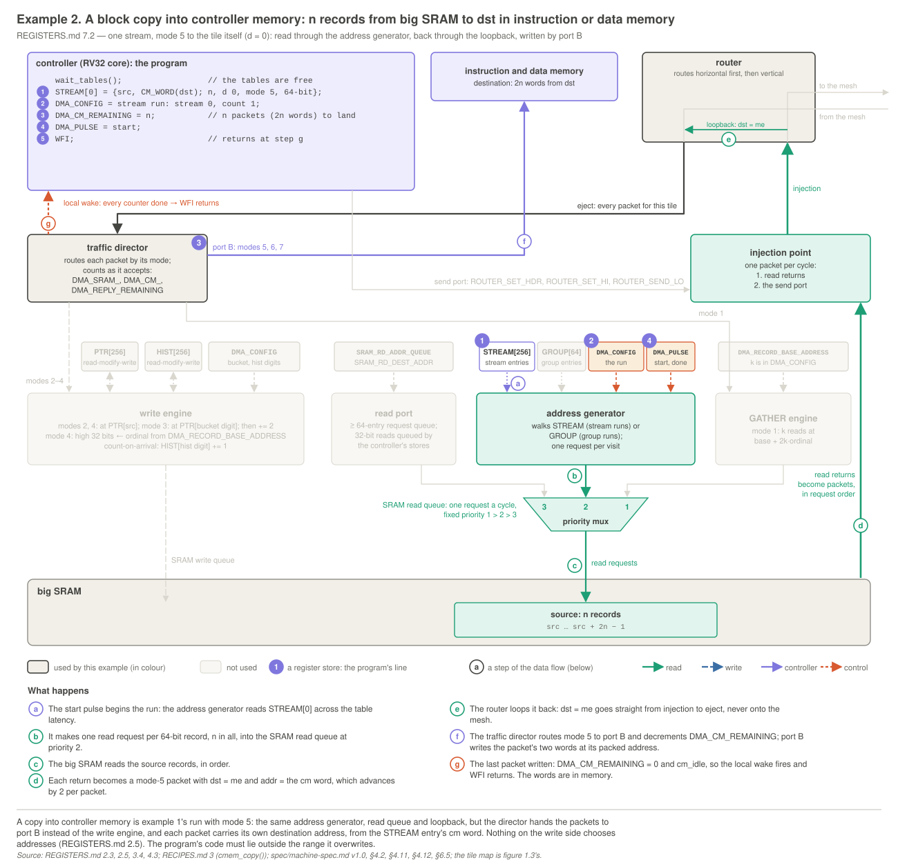
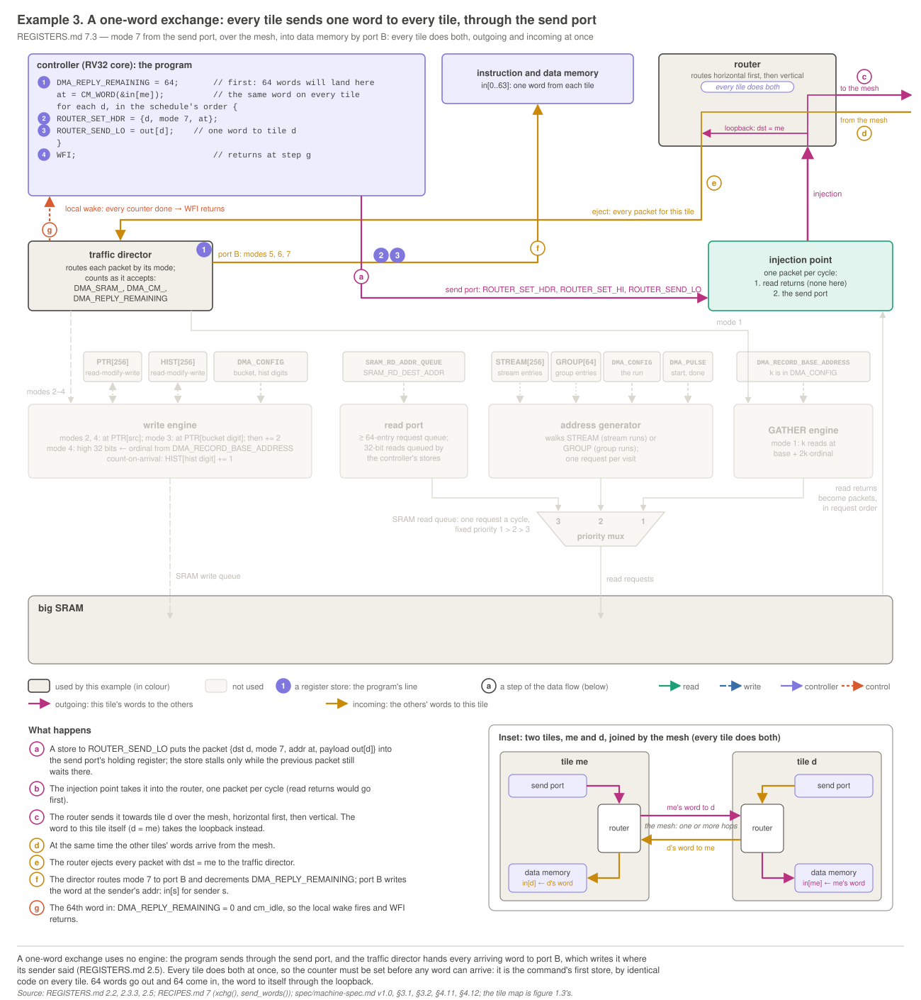
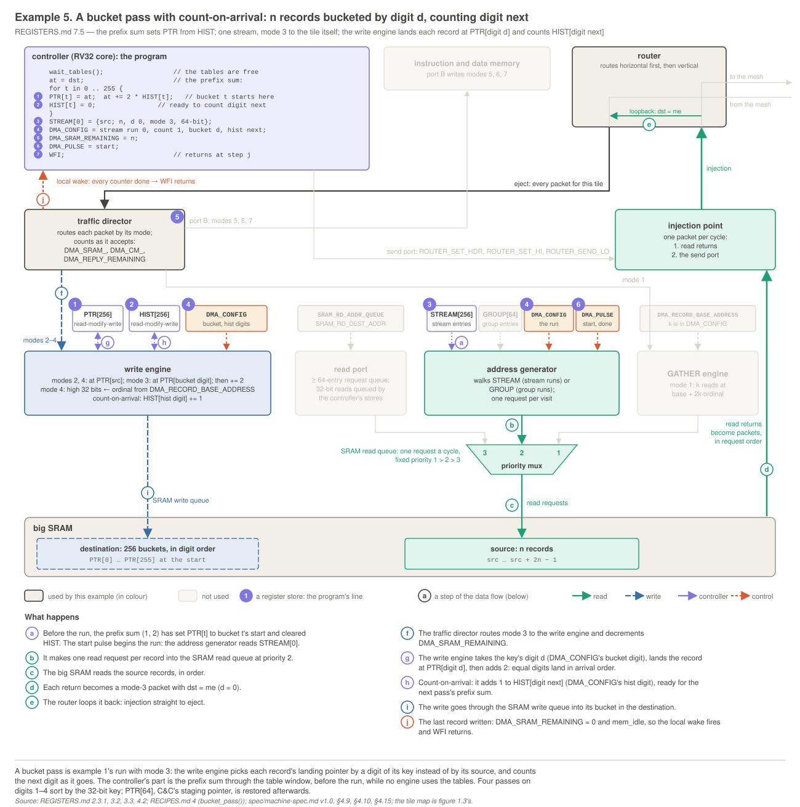

# Tile registers: the programmer's reference (v1.1)

**v1.1 (`mesh.h` 1.1, meshsim v1.1).** This is everything a tile program reaches with loads and stores: the address map, the registers, the table window, and the packets and command words that programs build. `spec/machine-spec.md v1.1` is the source of truth. This document is its programmer's view, and where the two differ, this document is wrong.

## 0. About this document

**Generated tables.** Each block between `<!-- generated: … -->` and `<!-- end generated -->` (visible in the Markdown source) is written by `meshsim/src/RegDoc.java`, from the register table in `meshsim/src/Registers.java` that also generates `mesh.h`. Don't edit these blocks by hand; run `java -cp build RegDoc` in `meshsim/`. `RegDocTest` fails if any block differs from the generator, or if `mesh.h`, the simulator and this document disagree on a name, offset, field, width or reset value. The prose around the blocks is hand-written.

**This folder.** `regdoc/` holds the worked examples' diagrams (`svg/`, `png/`), their scripts and the PDF build (`src/`): `regdoc/src/build_pdf.sh` redraws the diagrams and writes `Reference.pdf` at the release's top level (see `regdoc/README.md`).

**Names.** Register, field and table names are `mesh.h`'s; the field tables' `mesh.h` column gives each field's macro (`NAME_SHIFT`, `NAME_MASK`, `NAME(v)`).

**Notation.**
- **Bits** are written [*hi*:*lo*]. Diagrams put bit 31 on the left; field tables list bit 0 first. A field's value is unsigned.
- **Access:** R (read-only), W (write-only), R/W.
- **Reset** is the value at chip reset: *undef* means undefined, and — means the field holds no state.
- **Chunk:** a 32-bit word of big SRAM, named by a 21-bit **chunk address**. A record is 2 chunks; a 128-bit row is 4.
- **Packed word:** a 12-bit controller-memory word address (section 4.3).
- ***L*** is `ts_engine_latency`, the one-way latency between the table memories and the engines (default 1).
- **Timing.** A store executed in cycle *t* takes effect at the end of *t*; stores are single-cycle and posted (the core doesn't wait), and only a send store (`ROUTER_SEND_32`, `_64` or `_128`, 2.2), a request store (`REQUEST_SEND`, 2.7) or a `UART_TX` store on a wired tile (2.9) can stall. **A load from a register or the table window takes 1 or 2 cycles,** fixed per register by the implementation, the same on every access and tile (meshsim uses 2); don't depend on which. A load at *t* with latency *L* returns the state at the end of *t* + *L* − 2 and takes its side effect (a `WAKE_EVENTS` clear, a pop) at the end of *t* + *L* − 1, on exactly what it returned. Accesses complete in program order, so a load sees every earlier store. Loads from controller memory take one cycle.

## 1. Address map and access rules

The controller is strictly Harvard: instructions come only from instruction memory, and data accesses go to the table window, data memory and the registers. Figure 3.2 draws the decode and every register's bit layout.

<!-- generated: addressmap -->
| address | size | contents | data access |
|---|---|---|---|
| `0x00000000`–`0x00001EFF` | 7936 B | instruction memory: code (fetched; written only by mode 6) | bus error |
| `0x00001F00`–`0x00001FFF` | 256 B | instruction memory: the resident loader | bus error |
| `0x00002000`–`0x000023FF` | 1 KB | table window: `HIST` | `lw`, `sw` |
| `0x00002400`–`0x000027FF` | 1 KB | table window: `PTR` | `sw` only |
| `0x00002800`–`0x00002BFF` | 1 KB | table window: `STREAM_SRC` | `sw` only |
| `0x00002C00`–`0x00002FFF` | 1 KB | table window: `STREAM_DEST` | `sw` only |
| `0x00003000`–`0x000033FF` | 1 KB | table window: `STREAM_COUNT` | `sw` only |
| `0x00003400`–`0x000035FF` | 512 B | table window: `GROUP` | `sw` only |
| `0x00003600`–`0x00003FFF` | 2560 B | unmapped | bus error |
| `0x00004000`–`0x00005BBF` | 7104 B | data memory: `.rodata`, `.data`, `.bss`, stack | any width |
| `0x00005BC0`–`0x00005FBF` | 1 KB | data memory: the reply block, 256 words (2 per source) | any width |
| `0x00005FC0`–`0x00005FFF` | 64 B | data memory: the command block, 16 slots | any width |
| `0x00006000`–`0xFFFFF7FF` | ≈ 4 GB | unmapped | bus error |
| `0xFFFFF800`–`0xFFFFF89F` | 160 B | registers: 40 words (section 2) | `lw`, `sw` per register |
| `0xFFFFF8A0`–`0xFFFFFFFF` | 1888 B | unmapped | bus error |
<!-- end generated -->

**Access rules.**
1. **Registers and the table window take `lw` and `sw` only.** `lb`, `lh`, `lbu`, `lhu`, `sb` and `sh` there are bus errors. Data memory takes every width.
2. **A load from a write-only register returns 0,** except at the request port's four offsets (`0x858`–`0x864`), where a load reads the receive side's registers instead (2.7).
3. **A store to a read-only register is a bus error.** So is a load from `PTR`, a `STREAM` array or `GROUP`, which the controller only writes.
4. **Unmapped addresses are bus errors:** register offsets `0x8A0`–`0xFFC` (the map has no holes since part E), the window's `0x3600`–`0x3FFF`, and everything else outside the map. So are misaligned accesses and any data access to instruction memory.
5. **Spare and reserved bits** are ignored on a store and read 0.
6. **Registers are one instruction each:** `lw`/`sw` with `rs1` = `x0` reaches every register.

**A bus error** sets the bus-error condition (2.1.2) and halts the controller; the tile's engines and router keep running. The next HALT → RUN restarts it at the loader.

**Reset.** At chip reset the down-counters, `TILE_CONDITIONS`, `WAKE_EVENTS`, `WAKE_REQUIRED`, the read port's queue and the request FIFO are 0 or empty, `WAKE_MASK` is [8] | [9] (GO and counters done), and `TILE_STATUS` shows the idle machine, with the peripheral and the sender idle. The configuration registers (`DMA_CONFIG`, `DMA_RECORD_BASE_ADDRESS`, `ROUTER_SET_HDR`, `ROUTER_SET_W0`–`W2`, `REQUEST_SET_W0`–`W2`, `SENDER_ADDR` and `SRAM_RD_DEST_ADDR`) are undefined at chip reset and keep their values across HALT → RUN; a program writes each one before it relies on it. The tables' contents are undefined at reset.

**The registers** sit at `0xFFFFF800` + the offset, in families named by owner, in that order: `TILE_` for the whole tile (its status, conditions and pulses), `ROUTER_` for the send port, `DMA_` for the engines and their arrival counters, `SRAM_` for the read port, `WAKE_` for the wake events (`0x848`–`0x854`), `PERIPH_` for the peripheral slot (its counter `DMA_PERIPH_REMAINING` at `0x83C` and `PERIPH_STATUS_0`–`7` at `0x870`–`0x88C`, 2.8), `REQUEST_` for the request port (`0x858`–`0x864`, 2.7), `SENDER_` for the sender (`0x868`–`0x86C`, 2.8.1) and `UART_` for the UART (`0x890`–`0x89C`, 2.9). Every family is contiguous, `0x800`–`0x89C` (part E).

<!-- generated: summary -->
| offset | register | access | a load returns | reset | entry |
|---|---|---|---|---|---|
| `0x800` | `TILE_STATUS` | R | live bits, peripheral type, endpoint id, size | the idle machine | [2.1.1](#tile-status) |
| `0x804` | `TILE_CONDITIONS` | R | the conditions | 0 | [2.1.2](#tile-conditions) |
| `0x808` | `TILE_PULSE` | W | 0 | — (no state) | [2.1.3](#tile-pulse) |
| `0x80C` | `ROUTER_SET_HDR` | W | 0 | undefined; kept across HALT → RUN | [2.2](#send-port) |
| `0x810` | `ROUTER_SET_W0` | W | 0 | undefined; kept across HALT → RUN | [2.2](#send-port) |
| `0x814` | `ROUTER_SET_W1` | W | 0 | undefined; kept across HALT → RUN | [2.2](#send-port) |
| `0x818` | `ROUTER_SET_W2` | W | 0 | undefined; kept across HALT → RUN | [2.2](#send-port) |
| `0x81C` | `ROUTER_SEND_32` | W | 0 | — (no state) | [2.2](#send-port) |
| `0x820` | `ROUTER_SEND_64` | W | 0 | — (no state) | [2.2](#send-port) |
| `0x824` | `ROUTER_SEND_128` | W | 0 | — (no state) | [2.2](#send-port) |
| `0x828` | `DMA_CONFIG` | W | 0 | undefined; kept across HALT → RUN | [2.3.1](#dma-config) |
| `0x82C` | `DMA_RECORD_BASE_ADDRESS` | W | 0 | undefined; kept across HALT → RUN | [2.3.3](#record-base) |
| `0x830` | `DMA_SRAM_REMAINING` | R/W | the count | 0 | [2.3.2](#down-counters) |
| `0x834` | `DMA_CM_REMAINING` | R/W | the count | 0 | [2.3.2](#down-counters) |
| `0x838` | `DMA_REPLY_REMAINING` | R/W | the count | 0 | [2.3.2](#down-counters) |
| `0x83C` | `DMA_PERIPH_REMAINING` | R/W | the count | 0 | [2.8](#replayer) |
| `0x840` | `SRAM_RD_ADDR_QUEUE` | R/W | free entries | queue empty | [2.4](#read-port) |
| `0x844` | `SRAM_RD_DEST_ADDR` | W | 0 | undefined; kept across HALT → RUN | [2.4](#read-port) |
| `0x848` | `WAKE_EVENTS` | R | every pending event; consumes those in `WAKE_MASK` | 0 (live events: their state) | [2.6](#wake-events) |
| `0x84C` | `WAKE_PEEK` | R | every pending event; consumes nothing | as `WAKE_EVENTS` | [2.6](#wake-events) |
| `0x850` | `WAKE_MASK` | R/W | the mask | [8] \| [9]; again at HALT → RUN | [2.6](#wake-events) |
| `0x854` | `WAKE_REQUIRED` | R/W | the required set | 0; again at HALT → RUN | [2.6](#wake-events) |
| `0x858` | `REQUEST_SET_W0` / `REQUEST_GET_W0` | W / R | (a load: `REQUEST_GET_W0`) | undefined; kept across HALT → RUN | [2.7](#request-port) |
| `0x85C` | `REQUEST_SET_W1` / `REQUEST_GET_W1` | W / R | (a load: `REQUEST_GET_W1`) | undefined; kept across HALT → RUN | [2.7](#request-port) |
| `0x860` | `REQUEST_SET_W2` / `REQUEST_GET_W2` | W / R | (a load: `REQUEST_GET_W2`) | undefined; kept across HALT → RUN | [2.7](#request-port) |
| `0x864` | `REQUEST_SEND` / `REQUEST_RECEIVE` | W / R | (a load: `REQUEST_RECEIVE`) | — (no state) | [2.7](#request-port) |
| `0x868` | `SENDER_SEND` | W | 0 | — (no state) | [2.8.1](#sender) |
| `0x86C` | `SENDER_ADDR` | W | 0 | undefined; kept across HALT → RUN | [2.8.1](#sender) |
| `0x870` | `PERIPH_STATUS_0` | R | the peripheral's status 0; no side effects | per peripheral; 0 when idle | [2.8](#replayer) |
| `0x874` | `PERIPH_STATUS_1` | R | the peripheral's status 1; no side effects | per peripheral; 0 when idle | [2.8](#replayer) |
| `0x878` | `PERIPH_STATUS_2` | R | the peripheral's status 2; no side effects | per peripheral; 0 when idle | [2.8](#replayer) |
| `0x87C` | `PERIPH_STATUS_3` | R | the peripheral's status 3; no side effects | per peripheral; 0 when idle | [2.8](#replayer) |
| `0x880` | `PERIPH_STATUS_4` | R | the peripheral's status 4; no side effects | per peripheral; 0 when idle | [2.8](#replayer) |
| `0x884` | `PERIPH_STATUS_5` | R | the peripheral's status 5; no side effects | per peripheral; 0 when idle | [2.8](#replayer) |
| `0x888` | `PERIPH_STATUS_6` | R | the peripheral's status 6; no side effects | per peripheral; 0 when idle | [2.8](#replayer) |
| `0x88C` | `PERIPH_STATUS_7` | R | the peripheral's status 7; no side effects | per peripheral; 0 when idle | [2.8](#replayer) |
| `0x890` | `UART_TX` | W | 0 | — (no state) | [2.9](#uart) |
| `0x894` | `UART_RX` | R | the oldest byte and valid; pops when valid | FIFO empty | [2.9](#uart) |
| `0x898` | `UART_STATUS` | R/W | occupancies and errors; no side effects | 0 | [2.9](#uart) |
| `0x89C` | `UART_DIVISOR` | R/W | the divisor | round(f_ref / 57,600) | [2.9](#uart) |
<!-- end generated -->

## 2. Registers

### 2.1 `TILE_`: the whole tile

Two read-only registers describe the whole tile: **`TILE_STATUS`**, what it is doing now (live bits, its peripheral type, its endpoint id and its big-SRAM size), and **`TILE_CONDITIONS`**, the errors it has seen. Programs read them; nothing a program does can write them. A third, **`TILE_PULSE`** (2.1.3), is write-only: it fires the tile's pulses, `done`, the engines' start and the peripheral's run.

<a id="tile-status"></a>
#### 2.1.1 `TILE_STATUS`: what the tile is doing

<!-- generated: reg TILE_STATUS -->
| register | address | access | a load returns | reset |
|---|---|---|---|---|
| `TILE_STATUS` | `0xFFFFF800` | R | live bits, peripheral type, endpoint id, size | the idle machine |

```text
 31    27 26         20 19   16 15   12 11                0
+--------+-------------+-------+-------+-------------------+
| size-1 | endpoint id | spare | type  | live bits (table) |
+--------+-------------+-------+-------+-------------------+
    5           7          4       4            12
```

| bits | field | width | reset | `mesh.h` | meaning |
|---|---|---|---|---|---|
| [0] | rd running | 1 | 0 | `TILE_ST_RD_RUNNING` | live: the address generator is running (from the start, lead-in included) |
| [1] | rd done | 1 | 0 | `TILE_ST_RD_DONE` | live: the last run has walked its last entry (cleared by the next start) |
| [2] | gather busy | 1 | 0 | `TILE_ST_GATHER_BUSY` | live: the GATHER engine has work |
| [3] | periph running | 1 | 0 | `TILE_ST_PERIPH_RUNNING` | live: the peripheral is running (its ownership state, 4.17.2) |
| [4] | sender busy | 1 | 0 | `TILE_ST_SENDER_BUSY` | live: a send of peripheral output is in progress (4.17.9) |
| [5] | send busy | 1 | 0 | `TILE_ST_SEND_BUSY` | live: the send holding register is occupied |
| [6] | ts busy | 1 | 0 | `TILE_ST_TS_BUSY` | live: a table memory is in use by an engine |
| [7] | mem idle | 1 | 1 | `TILE_ST_MEM_IDLE` | live: the big-SRAM write path is empty |
| [8] | cm idle | 1 | 1 | `TILE_ST_CM_IDLE` | live: the port-B pipeline is empty |
| [9] | done | 1 | 1 | `TILE_ST_DONE` | live: done pulsed since the last GO or HALT -> RUN (forced to 1 in HALT) |
| [10] | landed | 1 | 0 | `TILE_ST_LANDED` | live: a command write to slot 0 since the last GO or HALT -> RUN |
| [11] | request busy | 1 | 0 | `TILE_ST_REQUEST_BUSY` | live: the request FIFO is full (4.18) |
| [15:12] | type | 4 | 1 (tiles 0-63) | `TILE_ST_PERIPH_TYPE` | the peripheral slot's type: 0 none, 1 the replayer (fixed; 1 on every mesh tile) |
| [19:16] | spare | 4 | 0 | — | reads 0 |
| [26:20] | endpoint id | 7 | the tile's id | `TILE_ST_ID` | this tile's endpoint id: the tile index, 0-63 (fixed) |
| [31:27] | size-1 | 5 | device | `TILE_ST_SIZE` | big-SRAM size in 256 KB units, minus 1 (fixed per device; 15 at 4 MB) |
<!-- end generated -->

**A load** returns the state at the end of the previous cycle. **A store is a bus error.**

**The live bits:**
- **`rd_running`**: the address generator has a run: from the start (its lead-in included) until it has walked the run's last entry.
- **`rd_done`**: the last run has finished. Cleared by the next start; 0 before a tile's first run. It does not mean the packets have arrived anywhere: that is what the counters are for (2.3.2).
- **`gather_busy`**: the GATHER engine's request queue is non-empty, or a request is part-way through its *k* reads. Reads issued but not yet landed are not included (`DMA_SRAM_REMAINING` covers their landing).
- **`periph_running`** [3]: the peripheral is running (its ownership state), from the end of the `PERIPH_RUN` store's cycle until its work ends or a halt; for the replayer, until a pass's last row is in the output queue (2.8). v1.1's `replay_running`.
- **`sender_busy`** [4]: a send is in progress, from the end of the `SENDER_SEND` store's cycle until its last packet has left; a `SENDER_SEND` store now would be ignored (2.8.1). v1.1's `replay_wait` is gone: the replayer's new-expansion line already says it is waiting.
- **`send_busy`**: the send port's holding register is occupied, so a send store now would stall (2.2).
- **`request_busy`** ([11]): the request FIFO is full, so a request store now would stall (2.7).
- **`ts_busy`**: an engine is using a table memory: it issued a table request within the last *L* + 1 cycles, or `PTR` or `HIST` has a request arriving, queued, or too recent to read back.
- **`mem_idle`**: the big-SRAM write path is empty: a packet on its way from the traffic director, the write engine's input FIFO, its pointer stage and every area's queue. It covers mode-3 writes too; counters done waits for it (2.3.2).
- **`cm_idle`**: the controller memories' port-B pipeline is empty.
- **`done`**: done was pulsed since the last GO or HALT → RUN. Forced to 1 in HALT.
- **`landed`**: a command write (mode 7) to command slot 0 since the last GO or HALT → RUN.

**v1.1 regroups the bits:** the engines first ([0]–[4]), then the send port, the tables, the write paths and control; then the peripheral type [15:12], the endpoint id [26:20] and the size [31:27]. v1.0 had `send_busy` at [3] through `landed` at [8], `gather_busy` at [9], and [2] spare.

**Fixed fields.** The **peripheral type** [15:12] says what the tile's peripheral slot holds: 0 none, 1 the replayer (every tile 0–63), 2–15 reserved (2.8). The **endpoint id** [26:20] is 7 bits, the tile index 0–63 on a mesh tile; it was the 6-bit tile index at [26:21], so **its low bit is now [20]** and code extracting the index must use the new field macro. The **size** [31:27] is the big SRAM's size in 256 KB units, minus 1: the big SRAM holds (size + 1) × 2^16 chunks, 15 at the default 4 MB (`sram_chunks()`).

**The table window is free** when `rd_running` and `ts_busy` are both 0: `wait_tables()` polls them (3.1).

<a id="tile-conditions"></a>
#### 2.1.2 `TILE_CONDITIONS`: errors

<!-- generated: reg TILE_CONDITIONS -->
| register | address | access | a load returns | reset |
|---|---|---|---|---|
| `TILE_CONDITIONS` | `0xFFFFF804` | R | the conditions | 0 |

```text
 31      15 14                 0
+----------+--------------------+
| reserved | conditions (table) |
+----------+--------------------+
     17              15
```

| bits | field | width | reset | `mesh.h` | meaning |
|---|---|---|---|---|---|
| [0] | router overflow | 1 | 0 | `TILE_COND_ROUTER_OVF` | **P** a link, eject or fifth-port FIFO of this tile's router overflowed |
| [1] | bad mode or size | 1 | 0 | `TILE_COND_BAD_MODE_OR_SIZE` | **P** a bad packet arrived (mode 0 or 10-15, mode 5 at 128 bits, a misaligned mode 3, mode 7 above 32 bits, mode 8 at 128 bits); it was dropped, uncounted |
| [2] | unexpected arrival | 1 | 0 | `TILE_COND_UNEXPECTED` | **P** a counted packet arrived for a down-counter already at 0 (in RUN) |
| [3] | drift | 1 | 0 | `TILE_COND_DRIFT` | **P** in a group run, the SRAM read queue refused an address-generator request: the tile fell behind its timetable |
| [4] | write-engine input overflow | 1 | 0 | `TILE_COND_WE_IN_OVF` | **P** a mode-2, 3, 4 or 5 packet found the write engine's input FIFO full |
| [5] | table request overflow | 1 | 0 | `TILE_COND_TABLE_OVF` | **H** the `PTR` or `HIST` request FIFO overflowed |
| [6] | GATHER queue overflow | 1 | 0 | `TILE_COND_GATHER_OVF` | **H** a mode-1 packet found the GATHER engine's 16-entry request queue full |
| [7] | read-port error | 1 | 0 | `TILE_COND_READ_PORT` | **P** a `SRAM_RD_ADDR_QUEUE` store found no free entry, or its address wasn't aligned to the read size; the read is dropped |
| [8] | done early | 1 | 0 | `TILE_COND_DONE_EARLY` | **P** done was pulsed while a down-counter was non-zero |
| [9] | bus error | 1 | 0 | `TILE_COND_BUS_ERROR` | **P (or H)** a load or store broke the access rules (section 1); the controller halts |
| [10] | illegal instruction | 1 | 0 | `TILE_COND_ILLEGAL` | **P (or H)** a divide opcode or a CSR instruction; the controller halts |
| [11] | bad peripheral write | 1 | 0 | `TILE_COND_BAD_PERIPH_WRITE` | **P** the peripheral's write port dropped a mode-9 packet (an address, size or ownership it doesn't take); every mode-9 packet on a tile with no peripheral |
| [12] | peripheral condition 2 | 1 | 0 | `TILE_COND_PERIPH_2` | **per peripheral** defined by the peripheral; the replayer: queue overrun |
| [13] | peripheral condition 3 | 1 | 0 | `TILE_COND_PERIPH_3` | **per peripheral** defined by the peripheral; the replayer: invalid expansion (the pass stops) |
| [14] | receive underflow | 1 | 0 | `TILE_COND_RECV_UNDERFLOW` | **P** a `REQUEST_RECEIVE` load found the receive queue empty (on tiles 0-63, every one) |
| [31:15] | reserved | 17 | 0 | — | reserved: reads 0 |
<!-- end generated -->

**A condition means something went wrong** (figure 2.4). In a correct program on correct hardware this register reads 0 for ever, so the test is `conditions() == 0`. **A store is a bus error** (and sets the bus-error condition). Nothing in RUN clears a condition; **entering HALT** (the RUN → HALT edge, and chip reset) clears them all, and a condition set in the same cycle is cleared too. **Any non-zero condition raises the tile's error line to C&C.** A program sees what a phase caused by comparing `conditions()` at its start and its end.

**The bits are grouped by unit** (v1.1): the network ([0] router overflow, [1] bad mode or size), the arrivals ([2] unexpected arrival), the address generator ([3] drift), the write engine ([4]), the tables ([5]), the GATHER engine ([6]), the read port ([7], **read-port error**: an overflow or a misaligned read), control ([8] done early) and the controller ([9] bus error, [10] illegal instruction). **[13:11]** are the peripheral slot's (2.8): [11] **bad peripheral write**, a mode-9 packet the peripheral's port dropped, for every peripheral (and every mode-9 packet on a tile with no peripheral); [12] and [13] are defined by the peripheral, for the replayer queue overrun and invalid expansion, which also stops the pass. **[14] receive underflow:** a load of `REQUEST_RECEIVE` found the receive queue empty (2.7); on tiles 0–63, any such load. v1.0 numbered the bits differently: the spec's 8.3 gives the mapping. **Bad mode or size** is set by any packet the traffic director drops as bad: mode 0 or 10–15, mode 5 at 128 bits, mode 3 at an addr not aligned to its size, a command write (mode 7) above 32 bits, or a 128-bit reply (mode 8). (Size 11 is undefined, not a bad packet.)

**Kinds** (in the table): **P** a program error, which a program can cause; **H** a hardware-fault detector, which no program on a correct design can cause; **P (or H)** a program error that a corrupted image can also cause. All raise the error line alike.

**On every overflow the arriving item is dropped** (the packet, write, request or gather request), and only the condition records it. A FIFO is full by its count before the cycle's pop, so a push into a full FIFO overflows even if an entry leaves in the same cycle. **Setting a condition stops nothing,** except that bus error and illegal instruction halt the controller (as do `ecall` and `ebreak`, which set no condition).

<a id="tile-pulse"></a>
#### 2.1.3 `TILE_PULSE`: start, peripheral run and done

<!-- generated: reg TILE_PULSE -->
| register | address | access | a load returns | reset |
|---|---|---|---|---|
| `TILE_PULSE` | `0xFFFFF808` | W | 0 | — (no state) |

```text
 31    4  3        2          1      0
+-------+----+------------+-------+------+
| spare | GO | periph run | start | done |
+-------+----+------------+-------+------+
   28     1        1          1      1
```

| bits | field | width | `mesh.h` | meaning |
|---|---|---|---|---|
| [0] | done | 1 | `TILE_PULSE_DONE` | done (READY fires when a command has landed) |
| [1] | start | 1 | `TILE_PULSE_START` | start: load the run from DMA_CONFIG and begin it (the first request when its table entries are in) |
| [2] | periph run | 1 | `TILE_PULSE_PERIPH_RUN` | peripheral run: start the peripheral's work; ignored while periph_running and on a type-0 tile (meshsim flags both) |
| [3] | GO | 1 | `TILE_PULSE_GO` | GO: drives the GO net where wired (C&C's); on every mesh tile ignored, and meshsim flags a 1 |
| [31:4] | spare | 28 | — | ignored on a store |
<!-- end generated -->

**A store** fires each bit written as 1 for one cycle; a 0 does nothing. **Start, run and done in one store act in that order: start and run, then done.**

- **Start** loads the run in `DMA_CONFIG`, clears `rd_done`, sets `rd_running` and begins the read-ahead of `STREAM` and `GROUP` entries. It is the only way to start a run; GO does not. **The first request is offered as soon as its entries are in** (the lead-in), with *L* = `ts_engine_latency`:

  | run | first request, cycles after the start store | after the cycle the start takes effect | at the default (*L* = 1), from the store |
  |---|---|---|---|
  | group run (the `GROUP` read, then the `STREAM` read) | 4*L* + 3 | 4*L* + 2 | 7 |
  | stream run (one `STREAM` read) | 2*L* + 2 | 2*L* + 1 | 4 |

  A store at cycle *t* takes effect at *t* + 1. S₀, the start of a group run's timetable, is the first-request cycle. The lead-in has no counter of its own: it depends only on the run kind, the tables and *L*, so it is the same on every tile and a synchronised start stays in lockstep. `rd_running` = 1 and `rd_done` = 0 from the end of the start store's cycle (the next instruction's load of `TILE_STATUS` already sees them), through the lead-in, until the run has walked its last entry; so `wait_tables()` right after `start_run()` waits for the run.
- **A start while a run is running** (its lead-in included) is ignored; meshsim flags it.
- **The run ends** when the address generator has walked its last entry, trailing count-0 streams and R = 0 groups included; the last entry's gap-after is not waited out. Then `rd_running` = 0 and `rd_done` = 1, until the next start.
- **Done** declares the tile finished with its command: `done` = 1, and READY goes to C&C once a command has also landed (`landed`, 2.1.1). Done also clears counters done (`WAKE_EVENTS` [9]), and from then until GO only a pending GO can wake `WFI`, whatever `WAKE_MASK` holds (the done gate, 2.6). **Done while a down-counter is non-zero sets done early.**
- **[2], `PERIPH_RUN`,** starts the peripheral's work (2.8): for the replayer, it empties its four queues, loads its checkpoint and runs one pass of 65,536 rows. Run only: ignored while `periph_running` is 1, and on a tile with no peripheral (meshsim flags both). **[3]** is reserved and ignored (meshsim flags a 1 there).
- **v1.0** called this register `DMA_PULSE`, at offset `0x818`. It is renamed because it now carries more than the engines' pulses.

An ignored pulse sets no condition: the run the program expected never happens, and the tile hangs where C&C's watchdog sees it.

**Synchronised starts** (spec/machine-spec.md v1.1, §6.3). A run that must start in step on every tile (an all-to-all) is configured (tables and `DMA_CONFIG`) in one command and started by the next, right after GO. Every core leaves `WFI` on the same cycle, so **the path from `WFI` to the start store must be identical code on every tile**, with no stalling store (no send or request store). A tile that receives stores its counters in that path, then pulses start. `start_run()` is the start store, and `wait_for_command()` is the done pulse followed at once by `WFI`, then a load of `WAKE_EVENTS` that consumes GO (2.6), the same code on every tile.

<a id="send-port"></a>
### 2.2 `ROUTER_`: the send port

<!-- generated: reg ROUTER_SET_HDR ROUTER_SET_W0 ROUTER_SET_W1 ROUTER_SET_W2 ROUTER_SEND_32 ROUTER_SEND_64 ROUTER_SEND_128 -->
| register | address | access | a load returns | reset |
|---|---|---|---|---|
| `ROUTER_SET_HDR` | `0xFFFFF80C` | W | 0 | undefined; kept across HALT → RUN |
| `ROUTER_SET_W0` | `0xFFFFF810` | W | 0 | undefined; kept across HALT → RUN |
| `ROUTER_SET_W1` | `0xFFFFF814` | W | 0 | undefined; kept across HALT → RUN |
| `ROUTER_SET_W2` | `0xFFFFF818` | W | 0 | undefined; kept across HALT → RUN |
| `ROUTER_SEND_32` | `0xFFFFF81C` | W | 0 | — (no state) |
| `ROUTER_SEND_64` | `0xFFFFF820` | W | 0 | — (no state) |
| `ROUTER_SEND_128` | `0xFFFFF824` | W | 0 | — (no state) |

**`ROUTER_SET_HDR`, store.**

```text
 31   11 10   7 6   0
+-------+------+-----+
| addr  | mode | dst |
+-------+------+-----+
   21      4      7
```

| bits | field | width | reset | `mesh.h` | meaning |
|---|---|---|---|---|---|
| [6:0] | dst | 7 | undef | `ROUTER_HDR_DST` | destination: tile 0-63, 64 C&C, 126 broadcast |
| [10:7] | mode | 4 | undef | `ROUTER_HDR_MODE` | packet mode, 4 bits: 1-9 (0 and 10-15 are bad modes; mode 5 not at 128 bits, mode 7 only at 32, mode 8 not at 128, mode 3 aligned to its size) |
| [31:11] | addr | 21 | undef | `ROUTER_HDR_ADDR` | the packet's addr: modes 3, 6, 7 and 9 (0 otherwise); after each send + 1, 2 or 4 by the size sent (modes 3, 6, 9) or + 1 (mode 7) |

**`ROUTER_SET_W0`, store.**

```text
 31             0
+----------------+
| payload [31:0] |
+----------------+
        32
```

| bits | field | width | reset | meaning |
|---|---|---|---|---|
| [31:0] | payload [31:0] | 32 | undef | the next packet's payload bits 31-0 (64- and 128-bit sends); 0 after each send |

**`ROUTER_SET_W1`, store.**

```text
 31              0
+-----------------+
| payload [63:32] |
+-----------------+
        32
```

| bits | field | width | reset | meaning |
|---|---|---|---|---|
| [31:0] | payload [63:32] | 32 | undef | the next packet's payload bits 63-32 (128-bit sends); 0 after each send |

**`ROUTER_SET_W2`, store.**

```text
 31              0
+-----------------+
| payload [95:64] |
+-----------------+
        32
```

| bits | field | width | reset | meaning |
|---|---|---|---|---|
| [31:0] | payload [95:64] | 32 | undef | the next packet's payload bits 95-64 (128-bit sends); 0 after each send |

**`ROUTER_SEND_32`, store.**

```text
 31             0
+----------------+
| payload [31:0] |
+----------------+
        32
```

| bits | field | width | meaning |
|---|---|---|---|
| [31:0] | payload [31:0] | 32 | the packet's payload bits 31-0: the store sends a 32-bit packet |

**`ROUTER_SEND_64`, store.**

```text
 31              0
+-----------------+
| payload [63:32] |
+-----------------+
        32
```

| bits | field | width | meaning |
|---|---|---|---|
| [31:0] | payload [63:32] | 32 | the packet's payload bits 63-32: the store sends a 64-bit packet, `ROUTER_SET_W0` below |

**`ROUTER_SEND_128`, store.**

```text
 31               0
+------------------+
| payload [127:96] |
+------------------+
         32
```

| bits | field | width | meaning |
|---|---|---|---|
| [31:0] | payload [127:96] | 32 | the packet's payload bits 127-96: the store sends a 128-bit packet, `ROUTER_SET_W0`-`W2` below |
<!-- end generated -->

**A send store** (figure 3.4) sends one packet. dst, mode and addr come from `ROUTER_SET_HDR`; the size is the register stored to (`ROUTER_SEND_32`, `_64` or `_128`); the value stored is the packet's **top word** (bits [31:0], [63:32] or [127:96] by the size), and the words below it come from `ROUTER_SET_W0` (64 bits) or `ROUTER_SET_W0`–`W2` (128 bits). The router adds src. Then:
- `ROUTER_SET_W0`, `W1` and `W2` all become 0, so a packet never inherits an earlier packet's words;
- `ROUTER_SET_HDR`'s addr advances by the words sent for **modes 3, 6 and 9** (1, 2 or 4) and by **1 for modes 7 and 8**, and stays put for the other modes, so a run of consecutive words needs one `ROUTER_SET_HDR` store.

**One store per 32 bits, in ascending order:** `ROUTER_SEND_32` alone; `ROUTER_SET_W0`, then `ROUTER_SEND_64`; or `ROUTER_SET_W0`, `W1` and `W2`, then `ROUTER_SEND_128`. v1.0's `ROUTER_SET_HI` (bits [63:32]) and `ROUTER_SEND_LO` (bits [31:0], sending) became `ROUTER_SEND_64` and `ROUTER_SET_W0`, stored the other way round; v1.0 sent every packet as 64 bits.

**`ROUTER_SET_HDR` and the `W` registers are sticky**: they hold until the next store (or, for the `W` registers, the next send).

**Timing.** The packet goes into a one-packet holding register in the store's cycle. **The store stalls only if the holding register is full and is not being injected in that cycle**, so a program can send one packet per cycle; `send_busy` (2.1.1) says the register is full. The injection point takes one packet per cycle, and big-SRAM read returns go first, so the send port gets one packet per cycle only while no read return is waiting.

**Rules.**
- **dst** is absolute: a tile 0–63, 64 for C&C, 126 for broadcast. C&C's port ignores mode and addr, except mode 3, which it takes as a write stream's data (2.7): don't send mode 3 to C&C from the send port.
- **mode** is 1–9 (4.2). Never send mode 0 or 10–15, mode 5 with `ROUTER_SEND_128`, mode 7 with `ROUTER_SEND_64` or `_128`, mode 8 with `ROUTER_SEND_128`, or mode 3 at an addr not aligned to the packet's size (a multiple of 2 for 64 bits, 4 for 128): the receiver drops it and sets bad mode or size. Mode 1 goes only to the tile itself. Mode 9 is the peripheral write, into the receiving tile's peripheral (2.8); it may go to any tile.
- **addr** is used by modes 3 and 6–9 only: a packed word for modes 6–8 (4.3), a word address in the peripheral's address space for mode 9 (the replayer's map, 2.8.2), a chunk address aligned to the size for mode 3; put 0 otherwise. It advances like mode 6's for mode 3 (1, 2 or 4 by size).
- **A packet for the tile itself, or a broadcast,** waits in the holding register for a token (spec 4.5), so `send_busy` can stay 1 a little longer while the tile's loopback is busy.
- **Order:** packets from one sender to one tile arrive in the order sent if they are all unicast or all broadcast. A unicast and a broadcast may overtake each other.
- **No flow control:** many-to-one traffic must be paced by the program (spec/machine-spec.md v1.1, §3.2, the fan-in table).
- **Writing big SRAM** from the controller is mode 2 to the tile itself, landing at `PTR[me]` at the packet's size (32, 64 or 128 bits), or mode 3 to the tile itself, landing at addr without touching `PTR`.

### 2.3 `DMA_`: the engines and their arrival counters

The DMA engine's registers: **`DMA_CONFIG`** describes the next run and how arriving packets are treated (the start pulse that begins it is `TILE_PULSE`, 2.1.3), the three **down-counters** track the arrivals a phase expects, and **`DMA_RECORD_BASE_ADDRESS`** sets the run's record buffer for augmenting and gathers.

<a id="dma-config"></a>
#### 2.3.1 `DMA_CONFIG`: the run and the receive-side settings

<!-- generated: reg DMA_CONFIG -->
| register | address | access | a load returns | reset |
|---|---|---|---|---|
| `DMA_CONFIG` | `0xFFFFF828` | W | 0 | undefined; kept across HALT → RUN |

```text
 31   27 26   24 23        21 20          18 17    9 8     1   0
+-------+-------+------------+--------------+-------+-------+------+
| spare |  k-1  | hist digit | bucket digit | count | start | kind |
+-------+-------+------------+--------------+-------+-------+------+
    5       3         3             3           9       8      1
```

| bits | field | width | reset | `mesh.h` | meaning |
|---|---|---|---|---|---|
| [0] | kind | 1 | undef | `DMA_CFG_KIND` | run kind: 0 stream run, 1 group run |
| [8:1] | start | 8 | undef | `DMA_CFG_START` | first stream (0-255) or first GROUP entry (0-63) |
| [17:9] | count | 9 | undef | `DMA_CFG_COUNT` | streams (1-256) or groups (1-64) |
| [20:18] | bucket digit | 3 | undef | `DMA_CFG_BUCKETDIG` | bucket digit (mode 4): 0 none, 1-4 key byte, 1 least significant |
| [23:21] | hist digit | 3 | undef | `DMA_CFG_HISTDIG` | histogram digit (count-on-arrival, modes 2, 4, 5): 0 off, 1-4 |
| [26:24] | k-1 | 3 | undef | `DMA_CFG_KM1` | gather value size k - 1, in records (k = 1-8) |
| [31:27] | spare | 5 | — | — | ignored on a store |
<!-- end generated -->

**A store** sets the next engine run and how arriving packets are treated. Nothing happens until a pulse:
- **kind, start and count** describe the address generator's next run, which the start (2.1.3) loads.
  - **Stream run** (kind 0): streams *start* … *start* + *count* − 1, one after another; *start* 0–255, *count* 1–256.
  - **Group run** (kind 1): groups *start* … *start* + *count* − 1; *start* 0–63, *count* 1–64.
  - A **count of 0** is a run with no entries: it ends at once (`rd_done`), with no requests. Stream or group numbers past the table's end **wrap within the table** (meshsim flags them).
- **bucket digit** selects the byte of the key (payload bits [31:0]) that indexes `PTR` for mode-4 packets: 1 is bits [7:0], 2 bits [15:8], 3 bits [23:16], 4 bits [31:24]; 0 when no mode-4 packet is expected. Values 5–7 are reserved and treated as 0 (meshsim flags them), for both digits.
- **hist digit** turns count-on-arrival on: every payload of modes 2, 4 or 5 that the write engine accepts increments `HIST[`its byte`]`, with the same byte numbering; 0 is off.
- **k − 1** is the gather value size in records, for mode-1 requests (2.3.3): *k* = 1–8.

**Rules.** Write it once per engine run, before the start, and don't store it again while the run is running or the phase's arrivals are still landing: the write engine and the GATHER engine read the digits and *k* as packets arrive. A one-command local phase rewrites it between passes.

<a id="down-counters"></a>
#### 2.3.2 The down-counters and the done events: `DMA_SRAM_REMAINING`, `DMA_CM_REMAINING`, `DMA_REPLY_REMAINING`

<!-- generated: reg DMA_SRAM_REMAINING DMA_CM_REMAINING DMA_REPLY_REMAINING -->
| register | address | access | a load returns | reset |
|---|---|---|---|---|
| `DMA_SRAM_REMAINING` | `0xFFFFF830` | R/W | the count | 0 |
| `DMA_CM_REMAINING` | `0xFFFFF834` | R/W | the count | 0 |
| `DMA_REPLY_REMAINING` | `0xFFFFF838` | R/W | the count | 0 |

```text
 31   20 19    0
+-------+-------+
| spare | count |
+-------+-------+
   12      20
```

| bits | field | width | reset | meaning |
|---|---|---|---|---|
| [19:0] | count | 20 | 0 | store: N is added to the count (0 adds nothing; N > 0 arms it); load: the count |
| [31:20] | spare | 12 | 0 | ignored on a store, reads 0 |
<!-- end generated -->

**A write** of *N* **adds** *N* to the count (20 bits; up to 1,048,575), atomically and in step with arrivals, so you can **arm a request's packets, or top a counter up, while other traffic for it is in flight**. A packet arriving in the same cycle is judged against count + *N*. A write of *N* > 0 arms the counter: it clears counters done (`WAKE_EVENTS` [9]) and the counter's own done event (below) and sets their qualifiers. A write of 0 does nothing; a sum past 2^20 − 1 wraps (meshsim flags it). At 0, the usual case at a phase start, a write is just a set. **A load** returns the count. **A counter can't be overwritten:** it returns to 0 only by counting down, at chip reset, or on entering HALT, which clears all four with their done events.


**Counting.** The traffic director decrements a counter by 1 for each packet of its kind it accepts:

| counter | counts | done when |
|---|---|---|
| `DMA_SRAM_REMAINING` | modes 2, 4 and 5, gather values included | 0 and `mem_idle` |
| `DMA_CM_REMAINING` | mode 6 (a packet counts 1, whatever its size) | 0 and `cm_idle` |
| `DMA_REPLY_REMAINING` | mode 8 (replies) | 0 and `cm_idle` |
| `DMA_PERIPH_REMAINING` | mode 9 from any tile (the tile itself included), when it lands or is dropped (2.8) | 0 |

- **Counted from every source** (tiles, C&C, the memory system): every mode except **mode 1** (gather requests; their values count as mode 2) and **mode 7** (command writes), which are never counted. Bad packets are dropped uncounted.
- **A halted tile counts nothing** and sets no unexpected arrival: boot loads go in uncounted.
- **Counted data only when expected:** data reaches a running tile only after it has armed the counter. C&C stages into a halted tile, or after a command that says what to expect; for an uncoordinated write it halts the tile first.
- **An arrival at a counter already at 0** leaves it at 0 and sets unexpected arrival.
- **A write and an arrival in the same cycle:** the arrival is judged against count + *N*: next = count + *N* − arrive, unexpected = arrive & (count + *N* = 0).

**Counters done** (figure 2.3; spec 4.12). v1.0's local wake is now the event `WAKE_EVENTS` [9]. It is set on the rising edge of "every counter is done": all four at 0 with `mem_idle` and `cm_idle`, **counted only if some counter has been non-zero since [9] was last set or cleared** (the qualifier).
- It is sticky: it stays pending until a load of `WAKE_EVENTS` with [9] in `WAKE_MASK` consumes it, so a wait that finishes before the `WFI` is not lost. A wake does not consume it; `wfi()` in mesh.h loads `WAKE_EVENTS` after waking, which does (2.6).
- **Cleared** by any non-zero counter write (which also clears the qualifier), by the done pulse, by HALT → RUN and by a consuming load. A set and a clear in the same cycle: the clear wins.
- **A count of 0 never makes an edge;** a phase that expects nothing must not `WFI` for counters done.
- **The done gate:** from the done pulse until GO counters done cannot be set (an edge then is ignored), and only a pending GO can wake `WFI` (2.6), so `wait_for_command()` is only ever woken by GO.

**`WFI`** completes on the wake events alone (2.6): with the reset mask, on GO or counters done. A counters-done edge at the end of cycle *t* releases a waiting `WFI` in *t* + 1, and so does GO at *t*.

**Rules.**
- A phase that sets counters ends with a `WFI` before it pulses done.
- Counters done waits for every counter. To wait for one class while another is outstanding, use **that counter's done event:** `WAKE_EVENTS` [0] `DMA_SRAM_REMAINING` done (with `mem_idle`), [1] `DMA_CM_REMAINING` done (with `cm_idle`), [2] `DMA_REPLY_REMAINING` done (with `cm_idle`), [3] `DMA_PERIPH_REMAINING` done. Each is sticky, set on its own counter's transition to done if that counter was armed since the event was last cleared, and cleared by arming that counter, by done, by HALT → RUN or by a load that consumes it.
- Write the counters before the arrivals can begin: before the start store, or before the command that makes others send.

<a id="record-base"></a>
#### 2.3.3 `DMA_RECORD_BASE_ADDRESS`: the run's record buffer

<!-- generated: reg DMA_RECORD_BASE_ADDRESS -->
| register | address | access | a load returns | reset |
|---|---|---|---|---|
| `DMA_RECORD_BASE_ADDRESS` | `0xFFFFF82C` | W | 0 | undefined; kept across HALT → RUN |

```text
 31   21 20            0
+-------+---------------+
| spare | chunk address |
+-------+---------------+
   11          21
```

| bits | field | width | reset | meaning |
|---|---|---|---|---|
| [20:0] | chunk address | 21 | undef | the run's record buffer: augment's landing buffer or gather's value buffer |
| [31:21] | spare | 11 | — | ignored on a store |
<!-- end generated -->

**A store** sets the base, a chunk address; a load returns 0. It holds for the phase, like `DMA_CONFIG`. **One base per run:** augment and gather both use it, and no run uses both.
- **Augment** (mode 5): the base is the start of the buffer the packets land in. A mode-5 packet (32 or 64 bits) landing at chunk *a* is written as a 64-bit record: its low 32 bits (the key) in [31:0], and the **ordinal** (*a* − base) / 2 in [63:32]. So the records of the buffer get ordinals 0, 1, 2, … by position, whatever order they arrive in. A 128-bit mode-5 packet is a bad packet.
- **Gather** (mode 1): the base is the start of the value buffer. For a request whose payload bits [63:32] hold ordinal *o*, the GATHER engine reads the *k* records at base + 2*k*·*o* + 2*e*, *e* = 0 … *k* − 1 (*k* from `DMA_CONFIG`), and sends each to the tile itself as mode 2, landing at `PTR[me]`.

<a id="read-port"></a>
### 2.4 `SRAM_`: the read port

<!-- generated: reg SRAM_RD_ADDR_QUEUE SRAM_RD_DEST_ADDR -->
| register | address | access | a load returns | reset |
|---|---|---|---|---|
| `SRAM_RD_ADDR_QUEUE` | `0xFFFFF840` | R/W | free entries | queue empty |
| `SRAM_RD_DEST_ADDR` | `0xFFFFF844` | W | 0 | undefined; kept across HALT → RUN |

**`SRAM_RD_ADDR_QUEUE`, store.**

```text
 31   21 20            0
+-------+---------------+
| spare | chunk address |
+-------+---------------+
   11          21
```

| bits | field | width | meaning |
|---|---|---|---|
| [20:0] | chunk address | 21 | the big-SRAM chunk to read: 1, 2 or 4 words by the setup register's size, aligned to it |
| [31:21] | spare | 11 | ignored on a store |

**`SRAM_RD_ADDR_QUEUE`, load.**

```text
 31           0
+--------------+
| free entries |
+--------------+
       32
```

| bits | field | width | reset | meaning |
|---|---|---|---|---|
| [31:0] | free entries | 32 | depth | free entries in the request queue (at least 64 when empty) |

**`SRAM_RD_DEST_ADDR`, store.**

```text
 31   16 15   14 13          0
+-------+-------+-------------+
| spare | size  | destination |
+-------+-------+-------------+
   16       2         14
```

| bits | field | width | reset | `mesh.h` | meaning |
|---|---|---|---|---|---|
| [13:0] | destination | 14 | undef | `SRAM_RD_SETUP_DEST` | packed controller-memory word of the next result; + 1, 2 or 4 (the size) per queued read, a dropped one included, wrapping in 14 bits |
| [15:14] | size | 2 | undef | `SRAM_RD_SETUP_SIZE` | read size: 0 32 bits, 1 64, 2 128 (3 reserved); each result one mode-6 packet of that size |
| [31:16] | spare | 16 | — | — | ignored on a store |
<!-- end generated -->

**A store to `SRAM_RD_ADDR_QUEUE`** (figure 3.3) queues a read of 1, 2 or 4 words (the setup register's size) at the chunk written, which must be aligned to the size, with the current destination as its result's address, then advances the destination by the size in words (wrapping within 14 bits). **It never stalls.** With no free entry, or a misaligned address, the read is dropped and **read-port error** is set; the destination still advances, so the reads after a dropped one keep their result positions.

**A load from `SRAM_RD_ADDR_QUEUE`** returns the free entries in the request queue. The queue holds **at least 64** entries, so a program can always issue 64 reads into an empty queue without checking.

**A store to `SRAM_RD_DEST_ADDR`** sets up the read port: destination [13:0], the packed controller-memory word of the next result, `CM_WORD(&results[0])`; size [15:14], 00 = 32 bits, 01 = 64, 10 = 128.

**The results.** The queue drains into the SRAM read queue at the lowest priority, below the GATHER engine and the address generator. Each return becomes **one mode-6 packet (a controller-memory write) to the tile itself** (addr = the entry's destination, size = its size, payload = the words read), which loops back through the router and lands in controller memory, counting **`DMA_CM_REMAINING`**. **Results may land in any order** (spec 4.1): each lands at the words its read named, so `DMA_CM_REMAINING` says how many have landed but not which; wait for the whole batch (count 0) before using any of them. An entry is freed when its return is injected, so 64 free entries do not mean the results have landed: only `DMA_CM_REMAINING` says that. Keep other `DMA_CM_REMAINING` traffic (overlays, vectors) out of a read step.

**Rules.**
- The results must be in controller memory and outside the command and reply blocks: packed `0x000`–`0xEEF` at today's sizes.
- **Read-port results and incoming packets don't mix:** issue no reads while packets are arriving for this tile, memory-system deliveries included (2.7), and start no receiving phase while results are outstanding. C&C's command writes are the exception.
- **Never between `WFI` and a synchronised start store:** that path must be identical code on every tile (2.1.3). Read-port traffic belongs before done or after the start.

<a id="cm-writes"></a>
### 2.5 Writes into controller memory

**Every controller-memory write (mode 6) is a packet whose link word carries its destination address.** The receiving side (the traffic director, port B) just writes there and counts it in `DMA_CM_REMAINING`. The address is chosen on the sending side, by whichever unit produces the packet:
- the address generator, from `STREAM_DEST`'s destination word, advancing by each packet's words (1, 2 or 4);
- the send port, from `ROUTER_SET_HDR`'s addr, advancing per packet;
- the read port, from `SRAM_RD_DEST_ADDR`'s destination, advancing by the read size per read.

One write path, three address sources; nothing on the write side chooses addresses. A mode-6 packet writes 1, 2 or 4 consecutive words, by its size. Mode 9 (the peripheral write) is addressed the same way, by a stream or the send port; where it lands is the peripheral's map (2.8). **The memory system's deliveries** (mode 6 into controller memory, and modes 3 and 9) take their addresses from the read's destination address (2.7) and are counted like any other data, against what the requester armed.

<!-- generated: cmwrites -->
| producer | packets | typical use | the address comes from | advances | counted in |
|---|---|---|---|---|---|
| the address generator | mode 6 (from a `STREAM` entry) | block copies and vector exchanges | `STREAM_DEST`'s destination word | +1, +2 or +4 per packet (its size) | `DMA_CM_REMAINING` |
| the send port | mode 6 | words or vectors sent by a program | `ROUTER_SET_HDR`'s addr | +1, +2 or +4 per packet (its size) | `DMA_CM_REMAINING` |
| the read port | mode 6, to the tile itself | scattered reads: searches, hashing | `SRAM_RD_DEST_ADDR`'s destination | +1, +2 or +4 per read (its size) | `DMA_CM_REMAINING` |
<!-- end generated -->

Modes 7 and 8 also write data memory, but not by address: **mode 7** (the command write) writes a command slot, carries C&C's commands and is not counted (section 5); **mode 8** (the reply) lands **by source** in the reply block, at word 2·src, and counts in `DMA_REPLY_REMAINING` (section 5).

<a id="wake-events"></a>
### 2.6 `WAKE_`: wake events

<!-- generated: reg WAKE_EVENTS WAKE_MASK WAKE_REQUIRED WAKE_PEEK -->
| register | address | access | a load returns | reset |
|---|---|---|---|---|
| `WAKE_EVENTS` | `0xFFFFF848` | R | every pending event; consumes those in `WAKE_MASK` | 0 (live events: their state) |
| `WAKE_MASK` | `0xFFFFF850` | R/W | the mask | [8] \| [9]; again at HALT → RUN |
| `WAKE_REQUIRED` | `0xFFFFF854` | R/W | the required set | 0; again at HALT → RUN |
| `WAKE_PEEK` | `0xFFFFF84C` | R | every pending event; consumes nothing | as `WAKE_EVENTS` |

```text
 31      23  22   21    20     19   18           16
+----------+----+----+------+------+---------------+
| reserved | tx | rx | idle | pend | service lines |
+----------+----+----+------+------+---------------+
     9       1    1     1      1           3

 15           13  12    11    10     9     8   7        4    3        2     1     0
+---------------+-----+-----+-----+------+----+----------+--------+-------+----+------+
| service lines | req | run | cmd | ctrs | GO | reserved | periph | reply | cm | sram |
+---------------+-----+-----+-----+------+----+----------+--------+-------+----+------+
        3          1     1     1     1     1       4         1        1     1     1
```

| bits | field | width | reset | `mesh.h` | meaning |
|---|---|---|---|---|---|
| [0] | sram | 1 | 0 | `WAKE_SRAM_DONE` | `DMA_SRAM_REMAINING` done (sticky) |
| [1] | cm | 1 | 0 | `WAKE_CM_DONE` | `DMA_CM_REMAINING` done (sticky) |
| [2] | reply | 1 | 0 | `WAKE_REPLY_DONE` | `DMA_REPLY_REMAINING` done (sticky) |
| [3] | periph | 1 | 0 | `WAKE_PERIPH_DONE` | `DMA_PERIPH_REMAINING` done (sticky) |
| [7:4] | reserved | 4 | 0 | — | reserved, read 0 |
| [8] | GO | 1 | 0 | `WAKE_GO` | GO (sticky): C&C's barrier release |
| [9] | ctrs | 1 | 0 | `WAKE_COUNTERS_DONE` | counters done (sticky): every counter done, the writes landed |
| [10] | cmd | 1 | 0 | `WAKE_COMMAND` | command landed (sticky): a command write to slot 0 |
| [11] | run | 1 | 0 | `WAKE_RUN_DONE` | engine run done (sticky): `rd_done` rose |
| [12] | req | 1 | 0 | `WAKE_REQUEST_ROOM` | request FIFO no longer full (sticky): `request_busy` fell |
| [18:13] | service lines | 6 | 0 | `WAKE_PERIPH(n)` | `PERIPH_SERVICE_1`-`6`: the peripheral's lines; a consuming load claims one unit of service (2.8) |
| [19] | pend | 1 | live | `WAKE_REQUEST_PENDING` | `REQUEST_PENDING` (live): a received request waits; consuming it changes nothing |
| [20] | idle | 1 | 0 | `WAKE_SENDER_IDLE` | sender idle (sticky): `sender_busy` fell |
| [21] | rx | 1 | live | `WAKE_UART_RX` | UART RX not empty (live); never on an unwired tile |
| [22] | tx | 1 | live | `WAKE_UART_TX` | UART TX not full (live); always on an unwired tile |
| [31:23] | reserved | 9 | 0 | — | reserved: ignored on a store, reads 0 |
<!-- end generated -->

**All wakes are events** (spec 4.12). **`WAKE_EVENTS`** (`0x848`, R) holds every one-bit event a program can sleep on, and `WFI` wakes on it and nothing else:

| bits | event | kind |
|---|---|---|
| [0], [1], [2], [3] | `DMA_SRAM_REMAINING`, `DMA_CM_REMAINING`, `DMA_REPLY_REMAINING`, `DMA_PERIPH_REMAINING` done: each counter's own done event (2.3.2) | sticky |
| [7:4] | reserved, read 0 (with [3:0], v1.1's request tags, withdrawn with the wake-event mode) | — |
| [8] | GO, C&C's barrier release | sticky |
| [9] | counters done: every down-counter at 0 with `mem_idle` and `cm_idle` (2.3.2) | sticky |
| [10] | command landed: a command write (mode 7) to command slot 0 (5) | sticky |
| [11] | engine run done: `rd_done` has risen (2.1.3) | sticky |
| [12] | request FIFO no longer full: `request_busy` has fallen (2.7) | sticky |
| [18:13] | `PERIPH_SERVICE_1`–`6`, the peripheral's six service lines: for the replayer [13] code, [14] read-log, [15] write-log and [16] expansion low-water, [17] new expansion, [18] done (2.8) | service line: live or sticky by the peripheral; consuming one claims one unit of service (2.8) |
| [19] | `REQUEST_PENDING`: a received request is waiting (2.7); always 0 on tiles 0–63 | live |
| [20] | sender idle: `sender_busy` has fallen, a send has finished (2.8.1) | sticky |
| [21] | UART RX not empty (2.9); never on an unwired tile | live |
| [22] | UART TX not full (2.9); always on an unwired tile | live |
| [31:23] | reserved for future units; read 0 | — |

**Kinds.** A **sticky** event stays pending until a load consumes it. A **live** event is true while its condition holds and is not stored; what consuming it does depends on its source: a peripheral's queue line takes a credit (the replayer's low-water lines credit half a queue), `REQUEST_PENDING` is unaffected (only `REQUEST_RECEIVE` removes a request, so queued requests never merge into one wake), and a peripheral's item FIFO pops its next item into its status register.

**A load of `WAKE_EVENTS` consumes:** it returns every pending event and clears those that are 1 in `WAKE_MASK`. Act only on *value* & *mask*: those are the events the load consumed. An event set in the load's own cycle is neither returned nor cleared, so the next load sees it. A store is a bus error.

**`WAKE_PEEK`** (`0x84C`, R) returns exactly what a load of `WAKE_EVENTS` would, and clears and credits nothing: it is an alias of the same state with no storage of its own. **Read `WAKE_PEEK` to look and `WAKE_EVENTS` to consume.** A store is a bus error.

**`WAKE_MASK`** (`0x850`, R/W, [22:0]) chooses which events wake `WFI` on their own and which a load of `WAKE_EVENTS` consumes. Hardware never writes it; it is [8] | [9] (GO and counters done) at chip reset and after HALT → RUN, so [19]–[22] start clear. To stop an event from waking the core, clear its bit; there is no squelch pulse.

**`WAKE_REQUIRED`** (`0x854`, R/W, [22:0]; 0 at chip reset and after HALT → RUN) holds events that wake `WFI` only all together.

**`WFI`** completes when

wake = gate ? [8] pending : ((`WAKE_EVENTS` & `WAKE_MASK` & ~`WAKE_REQUIRED`) ≠ 0) OR (`WAKE_REQUIRED` ≠ 0 AND (`WAKE_EVENTS` & `WAKE_REQUIRED`) = `WAKE_REQUIRED`)

A mask bit that isn't required wakes on its own; required bits wake only when every one is pending. With `WAKE_REQUIRED` = 0 this is (`WAKE_EVENTS` & `WAKE_MASK`) ≠ 0. Clearing ignores `WAKE_REQUIRED`, so put required events in the mask too to consume them.

**A wake consumes nothing.** Consume an event with a load, or clear its mask bit, before the next `WFI`, or that `WFI` falls straight through. **mesh.h's `wfi()` and `wait_for_command()` follow every `WFI` with a load of `WAKE_EVENTS`,** so a program that uses them behaves as in v1.0 without ever writing `WAKE_MASK`.

**The done gate:** from the done pulse until GO, only a pending GO can wake `WFI`, whatever `WAKE_MASK` and `WAKE_REQUIRED` hold, and counters done cannot be set. The gate writes no register, so after GO your own mask is in force.

**Rules.**
- Keep [8] in `WAKE_MASK` whenever you call `wait_for_command()`: GO wakes it through the gate whatever the mask, but only a load with [8] in the mask consumes GO.
- Wait for a request like this: arm its counters (writes add, so other traffic for them may be in flight), send it (2.7), `wfi()` (which loads `WAKE_EVENTS`, consuming counters done), or wait on its counter's own event.

<a id="request-port"></a>
### 2.7 `REQUEST_`: the request port

<!-- generated: reg REQUEST_SET_W0 REQUEST_SET_W1 REQUEST_SET_W2 REQUEST_SEND REQUEST_GET_W0 REQUEST_GET_W1 REQUEST_GET_W2 REQUEST_RECEIVE -->
| register | address | access | a load returns | reset |
|---|---|---|---|---|
| `REQUEST_SET_W0` | `0xFFFFF858` | W | (a load: `REQUEST_GET_W0`) | undefined; kept across HALT → RUN |
| `REQUEST_SET_W1` | `0xFFFFF85C` | W | (a load: `REQUEST_GET_W1`) | undefined; kept across HALT → RUN |
| `REQUEST_SET_W2` | `0xFFFFF860` | W | (a load: `REQUEST_GET_W2`) | undefined; kept across HALT → RUN |
| `REQUEST_SEND` | `0xFFFFF864` | W | (a load: `REQUEST_RECEIVE`) | — (no state) |
| `REQUEST_GET_W0` | `0xFFFFF858` | R | the oldest received request's bits 31-0; 0 when empty | queue empty |
| `REQUEST_GET_W1` | `0xFFFFF85C` | R | its bits 63-32; 0 when empty | queue empty |
| `REQUEST_GET_W2` | `0xFFFFF860` | R | its bits 95-64; 0 when empty | queue empty |
| `REQUEST_RECEIVE` | `0xFFFFF864` | R | its bits 127-96, and pops it; empty: 0 and receive underflow | queue empty |

**`REQUEST_SET_W0` and `REQUEST_GET_W0`, store.**

```text
 31             10 9      7 6         0
+-----------------+--------+-----------+
| request [31:10] | target | requestor |
+-----------------+--------+-----------+
        22            3          7
```

| bits | field | width | `mesh.h` | meaning |
|---|---|---|---|---|
| [6:0] | requestor | 7 | `REQ_REQUESTOR` | the sender's endpoint id: written 0, stamped by the tree |
| [9:7] | target | 3 | `REQ_TARGET` | the receiver the root delivers to (8 targets) |
| [31:10] | request [31:10] | 22 | — | defined by the target |

**`REQUEST_SET_W1` and `REQUEST_GET_W1`, store.**

```text
 31              0
+-----------------+
| request [63:32] |
+-----------------+
        32
```

| bits | field | width | meaning |
|---|---|---|---|
| [31:0] | request [63:32] | 32 | the request's bits 63-32; store: sticky until the next send, then 0 |

**`REQUEST_SET_W2` and `REQUEST_GET_W2`, store.**

```text
 31              0
+-----------------+
| request [95:64] |
+-----------------+
        32
```

| bits | field | width | meaning |
|---|---|---|---|
| [31:0] | request [95:64] | 32 | the request's bits 95-64; store: sticky until the next send, then 0 |

**`REQUEST_SEND` and `REQUEST_RECEIVE`, store.**

```text
 31               0
+------------------+
| request [127:96] |
+------------------+
         32
```

| bits | field | width | meaning |
|---|---|---|---|
| [31:0] | request [127:96] | 32 | the request's bits 127-96: a store pushes the request, a load pops the oldest received one |
<!-- end generated -->

The request port sends requests over the **request bus**, a 16-bit tree separate from the mesh, to the endpoints that serve them: the memory system, the controllers and, later, engines (spec 3.3, 4.18). It is how a tile reads and writes LPDDR and sends debug messages. It has **two sides that share four offsets: a store sends, a load receives.**

**A request** is always **128 bits**. The hardware owns only its low ten bits:

| bits | field | |
|---|---|---|
| [6:0] | requestor | the sender's endpoint id; **write 0**: the tree overwrites it, so a request can't claim another sender |
| [9:7] | target | which receiver gets it: 0 C&C 1, 1 C&C 2, 2 C&C 3, 3 the Updater/Binder/RW engine, 4–7 reserved (proposed numbering, spec 3.3) |
| [127:10] | the request proper | laid out by the target, and specified with each receiver |

**Sending.** Store `REQUEST_SET_W0` (bits [31:0]), `W1` ([63:32]) and `W2` ([95:64]), then `REQUEST_SEND` (bits [127:96]), which pushes the request into the tile's **2 KB request FIFO** (128 requests). Store the words in ascending order; the last store sends, and all three `SET` registers become 0. v1.1's `REQUEST_SEND_32`, `_64` and `_128` and its 64-bit request layout are gone.

**Timing.** A `REQUEST_SEND` store stalls only if the FIFO is full and no entry leaves in that cycle. `request_busy` (`TILE_STATUS` [11], 2.1.1) says the FIFO is full; when it falls, `WAKE_EVENTS` [12] is posted (2.6), so a program can sleep instead of stalling. There is no acknowledgement for issuing: a request answers, if at all, through its wake event. The tree stamps the requestor; the FIFO keeps draining in HALT. A tile's requests reach their target in the order sent; a request waiting for a busy target holds up the requests behind it from its row.

**Receiving** (on a tile that serves a target; on tiles 0–63 nothing feeds it). Every tile has a **16-entry receive queue** (16 × 128 bits); the request bus's root holds one credit per entry, and each `REQUEST_RECEIVE` pop returns one, so the queue never overflows. HALT keeps its contents. Load `REQUEST_GET_W0`–`W2` for the oldest received request's bits [95:0] without removing it (`GET_W0` carries its requestor and target), then `REQUEST_RECEIVE` for bits [127:96], which **pops** it. **`REQUEST_PENDING`** (`WAKE_EVENTS` [19], live) is up while a request is waiting; consuming it does nothing, so a `WFI` with [19] in the mask falls through until every request has been received. A `REQUEST_RECEIVE` load with nothing waiting returns 0 and sets **receive underflow** (`TILE_CONDITIONS` [14]); a `GET` load then returns 0 and sets nothing. On tiles 0–63 the `GET` registers read 0, [19] never rises, and every `REQUEST_RECEIVE` load is an underflow.

**Answers** (spec 6.7) are the same whatever the target: **first any data, counted against what you armed when you sent the request; then, only if the request has a value answer, exactly one reply** (mode 8), in `DMA_REPLY_REMAINING`, at the responder's pair in the reply block. **Arm before you send.**
- **A read** arrives as 128-bit packets from C&C (src 64) at its destination address × 32 (mode 3 at a chunk address in big SRAM, mode 6 at a packed word in controller memory, mode 9 at a word address in the peripheral), stepping 4 per packet, **with no reply**. Arm the destination's counter (`DMA_SRAM_REMAINING`, `DMA_CM_REMAINING` or `DMA_PERIPH_REMAINING`) with length × 8 packets first; **it has landed** when counters done, or its counter's own event ([0], [1] or [3]), says so. Reads may be outstanding in any number.
- **A value answer** (an fd, an address, an error code, a write token or ack) is a **reply**, 32 or 64 bits. Only one reply-producing request may be outstanding per responder, since its replies land in one place; read the reply before the next.
- **A write** is token-gated: arm `DMA_REPLY_REMAINING`, send the request, wait for the token (a reply), then stream the block to C&C with a `STREAM` entry of *d* = 64, mode 3 and destination word 0 (3.4), so each packet's addr is its chunk offset within the write, aligned to its size. If the write asked for an acknowledgement, a second reply arrives once a later read will see the data; arm for it and read the token first. The token already serializes writes to one responder.

**Rules** (spec 6.7).
- Arm the counters for a request's data and reply before sending it; at most one reply-producing request per responder.
- At most one read outstanding per replayer queue.
- No read outstanding and no write token pending across a group run.
- Read-port results and memory deliveries don't mix (2.4).
- A controller-memory read stays inside controller memory and below the reply block: its destination plus its length, in 128 B units, ≤ 119.
- The replayer takes no reads into its queues: fetch its LPDDR overflow into big SRAM and refill locally (2.8.2).
- A request for a reserved target, or one its receiver can't serve, is dropped and flagged at C&C; the tile waits until C&C's watchdog acts.
- Never load `REQUEST_RECEIVE` with nothing waiting: check [19] (with `WAKE_PEEK`, or by waking on it) first.

<a id="replayer"></a>
### 2.8 `PERIPH_`: the peripheral slot

<!-- generated: reg DMA_PERIPH_REMAINING PERIPH_STATUS_0 PERIPH_STATUS_1 PERIPH_STATUS_2 PERIPH_STATUS_3 PERIPH_STATUS_4 PERIPH_STATUS_5 PERIPH_STATUS_6 PERIPH_STATUS_7 -->
| register | address | access | a load returns | reset |
|---|---|---|---|---|
| `DMA_PERIPH_REMAINING` | `0xFFFFF83C` | R/W | the count | 0 |
| `PERIPH_STATUS_0` | `0xFFFFF870` | R | the peripheral's status 0; no side effects | per peripheral; 0 when idle |
| `PERIPH_STATUS_1` | `0xFFFFF874` | R | the peripheral's status 1; no side effects | per peripheral; 0 when idle |
| `PERIPH_STATUS_2` | `0xFFFFF878` | R | the peripheral's status 2; no side effects | per peripheral; 0 when idle |
| `PERIPH_STATUS_3` | `0xFFFFF87C` | R | the peripheral's status 3; no side effects | per peripheral; 0 when idle |
| `PERIPH_STATUS_4` | `0xFFFFF880` | R | the peripheral's status 4; no side effects | per peripheral; 0 when idle |
| `PERIPH_STATUS_5` | `0xFFFFF884` | R | the peripheral's status 5; no side effects | per peripheral; 0 when idle |
| `PERIPH_STATUS_6` | `0xFFFFF888` | R | the peripheral's status 6; no side effects | per peripheral; 0 when idle |
| `PERIPH_STATUS_7` | `0xFFFFF88C` | R | the peripheral's status 7; no side effects | per peripheral; 0 when idle |

**`DMA_PERIPH_REMAINING`, store and load.**

```text
 31   20 19    0
+-------+-------+
| spare | count |
+-------+-------+
   12      20
```

| bits | field | width | reset | meaning |
|---|---|---|---|---|
| [19:0] | count | 20 | 0 | store: N is added to the count (0 adds nothing; N > 0 arms it); load: the count |
| [31:20] | spare | 12 | 0 | ignored on a store, reads 0 |

**`PERIPH_STATUS_0`, `PERIPH_STATUS_1`, `PERIPH_STATUS_2`, `PERIPH_STATUS_3`, `PERIPH_STATUS_4`, `PERIPH_STATUS_5`, `PERIPH_STATUS_6` and `PERIPH_STATUS_7`, load.**

```text
 31     0
+--------+
| status |
+--------+
    32
```

| bits | field | width | reset | meaning |
|---|---|---|---|---|
| [31:0] | status | 32 | 0 | defined by the peripheral; 0 where it defines none (the replayer: 2.8.2) |
<!-- end generated -->

Every tile has **one peripheral slot** (spec 4.17), and every peripheral talks to its controller through the same small interface. The replayer is today's only peripheral (type 1, on every tile 0–63); `TILE_STATUS` [15:12] gives the type, and 0 means none.

| what | where | |
|---|---|---|
| run | `TILE_PULSE` [2], `PERIPH_RUN` | starts the peripheral's work; ignored while it runs (2.1.3) |
| running | `TILE_STATUS` [3], `periph_running` | its ownership state (2.1.1) |
| service lines | `WAKE_EVENTS` [18:13], `PERIPH_SERVICE_1`–`6` | its calls for service; meanings per peripheral (2.6) |
| status | `PERIPH_STATUS_0`–`7`, `0x870`–`0x88C` (R) | its state; meanings per peripheral; **no read has a side effect**; 0 where unused |
| writes into it | mode 9, counted in `DMA_PERIPH_REMAINING` (`0x83C`, R/W) | its own address space (below) |
| errors | `TILE_CONDITIONS` [13:11] | [11] bad peripheral write; [12], [13] the peripheral's (2.1.2) |
| output | the sender (2.8.1) | only for a peripheral with output; none on tiles 0–63 |

**Claiming service.** A load of `WAKE_EVENTS` that returns a service line under `WAKE_MASK` **claims one unit of its service**: it is the program's commitment to handle it. An event line clears; a queue line credits its unit (the replayer: half a queue); an item line pops its next item into its status register. A line whose mask bit is clear isn't claimed, and `WAKE_PEEK` claims nothing, so read `WAKE_PEEK` to look. At most one line per peripheral presents an item in a status register, so one load can't leave a register describing two claims.

**Mode 9** writes into the peripheral's address space (the map is the peripheral's: the replayer's is in 2.8.2), from **any source**: this tile, another tile, or the memory system. It lands a fixed 2 cycles after the traffic director. **`DMA_PERIPH_REMAINING`** counts every mode-9 packet, from any source, when it lands or is dropped; nothing counts while the tile is halted (C&C's boot loads), and data reaches a running tile only after it has armed the counter. A write arms it (writes add), like the other counters (2.3.2), and `WAKE_EVENTS` [3] is its own done event. A port that places writes in order (a replayer queue) takes **one source at a time**. A mode-9 packet the peripheral can't take is a **bad peripheral write**, dropped with condition [11]; on a tile with no peripheral, every mode-9 packet is.

**HALT,** or the controller halting, stops the peripheral and the sender at once and clears its lines; its memories keep their contents.

<a id="sender"></a>
#### 2.8.1 `SENDER_`: the sender

<!-- generated: reg SENDER_SEND SENDER_ADDR -->
| register | address | access | a load returns | reset |
|---|---|---|---|---|
| `SENDER_SEND` | `0xFFFFF868` | W | 0 | — (no state) |
| `SENDER_ADDR` | `0xFFFFF86C` | W | 0 | undefined; kept across HALT → RUN |

**`SENDER_SEND`, store.**

```text
 31   29 28        13 12   11 10   7 6    0
+-------+------------+-------+------+------+
| spare | word count | queue | mode | dest |
+-------+------------+-------+------+------+
    3         16         2      4      7
```

| bits | field | width | `mesh.h` | meaning |
|---|---|---|---|---|
| [6:0] | dest | 7 | `SENDER_DEST` | destination endpoint id |
| [10:7] | mode | 4 | `SENDER_MODE` | packet mode stamped on every packet |
| [12:11] | queue | 2 | `SENDER_QUEUE` | the peripheral's output queue (0-3) |
| [28:13] | word count | 16 | `SENDER_COUNT` | 32-bit words to send |
| [31:29] | spare | 3 | — | ignored on a store |

**`SENDER_ADDR`, store.**

```text
 31   21 20           0
+-------+--------------+
| spare | word address |
+-------+--------------+
   11          21
```

| bits | field | width | reset | meaning |
|---|---|---|---|---|
| [20:0] | word address | 21 | undef | the first packet's addr for modes 3, 6 and 9; advancing by each packet's words |
| [31:21] | spare | 11 | — | ignored on a store |
<!-- end generated -->

A peripheral with output (none on tiles 0–63 today) fills up to four **output queues**, and the **sender** moves their words onto the network, one send at a time, only when the program starts it (spec 4.17.9):

| register | offset | bits | |
|---|---|---|---|
| `SENDER_SEND` | `0x868` (W) | dest [6:0], mode [10:7], output queue [12:11], word count [28:13] | **a store starts one send** |
| `SENDER_ADDR` | `0x86C` (W) | word address [20:0] | the first packet's addr for modes 3, 6 and 9; advances per packet (+4, +2, +1); kept between sends |

- **A send** of *n* words goes as ⌊*n*/4⌋ 128-bit packets, then a 64-bit packet for 2 words left, a 32-bit for 1, or a 64-bit then a 32-bit for 3. Other modes than 5, 8 and 9 send addr 0. For mode 3, start `SENDER_ADDR` at a multiple of 4 so every packet stays aligned.
- **One at a time:** `sender_busy` (`TILE_STATUS` [4]) is 1 until the last packet has left; a `SENDER_SEND` store while it is 1 is **ignored** (meshsim flags it), so wait for **sender idle**, `WAKE_EVENTS` [20], which is posted as `sender_busy` falls. A store never stalls.
- **No output attached** (every tile 0–63): a `SENDER_SEND` store is ignored and flagged.

#### 2.8.2 The replayer (type 1)

The replayer regenerates the tile's 65,536 trace rows per pass from three streams, the code, a read log (LD values, advice, jump targets) and a write log (SD and AMO pre-values), each raw or LRU-compressed per window; the spec's 4.19 is the full description. It uses the slot as follows:

| slot | the replayer's use | v1.1 name |
|---|---|---|
| `PERIPH_RUN` | a pass: empty the four queues, reset the decompressors, load the checkpoint, run 65,536 rows | replay start |
| `periph_running` | the pass is running | `replay_running` |
| `PERIPH_SERVICE_1`–`_4` ([13]–[16]) | code, read-log, write-log and expansion low-water, live; claiming one credits half that queue | the replayer's events (value low-water split in two) |
| `PERIPH_SERVICE_5` ([17]) | new expansion, sticky: the instruction is in `PERIPH_STATUS_1`; claiming it credits the first 128 expansion words | |
| `PERIPH_SERVICE_6` ([18]) | done, sticky: the pass has ended | |
| `PERIPH_STATUS_0` | rows run [15:0] (modulo 2¹⁶), next offset [31:16] | `REPLAYER_STATUS` |
| `PERIPH_STATUS_1` | the instruction awaiting a controller-fed expansion (bit 0 clear if it was compressed), set with [17] | `REPLAYER_OPCODE` |
| `DMA_PERIPH_REMAINING` | its refill runs' mode-9 packets, counted as they land | `DMA_REPLAYER_REMAINING` |
| [12], [13] | queue overrun; invalid expansion (which also stops the pass; includes an `untraced` expansion word and a pop past a stream's length) | |

v1.1's `replay_wait` is gone: [17] says the replayer is waiting.

**Queues and streams.** Four queues, all of **128-bit entries**: code 4 KB, read log 8 KB, write log 8 KB, expansion 4 KB. **Their ports take 128-bit packets only** (anything else is a bad peripheral write). Each stream is padded to a whole entry; the **state word** carries, per stream, a compressed flag ([112] code, [113] read log, [114] write log) and the **stream word** at `0x00004` the exact length in bits, and a decompressor between each queue and the core unpacks it (raw: code four 32-bit words per entry, logs two 64-bit words, low first; compressed: hit = 1 + a 4-bit index into a 16-entry move-to-front table, miss = 0 + size bit + 32 or 64 bits, least significant bits first). In the write log's table, entry 15 is a **last-load entry**: every traced LD row copies its value there, and a hit at 15 reorders nothing, so a store's pre-value that equals the preceding load costs 5 bits. Credits and low-water count entries.

**Start and stop.** A pass **empties the four queues**, copies the state word into working pc, `instr_idx` and offset, **latches the state word's four flags and the stream word's three lengths**, copies the register image into the working file (64 cycles), runs 65,536 rows, then stops with `periph_running` = 0 and posts done. Done leaves the queues as they are; the next pass empties them. HALT, or the controller halting, stops it at once and empties them. There is no preloading: **before a pass, every queue push must have landed** (`DMA_PERIPH_REMAINING` done for refill runs), so nothing from one pass leaks into the next.

**Residency is best effort:** whatever the stage's free big SRAM can't hold stays in LPDDR and is fetched into big SRAM (mode 3, counted in `DMA_SRAM_REMAINING`) ahead of the replayer, then refilled locally like resident data. Nothing reads LPDDR straight into a queue (spec 4.19.13).

**Feeding it.** Mode-9 packets land by address (`addr` in 32-bit words):

| `addr` | region | sizes | written when |
|---|---|---|---|
| `0x00000` | state word: pc [63:0], `instr_idx` [95:64], next offset [111:96]; [112] code compressed, [113] read log compressed, [114] write log compressed, [115] includes store log | 128 | stopped or halted |
| `0x00004` | stream word: code length [23:0], read log [55:32], write log [87:64] (exact, in bits) | 128 | stopped or halted |
| `0x00008`–`0x00107` | register image: 128-bit word *i* (register 2*i* low, 2*i* + 1 high) at `0x00008` + 4*i* | 128 | stopped or halted |
| `0x00400`–`0x007FF` | decode table, eight 16-bit entries per packet | 128 | stopped or halted |
| `0x00800`–`0x00FFF` | ROM, 128-bit word *j* at `0x800` + 4*j* | 128 | always |
| `0x40000`–`0x7FFFF` | code queue (appended; addr ignored) | 128 | running or stopped (discarded by the next pass), not halted |
| `0x80000`–`0x9FFFF` | read-log queue | 128 | running or stopped (discarded by the next pass), not halted |
| `0xA0000`–`0xBFFFF` | write-log queue | 128 | running or stopped (discarded by the next pass), not halted |
| `0xC0000`–`0xFFFFF` | expansion queue | 128 | running or stopped (discarded by the next pass), not halted |

**The checkpoint is state first:** state word, stream word, then the 64 image words, so a sequential load (one 128-bit stream run from the checkpoint's start to `0x00000`) writes them in that order. Load it while the replayer is stopped or the tile is halted. A run latches all three; replay never writes region 0, so every pass of a window starts identically.

**Includes store log** (state word [115]): 1 as the tracer emits it. Clear it for a pass whose consumer doesn't need stores' pre-values: SD rows then pop nothing and output a pre-value of 0, the write-log queue is never fed and its low-water line stays quiet, so you never fetch the write log. Registers are unaffected.
**Loading and editing region 0 from the controller** (recommended practice, spec 4.19.10). Keep the window's checkpoint in data memory: `ck[0]` the state word, `ck[1]` the stream word and, if you load the image this way too, `ck[2..65]` the register image (1,056 bytes in all; 32 for the first two). Then, with the replayer stopped (`periph_running` = 0):

```text
1  ROUTER_SET_HDR = {me, mode 9, 0};     // my own peripheral, region 0, addr 0
2  DMA_PERIPH_REMAINING = n;             // adds n: n 128-bit words will land, 66 for a full checkpoint
   for w in 0 .. n - 1 {
3      ROUTER_SET_W0 = ck[w][31:0];  ROUTER_SET_W1 = ck[w][63:32];  ROUTER_SET_W2 = ck[w][95:64];
4      ROUTER_SEND_128 = ck[w][127:96];  // addr advances by 4 after each send
   }
5  WAKE_MASK = GO | PERIPH_DONE;  WFI;  load WAKE_EVENTS;   // [3]: every word has landed
6  TILE_PULSE = PERIPH_RUN;              // latches the state word's flags and the three lengths
```

- **A full checkpoint** is 66 words, about 264 stores. **A per-pass change,** such as flipping includes-store-log (state word bit 115, which is bit 19 of the word `ROUTER_SEND_128` sends), resends only the state word: `n` = 1, about seven stores. Region 0 persists across passes, so the register image isn't resent.
- **The replayer must be stopped:** a mode-9 write to region 0 while it runs is a bad peripheral write (2.1.2).
- **Arm before sending:** the write arms `DMA_PERIPH_REMAINING` and its done event [3]; the send port's packets to the tile itself take a loopback token, so a send store may wait briefly (2.2).
- **Or stream it from big SRAM** with the address generator, a 128-bit mode-9 run to `0x00000`, as before. The tracer's state record starts with a 16-byte template bitmap (spec 4.19.2), so the run starts at the record's byte 16.

Anything else is a **bad peripheral write**: dropped, with condition [11]. Mode-9 packets from tiles count in `DMA_PERIPH_REMAINING` when they land, so a `WFI` after a refill run returns when the words are in the queue. Keep other tiles' mode 9 away from a running pass: the loop below counts only its own refills.

**The loop that serves it** (spec 4.19.9): `WAKE_MASK` = GO | [18:13], then `WFI`; load `WAKE_EVENTS` (claiming the lines); exit on done; on new expansion read `PERIPH_STATUS_1` and `PERIPH_STATUS_0`; `WAKE_MASK` = GO | [3] (the squelch: `DMA_PERIPH_REMAINING` done alone, so an LPDDR fetch in flight doesn't hold the refill up); write `DMA_PERIPH_REMAINING` (it adds), write the `STREAM` entries and start the refill run; `WFI` and load `WAKE_EVENTS` (consuming [3]); `WAKE_MASK` = GO | [18:13] again. A refill is at most half a queue: 128 entries of code or expansion words, 256 of either log.

<a id="uart"></a>
### 2.9 `UART_`: the UART

<!-- generated: reg UART_TX UART_RX UART_STATUS UART_DIVISOR -->
| register | address | access | a load returns | reset |
|---|---|---|---|---|
| `UART_TX` | `0xFFFFF890` | W | 0 | — (no state) |
| `UART_RX` | `0xFFFFF894` | R | the oldest byte and valid; pops when valid | FIFO empty |
| `UART_STATUS` | `0xFFFFF898` | R/W | occupancies and errors; no side effects | 0 |
| `UART_DIVISOR` | `0xFFFFF89C` | R/W | the divisor | round(f_ref / 57,600) |

**`UART_TX`, store.**

```text
 31    8 7    0
+-------+------+
| spare | byte |
+-------+------+
   24      8
```

| bits | field | width | meaning |
|---|---|---|---|
| [7:0] | byte | 8 | pushed into the TX FIFO (stalls while it is full); on an unwired tile dropped, never stalls; meshsim prints it |
| [31:8] | spare | 24 | ignored on a store |

**`UART_RX`, load.**

```text
 31    9    8    7    0
+-------+-------+------+
| spare | valid | byte |
+-------+-------+------+
   23       1      8
```

| bits | field | width | `mesh.h` | meaning |
|---|---|---|---|---|
| [7:0] | byte | 8 | `UART_RX_BYTE` | the oldest received byte |
| [8] | valid | 1 | `UART_RX_VALID` | a byte was returned (and popped) |
| [31:9] | spare | 23 | — | reads 0 |

**`UART_STATUS`, store and load.**

```text
 31   18    17        16     15   13 12           8 7     5 4            0
+-------+---------+---------+-------+--------------+-------+--------------+
| spare | framing | overrun | spare | rx occupancy | spare | tx occupancy |
+-------+---------+---------+-------+--------------+-------+--------------+
   14        1         1        3          5           3          5
```

| bits | field | width | reset | `mesh.h` | meaning |
|---|---|---|---|---|---|
| [4:0] | tx occupancy | 5 | 0 | `UART_ST_TX_OCC` | TX FIFO occupancy (0-16) |
| [7:5] | spare | 3 | 0 | — | ignored on a store, reads 0 |
| [12:8] | rx occupancy | 5 | 0 | `UART_ST_RX_OCC` | RX FIFO occupancy (0-16) |
| [15:13] | spare | 3 | 0 | — | ignored on a store, reads 0 |
| [16] | overrun | 1 | 0 | `UART_ST_OVERRUN` | RX overrun, sticky (write 1 to clear) |
| [17] | framing | 1 | 0 | `UART_ST_FRAMING` | framing error, sticky (write 1 to clear) |
| [31:18] | spare | 14 | 0 | — | ignored on a store, reads 0 |

**`UART_DIVISOR`, store and load.**

```text
 31   16 15      0
+-------+---------+
| spare | divisor |
+-------+---------+
   16       16
```

| bits | field | width | reset | meaning |
|---|---|---|---|---|
| [15:0] | divisor | 16 | 434 at 25 MHz | reference-oscillator cycles per bit; reset round(f_ref / 57,600); on an unwired tile writes are ignored and it reads its reset value |
| [31:16] | spare | 16 | 0 | ignored on a store, reads 0 |
<!-- end generated -->

Every tile has the same small UART (spec 4.20), 8 data bits, no parity, 1 stop bit, with 16-byte TX and RX FIFOs. **Only a tile wired to a serial port uses it** (C&C's, once C&C is a tile); on every compute tile the registers decode but do nothing.

| register | offset | |
|---|---|---|
| `UART_TX` | `0x890` (W) | [7:0] pushed into the TX FIFO; **the store stalls while it is full** (on an unwired tile: dropped, never stalls) |
| `UART_RX` | `0x894` (R) | [7:0] the oldest byte, [8] valid; pops only when valid, and returns valid = 0 with the FIFO empty |
| `UART_STATUS` | `0x898` (R/W) | [4:0] TX occupancy, [12:8] RX occupancy, [16] RX overrun, [17] framing error; reads have no side effects; write 1 to [16] or [17] to clear it |
| `UART_DIVISOR` | `0x89C` (R/W) | [15:0] reference-oscillator cycles per bit; takes effect at the next idle point of each direction; reset = 57,600 baud |

- **Wake events,** both live, mask bits reset to 0: `WAKE_EVENTS` **[21] RX not empty** and **[22] TX not full** (2.6). On an unwired tile TX not full is always 1 and RX not empty never is, and `UART_DIVISOR` reads its reset value (writes are ignored).
- **Errors drop the byte:** a byte arriving to a full RX FIFO sets overrun; a bad stop bit sets framing error.
- **HALT doesn't reset the UART;** chip reset empties its FIFOs, clears the errors and restores the divisor.
- **In meshsim,** every tile's `UART_TX` bytes go to that tile's console log, wired or not: `putchar` for debugging on any tile.

## 3. The table window

<a id="table-window"></a>
### 3.1 Map and access

<!-- generated: window -->
| table | window | entries | entry | index from the address | load | store |
|---|---|---|---|---|---|---|
| `HIST` | `0x2000`–`0x23FF` | 256 | one word, 17 bits | *i* = addr[9:2] | the count | the count |
| `PTR` | `0x2400`–`0x27FF` | 256 | one word, 21 bits | *i* = addr[9:2] | bus error | the pointer |
| `STREAM_SRC` | `0x2800`–`0x2BFF` | 256 | one word | *i* = addr[9:2] | bus error | the word |
| `STREAM_DEST` | `0x2C00`–`0x2FFF` | 256 | one word | *i* = addr[9:2] | bus error | the word |
| `STREAM_COUNT` | `0x3000`–`0x33FF` | 256 | one word | *i* = addr[9:2] | bus error | the word |
| `GROUP` | `0x3400`–`0x35FF` | 64 | two words: low, high | *g* = addr[8:3]; addr[2]: 0 low, 1 high | bus error | one word |
| — | `0x3600`–`0x3FFF` | — | unmapped | — | bus error | bus error |
<!-- end generated -->

**Each table is its own memory**, with a controller side (this window, one cycle per access) and an engine side.

**When to touch it.** Only while no engine is using that table: the address generator not running (its lead-in included), and `ts_busy` = 0 (`wait_tables()`). The counters alone don't say so: a tile's arrivals can finish before its own address generator does.

**A window access that meets an engine access** is a programming error with no hardware check. For `PTR` and `HIST` the engine's increment wins (figure 5.2): a controller store is lost, and a controller load from `HIST` returns the engine's value at the engine's address. For `STREAM` and `GROUP` the result is undefined.

**There is no clear.** The controller writes zeros.

<a id="hist"></a>
### 3.2 `HIST[0..255]`: the histogram

<!-- generated: entry HIST -->
```text
 31   17 16    0
+-------+-------+
| spare | count |
+-------+-------+
   15      17
```

| bits | field | width | reset | meaning |
|---|---|---|---|---|
| [16:0] | count | 17 | undef | count-on-arrival's count for this digit value (modes 2, 4, 5) |
| [31:17] | spare | 15 | 0 | ignored on a store, reads 0 |
<!-- end generated -->

Count-on-arrival (`DMA_CONFIG`'s hist digit) adds 1 to `HIST[`*t*`]` for each accepted payload whose histogram digit is *t*. Loads and stores are both allowed: a program clears the entries before a counting pass and reads all 256 for the prefix sum after it. A count above 17 bits is an error (spec/machine-spec.md v1.1, §9, invariant 6).

<a id="ptr"></a>
### 3.3 `PTR[0..255]`: landing pointers

<!-- generated: entry PTR -->
```text
 31   21 20            0
+-------+---------------+
| spare | chunk address |
+-------+---------------+
   11          21
```

| bits | field | width | reset | meaning |
|---|---|---|---|---|
| [20:0] | chunk address | 21 | undef | where the next packet for this entry lands; + 1, 2 or 4 by the packet's size (modes 2, 4), + 2 (mode 5) |
| [31:21] | spare | 11 | — | ignored on a store |
<!-- end generated -->

Store only. Every big-SRAM write lands through `PTR`: the write engine writes at `PTR[`*i*`]`, then adds the chunks written: 1, 2 or 4 by the packet's size for modes 2 and 4, and 2 for mode 5's record.
- **Modes 2 and 5:** *i* = the packet's src: 0–63 for tiles, 64 for C&C. Mode-2 and mode-5 packets may share a phase.
- **Mode 4:** *i* = the payload's bucket digit, 0–255. A phase uses either `PTR[src]` or `PTR[`bucket digit`]`, never both.
- **`PTR[64]` is C&C's staging pointer.** The loader sets it; a mode-4 pass overwrites it, so a program restores it after any phase with mode 4.
- **`PTR[me]`** is where the tile's own mode-2 packets land: local copies, gather values and controller writes to big SRAM.

<a id="stream"></a>
### 3.4 `STREAM[0..255]`: streams

Entry *i* is one word in each of three arrays, which the address generator reads in parallel as one access (figure 6.1): `STREAM_SRC[i]` at `0x2800` + 4*i*, `STREAM_DEST[i]` at `0x2C00` + 4*i* and `STREAM_COUNT[i]` at `0x3000` + 4*i*. Store each word that changes (`set_stream()`); a new round usually rewrites `STREAM_SRC` and `STREAM_COUNT` only. The address generator never writes `STREAM`, so a run leaves the entries as the program wrote them. (v1.0 had one 64-bit entry per stream, a low and a high word at `0x2800` + 8*i*.)

**`STREAM_SRC[i]`:**

<!-- generated: entry STREAM_SRC -->
```text
 31   21 20     0
+-------+--------+
| spare | source |
+-------+--------+
   11       21
```

| bits | field | width | reset | `mesh.h` | meaning |
|---|---|---|---|---|---|
| [20:0] | source | 21 | undef | `STREAM_SRC_ADDR` | element 0's chunk address; element e at source + e × (1, 2 or 4 chunks by the read size), mod 2^21 |
| [31:21] | spare | 11 | — | — | ignored on a store |
<!-- end generated -->

**`STREAM_DEST[i]`:**

<!-- generated: entry STREAM_DEST -->
```text
 31   28 27   21 20        0
+-------+-------+-----------+
| spare |   d   | dest word |
+-------+-------+-----------+
    4       7        21
```

| bits | field | width | reset | `mesh.h` | meaning |
|---|---|---|---|---|---|
| [20:0] | dest word | 21 | undef | `STREAM_DEST_WORD` | modes 3, 6 and 9: element 0's addr (mode 6: a packed word; mode 3: a chunk, aligned to the size); + 1, 2 or 4 per element by the read size, mod 2^21. Other modes: ignored |
| [27:21] | d | 7 | undef | `STREAM_DEST_D` | destination: 0-63 a tile offset, dst = (me + d) mod 64; 64 C&C (mode 3 only); 65-127 errors |
| [31:28] | spare | 4 | — | — | ignored on a store |
<!-- end generated -->

**`STREAM_COUNT[i]`:**

<!-- generated: entry STREAM_COUNT -->
```text
 31   27 26   24 23   22 21   18 17    0
+-------+-------+-------+-------+-------+
| spare |  gap  | size  | mode  | count |
+-------+-------+-------+-------+-------+
    5       3       2       4      18
```

| bits | field | width | reset | `mesh.h` | meaning |
|---|---|---|---|---|---|
| [17:0] | count | 18 | undef | `STREAM_COUNT_N` | elements in the stream (0: the stream sends nothing) |
| [21:18] | mode | 4 | undef | `STREAM_COUNT_MODE` | packet mode, 4 bits: 1-6 or 9 (0, 7, 8 and 10-15 are errors; mode 5 needs read size 32 or 64) |
| [23:22] | size | 2 | undef | `STREAM_COUNT_SIZE` | read size, stamped as every packet's size: 0 32 bits, 1 64 bits, 2 128 bits (3 undefined) |
| [26:24] | gap | 3 | undef | `STREAM_COUNT_GAP` | stream runs: idle cycles after the stream (group runs ignore it) |
| [31:27] | spare | 5 | — | — | ignored on a store |
<!-- end generated -->

**Fields.**
- **source** (`STREAM_SRC` [20:0]) is the chunk address of element 0. Element *e* is read at source + *e* × (1, 2 or 4 chunks for read size 32, 64 or 128 bits).
- **destination word** (`STREAM_DEST` [20:0]) is used by modes 3, 6 and 9 only: the addr of element 0's packet, then + 1, 2 or 4 per element by the read size. For mode 6 it is a packed word (4.3), with [20:12] = 0; for mode 9 a word address in the peripheral's address space (the replayer's map, 2.8.2); for mode 3 a chunk address, or in a write stream to C&C the chunk offset within the write (2.7), which must leave every packet aligned to the read size (a multiple of 2 or 4). Other modes ignore it.
- **d** (`STREAM_DEST` [27:21], 7 bits) is the destination. 0–63 are an offset: the packets go to tile (`me` + *d*) mod 64, and *d* = 0 is the tile itself. 64–125 name a non-tile endpoint absolutely: **64 is C&C**, for a write stream (mode 3 only); 65–125 have no endpoint yet. 126–127 are invalid. A bad *d* is a programming error (meshsim flags it). [31:28] are spare.
- **count** (`STREAM_COUNT` [17:0]) is the number of elements, 0 to 262,143. A count-0 stream sends nothing and takes only its gap after.
- **mode** (`STREAM_COUNT` [21:18]) is the packet mode, 4 bits: 1–5, 8 or 9. **0, 6, 7 and 10–15 are errors**, even at count 0. Mode 1 needs *d* = 0, *d* = 64 needs mode 3, and mode 5 needs read size 32 or 64.
- **size** (`STREAM_COUNT` [23:22]) is the read size, stamped as every packet's size: 0 = 32 bits (one chunk), 1 = 64 bits (one record), 2 = 128 bits (one row, **one packet**; v1.0 sent two), so an element is 1 << size chunks. **3 is undefined**: a programming error, even at count 0 (meshsim flags it).
- **gap** (`STREAM_COUNT` [26:24]) applies to stream runs only: idle cycles after the stream's last element. Group runs ignore it.

**One read per element.** Each element is one request to the SRAM read queue; its return becomes one packet with dst = (`me` + *d*) mod 64 (or 64 for *d* = 64), the stream's mode, size = the read size, addr = 0 (modes 3, 6 and 9: the current destination word) and the element as payload. The address generator sends to tiles 0–63 and to C&C, never to broadcast. A stream to the tile itself may wait for tokens while the tile's eject output is busy (spec 4.5).

<a id="group"></a>
### 3.5 `GROUP[0..63]`: groups

Entry *g* is two words: the low word at `0x3400` + 8*g*, the high word at `0x3404` + 8*g* (`set_group()`). (v1.0: `0x3000`.)

**Low word** (rewritten every pass: one store per group):

<!-- generated: entry GROUP_LO -->
```text
 31   18 17   0
+-------+------+
| spare |  R   |
+-------+------+
   14      18
```

| bits | field | width | reset | `mesh.h` | meaning |
|---|---|---|---|---|---|
| [17:0] | R | 18 | undef | `GROUP_LO_R` | rotations: the group's maximum count over all tiles |
| [31:18] | spare | 14 | — | — | ignored on a store |
<!-- end generated -->

**High word:**

<!-- generated: entry GROUP_HI -->
```text
 31   20 19   12 11   8 7     0
+-------+-------+------+-------+
| spare |  gap  | t-1  | start |
+-------+-------+------+-------+
   12       8      4       8
```

| bits | field | width | reset | `mesh.h` | meaning |
|---|---|---|---|---|---|
| [7:0] | start | 8 | undef | `GROUP_HI_START` | first stream of the group (0-255) |
| [11:8] | t-1 | 4 | undef | `GROUP_HI_TM1` | streams in the group, minus 1 (t = 1-16) |
| [19:12] | gap | 8 | undef | `GROUP_HI_GAP` | idle cycles after the group |
| [31:20] | spare | 12 | — | — | ignored on a store |
<!-- end generated -->

**A group** is *t* consecutive streams, *start* … *start* + *t* − 1, visited round-robin for R rotations, then *gap* idle cycles.
- **R** is the group's largest count over all tiles, so every tile runs the same timetable. In rotation *r* each stream with *r* < its count sends element *r*; the others' visits are idle.
- **The period is *t* cycles,** whatever the read size: every visit is one packet. v1.0 required one read size per group, since a 128-bit visit took 2 cycles; v1.1 proposes allowing mixed sizes (spec section 13).
- **Timing.** Group *g* begins at S_g = S_{g−1} + max(R_{g−1}·P_{g−1}, 1) + gap_{g−1}, with S_0 the cycle the run's first request is offered: 4L + 3 cycles after the start store (2.1.3). **R = 0** sends nothing and takes 1 cycle plus its gap.
- Groups name their own streams, so several programs can sit in the tables at once and groups can share streams.

## 4. Packets

<a id="link-word"></a>
### 4.1 The link word

<!-- generated: linkword -->
| field | width | set by | from a program |
|---|---|---|---|
| src | 7 | the injecting tile's router (127: idle packet) | — |
| dst | 7 | the sender: tile 0–63, 64 C&C, 126 broadcast | `ROUTER_SET_HDR`.dst; `STREAM`: (`me` + *d*) mod 64, or 64; the read port: `me` |
| mode | 4 | the sender | `ROUTER_SET_HDR`.mode; `STREAM_COUNT`.mode; the read port: 6 |
| addr | 21 | the sender, for modes 3, 6, 7 and 9; 0 otherwise | `ROUTER_SET_HDR`.addr; `STREAM_DEST`'s word for modes 3, 6 and 9, else 0; the read port: its setup register's destination |
| size | 2 | the sender: 00 32, 01 64, 10 128 bits (11 undefined) | the send register (`ROUTER_SEND_32`, `_64`, `_128`); `STREAM_COUNT`.size; the read port: its setup register's size |
| payload | 128 | the sender; bits above the size are 0 | `ROUTER_SET_W0`–`W2` and the send store's data; `STREAM`: the element; the read port: the words read |
| **total** | **169** | | |
<!-- end generated -->

A program never sees the link word as bits: it supplies the fields through the send port (2.2), or a stream (3.4) or the read port (2.4) supplies them.

<a id="modes"></a>
### 4.2 Packet modes

<!-- generated: modes -->
| mode | `mesh.h` | packet | lands | uses addr | `ROUTER_SET_HDR` addr after a send | counted in | in `STREAM` |
|---|---|---|---|---|---|---|---|
| 0 | — | invalid | dropped; bad mode or size | no | unchanged | — | no |
| 1 | `MODE_GATHER` | gather request (to the tile itself) | the GATHER engine | no | unchanged | — (never; its values count) | yes, *d* = 0 |
| 2 | `MODE_SRC` | big-SRAM write by source | big SRAM at `PTR[src]` | no | unchanged | `DMA_SRAM_REMAINING` | yes |
| 3 | `MODE_EXPLICIT` | big-SRAM write at an explicit address, aligned to its size (misaligned: a bad packet) | big SRAM at addr; never spans | yes | +1, +2 or +4 by size | `DMA_SRAM_REMAINING` | yes; *d* = 64 a write stream to C&C |
| 4 | `MODE_BUCKET` | bucket write | big SRAM at `PTR[bucket digit]` | no | unchanged | `DMA_SRAM_REMAINING` | yes |
| 5 | `MODE_AUGMENT` | augmented write: a 32- or 64-bit packet's low word as a 64-bit record (128 bits: a bad packet) | big SRAM at `PTR[src]`, ordinal in [63:32] | no | unchanged | `DMA_SRAM_REMAINING` | yes, not at 128 bits |
| 6 | `MODE_CM` | controller-memory write, 1, 2 or 4 words by size | instruction or data memory at addr, outside both blocks | yes | +1, +2 or +4 by size | `DMA_CM_REMAINING` | yes |
| 7 | `MODE_COMMAND` | command write: 32 bits only | command slot addr[3:0] | yes | +1 | — (never; slot 0: command landed) | no |
| 8 | `MODE_REPLY` | reply: 32 or 64 bits (128: a bad packet) | the reply block at word 2·src (32 bits: word 0 only) | no | unchanged | `DMA_REPLY_REMAINING` | no |
| 9 | `MODE_PERIPH` | peripheral write | the peripheral's address space at addr (2.8) | yes | +1, +2 or +4 by size | `DMA_PERIPH_REMAINING`, on landing or drop | yes |
| 10–15 | — | reserved | dropped; bad mode or size | no | unchanged | — | no |
<!-- end generated -->

- **The modes** are figure 1.4's.
- **`ROUTER_SET_HDR`'s mode and `STREAM_COUNT`'s are both 4 bits.** A stream can send modes 1–6 and 9; modes 7 and 8 come only from the send port (and replies also from a request's responder). The read port sends mode 6 (2.4).
- **Size.** Every packet carries its payload's size, 32, 64 or 128 bits: a stream stamps its read size, the send port the size of the send register used, the read port its setup register's size. Modes 2–4, 6, 8 and 9 write the payload at its size; mode 5 writes a 64-bit record from a 32- or 64-bit packet; mode 7 is 32 bits only; mode 1 reads fixed bits at any size. Size 11 is undefined (meshsim flags it); mode 5 at 128 bits, mode 3 at an addr not aligned to its size, mode 7 above 32 bits, mode 8 at 128 bits, and modes 0 and 10–15, are bad packets.
- **Mode 9** is the peripheral write (2.8), from any source, counted in `DMA_PERIPH_REMAINING` when it comes from a tile.
- **Mode 3** writes big SRAM at an explicit chunk address, addr, at the packet's size; addr must be **aligned to the size** (a multiple of 2 at 64 bits, of 4 at 128), or the packet is dropped as bad, so a mode-3 write never spans two rows. It counts in `DMA_SRAM_REMAINING` (not in count-on-arrival) and touches no `PTR`. The memory system delivers reads into big SRAM with it, and at C&C it is a write stream's data (2.7).
- **Mode 7** is the command write: 32 bits to command slot addr[3:0], never counted (section 5).
- **Mode 8** is the reply: 32 or 64 bits landing by source at the reply block's word 2·src, counted in `DMA_REPLY_REMAINING` (section 5); addr is unused.
- **Modes 10–15** are reserved (bad packets). v1.1's mode 10, the wake event, is gone.
- **Digits** (mode 4 and count-on-arrival): selector *s* = 1–4 picks payload bits [8*s* − 1 : 8(*s* − 1)] of the key in bits [31:0].
- **Augmenting** (mode 5): the record written is the packet's low 32 bits and, in [63:32], the ordinal (2.3.3).

<a id="packed-words"></a>
### 4.3 Packed controller-memory words

Mode 6, `STREAM_DEST`'s destination word (for mode 6) and `SRAM_RD_DEST_ADDR`'s destination address controller memory by **packed word** of up to 14 bits (12 used at today's sizes): `CM_WORD(byte_address)`.

<!-- generated: cmword -->
| packed word | byte address | memory |
|---|---|---|
| `0x000`–`0x7FF` | `0x0`–`0x1FFC` | instruction memory (mode 6) |
| `0x800`–`0xEEF` | `0x4000`–`0x5BBC` | data memory below the blocks (mode 6) |
| `0xEF0`–`0xFEF` | `0x5BC0`–`0x5FBC` | the reply block (mode 8 writes it by source; mode 6 must not) |
| `0xFF0`–`0xFFF` | `0x5FC0`–`0x5FFC` | the command block (mode 7 writes it by slot; mode 6 must not) |
<!-- end generated -->

- **Mode 6** writes 1, 2 or 4 consecutive words (by its size) at any packed word in instruction or data memory, every one of them outside the command and reply blocks (packed `0xEF0`–`0xFFF`).
- **Mode 8** lands by source in the reply block, not by address.
- **Mode 7** addresses the command block by slot, addr[3:0], not by packed word.
- A mode-6 or mode-8 address outside these ranges is a programming error with no hardware check (meshsim checks it).

## 5. The command block, the reply block and the command word

<a id="mailbox"></a><a id="command-block"></a>
v1.1's 1 KB mailbox is replaced by two blocks at the top of data memory (spec 4.12):

| block | where | written by | |
|---|---|---|---|
| **command block** | 16 words, `0x5FC0`–`0x5FFF` (packed `0xFF0`–`0xFFF`); slot *s* at `0x5FC0` + 4*s* (`COMMAND_BASE`) | only **command writes** (mode 7): 32 bits, at slot addr[3:0], the rest of addr ignored; never counted | slot 0 the command word; slots 1–15 its arguments |
| **reply block** | 256 words, `0x5BC0`–`0x5FBF` (packed `0xEF0`–`0xFEF`), directly below (`REPLY_BASE`) | only **replies** (mode 8): 32 or 64 bits, landing **by source** at word 2·src; counted in `DMA_REPLY_REMAINING` | two words for each of the 128 sources |

- **A command write to slot 0 sets `landed`** (2.1.1). The program reads both blocks with ordinary loads.
- **A 32-bit reply writes word 0** of its source's pair and leaves word 1 alone; a 64-bit reply writes both. Replies from different sources never collide; a sender keeps at most one reply outstanding per receiver until it has been read.
- **Mode 6 never writes either block** (invariant 11); the read port's results obey that too.
- **The stack** grows down from `0x5BC0`, below the reply block (CONVENTIONS). The rest of the old mailbox region is ordinary data memory.

The rest is software convention (`mesh.h`, CONVENTIONS 4), not hardware. C&C writes a command's arguments first, then the command word to slot 0.

<!-- generated: command -->
```text
 31   24    23    22       0
+-------+--------+----------+
| type  | parity | argument |
+-------+--------+----------+
    8       1         23
```

| bits | field | width | `mesh.h` | meaning |
|---|---|---|---|---|
| [22:0] | argument | 23 | `CMD_ARG(w)` | the command's own argument |
| [23] | parity | 1 | `CMD_PARITY(w)` | 0: arguments in slots 1-7; 1: slots 8-15 |
| [31:24] | type | 8 | `CMD_TYPE(w)` | the command (jump, report, stage, the program's own) |

| command slots | use |
|---|---|
| 0 | the command word, written last |
| 1–7 | arguments of an even command |
| 8–15 | arguments of an odd command |
<!-- end generated -->

`wait_for_command()` pulses done, executes `WFI`, and on waking loads `WAKE_EVENTS` (consuming GO, 2.6) and returns the command word; `CMD_ARGS(w)` is its argument block: slots 1–7 for an even command, 8–15 for an odd one, seven arguments each. Even and odd commands alternate blocks, so the next command can never overwrite the arguments of the one still being read.

## 6. Common sequences

Each is a tested recipe in `sw/RECIPES.md`; the rules that bite are its section 15.

| sequence | registers | recipe |
|---|---|---|
| boot and the command loop | command block, `TILE_PULSE` (done) | 1 |
| a local run into big SRAM (`local_run()`) | `STREAM`, `PTR[me]`, `DMA_CONFIG`, `DMA_SRAM_REMAINING`, `TILE_PULSE` (start) | 0, 2 |
| a block copy into controller memory | `STREAM` (mode 6), `DMA_CM_REMAINING` | 3 |
| histogram, prefix sum and bucket passes | `DMA_CONFIG` digits, `HIST`, `PTR` | 4 |
| augmented transfers | `DMA_RECORD_BASE_ADDRESS`, mode 5 | 5 |
| a gather | `DMA_RECORD_BASE_ADDRESS`, `DMA_CONFIG` (*k*), mode 1, `PTR[me]` | 6 |
| a one-word exchange; words to one tile | send port, `DMA_REPLY_REMAINING` | 7 |
| a vector exchange with the neighbours | stream run, `PTR[src]` | 8 |
| an all-to-all on the 16-group schedule | `GROUP`, `STREAM`, `DMA_CONFIG` at configure, start after GO | 9 |
| a mesh reduction | send port, mode 8 | 10 |
| reading big SRAM | `SRAM_RD_DEST_ADDR`, `SRAM_RD_ADDR_QUEUE`, `DMA_CM_REMAINING` | 11 |
| status and conditions | `TILE_STATUS`, `TILE_CONDITIONS` | 12 |
| a synchronised start by identical code | the counters, then `TILE_PULSE` (start), right after GO | 13 |
| a block from data memory into big SRAM | `PTR[me]`, send port (mode 2 to itself) | 17 |
| REPORT | send port to C&C | 20 |
| a read from LPDDR (new; recipe to be written) | the destination's counter (writes add), `REQUEST_SET_W0`–`W2`, `REQUEST_SEND`, `WFI`, `WAKE_EVENTS` (2.3.2, 2.6, 2.7) | — |
| serving received requests, on a controller (new; recipe to be written) | `WAKE_MASK` with [19], `WFI`, `REQUEST_GET_W0`–`W2`, `REQUEST_RECEIVE` (2.7) | — |
| a write to LPDDR (new; recipe to be written) | `DMA_REPLY_REMAINING` (write 1), the request, the token reply (`WAKE_EVENTS` [2]), a `STREAM` entry with *d* = 64 and mode 3, optionally the acknowledgement reply (2.7) | — |

## 7. Worked examples

Each example is a program of register accesses, followed by a diagram of the tile's data path. All the diagrams use the same map of the tile (figure 1.3's, with the controller and the router added on top):
- **In colour:** the units and paths the example uses. Everything else is drawn faint.
- **Purple numbered circles:** the program's register stores, each on the register or table it writes. The numbers are the program's line numbers.
- **Lettered circles:** the steps of the data flow, explained under the diagram.

The program block here is the diagram's source: the diagram script (`regdoc/src/ex`*N*`_*.py`) reads it from this file.

<a id="ex-local-copy"></a>
### 7.1 A local copy

**What it does.** Copies *n* 64-bit records from `src` to `dst` in the tile's own big SRAM. It is one stream run: the address generator reads each record, each read return becomes a mode-2 packet to the tile itself, and the write engine lands it through `PTR[me]`. This is `local_copy()` in RECIPES 2, with `local_run()` (RECIPES 0) as lines 3–6.

<!-- program: ex1 -->
```text
   wait_tables();                  // the tables are free
1  PTR[me] = dst;                  // where the records land
2  STREAM[0] = {src; n, d 0, mode 2, 64-bit};
3  DMA_CONFIG = stream run: stream 0, count 1;
4  DMA_SRAM_REMAINING = n;         // n packets to land
5  TILE_PULSE = start;
6  WFI;                            // returns at step i
```

<div class="figpage"></div>

**Rules it relies on.**
- **`src` and `dst` don't overlap:** one engine run never reads and writes the same buffer (spec/machine-spec.md v1.1, §4.1).
- **`wait_tables()` comes before the `PTR` and `STREAM` stores:** an earlier run may still be using the tables (3.1).
- **The counter is stored before the start** (line 4 before line 5), so no arrival can beat it (2.3.2).
- ***n* > 0:** a count of 0 makes no counters-done edge, and the `WFI` would wait for the next GO (2.3.2).
- **`WFI` here is mesh.h's `wfi()`,** which loads `WAKE_EVENTS` after waking and so consumes counters done (2.6); a bare `WFI` would leave it pending.
- **Afterwards** `PTR[me]` = `dst` + 2*n*, and `rd_done` = 1 until the next start.

<a id="ex-cm-copy"></a>
### 7.2 A block copy into controller memory

**What it does.** Copies *n* 64-bit records (2*n* words) from big SRAM at `src` into the controller's own memory at the byte address `dst`: parameters into data memory, or an overlay into instruction memory. It is example 1's run with mode 6 instead of mode 2. Each read return becomes a mode-6 packet to the tile itself, carrying `STREAM_DEST`'s destination word as its address. The traffic director sends it to port B, which writes its two words there. This is `cmem_copy()` in RECIPES 3.

<!-- program: ex2 -->
```text
   wait_tables();                  // the tables are free
1  STREAM[0] = {src, CM_WORD(dst); n, d 0, mode 6, 64-bit};
2  DMA_CONFIG = stream run: stream 0, count 1;
3  DMA_CM_REMAINING = n;           // n packets (2n words) to land
4  TILE_PULSE = start;
5  WFI;                            // returns at step g
```

<div class="figpage"></div>

**Rules it relies on.**
- **The address is the packet's, chosen when it is sent** (2.5). Port B writes where the destination word says: element *e*'s packet goes to packed word `CM_WORD(dst)` + 2*e*.
- **`dst` is outside the command and reply blocks,** in instruction memory (packed `0x000`–`0x7FF`) or data memory (`0x800`–`0xEEF`) (4.3).
- **The code doing the copy lies outside `dst`'s range:** an overlay must not overwrite the loop that loads it.
- **Mode 6 counts in `DMA_CM_REMAINING`,** 1 per packet whatever its size, and counters done waits for `cm_idle` too. So when `WFI` returns, every word is in memory and an overlay can be called at once.
- As in 7.1: `wait_tables()` first, the counter before the start, and *n* > 0.

<a id="ex-exchange"></a>
### 7.3 A one-word exchange

**What it does.** Every tile sends one word to every tile, itself included, as a 32-bit reply: `out[d]` goes to tile *d* and lands there **by source**, in the reply block at word 2·`me`. Afterwards, `REPLY[2s]` holds tile *s*'s word to this tile. It is the first example on the mesh, and it uses no engine: the send port sends, and the traffic director hands each arriving word to port B. Every tile sends and receives at the same time, so the diagram shows both on one tile's map, outgoing and incoming in two colours. This is `xchg()` in RECIPES 7.

<!-- program: ex3 -->
```text
1  DMA_REPLY_REMAINING = 64;       // first: 64 words will land here
   for each d, in the schedule's order {
2      ROUTER_SET_HDR = {d, mode 8, 0};  // a reply: lands by source
3      ROUTER_SEND_32 = out[d];    // one word to tile d
   }
4  WFI;                            // returns at step g
```

<div class="figpage"></div>

**Rules it relies on.**
- **The counter is the first store of the command,** made by identical code on every tile. A fast sender's word can arrive a few cycles after GO, and it must find the counter already armed (2.3.2).
- **A reply lands by source** (section 5): the receiver's reply block has a pair of words per sender, so no sender chooses an address and none can collide.
- **The schedule's order** makes each step a permutation of the tiles, so no link carries more than its share. There is no flow control (2.2).
- **`ROUTER_SEND_32` sends one 32-bit packet,** so a word needs no `W` store.
- **One reply per sender per receiver** until it is read: a second 32-bit reply from the same tile overwrites the first, and a 64-bit reply carries two words. Several words to one tile go as mode-6 writes instead (RECIPES 7, `send_words()`, to be updated).

<a id="ex-read-port"></a>
### 7.4 Reading big SRAM through the read port

**What it does.** Reads *na* scattered 32-bit chunks of big SRAM into data memory, for example one step of several binary searches: result *a* lands in `res[a]`. The program never waits for a read: each store queues one, and one `WFI` waits for all the results. Each result comes back as a mode-6 packet (a controller-memory write) to the tile itself, through the loopback and port B. This is one step of `search()` in RECIPES 11.

<!-- program: ex4 -->
```text
1  DMA_CM_REMAINING = na;          // na results to land
2  SRAM_RD_DEST_ADDR = CM_WORD(&res[0]) | SIZE_32;  // result a lands in res[a]
   for a in 0 .. na - 1:
3      SRAM_RD_ADDR_QUEUE = chunk[a];     // queue one 32-bit read
4  WFI;                            // returns at step f
```

<div class="figpage"></div>

**Rules it relies on.**
- **The read port's results and incoming packets don't mix** (2.4). Results share the loopback and the eject with arrivals, and the network has no flow control. So reads run in steps of their own: every expected arrival has landed before a read step, and every result has landed before the next exchange.
- **The result address is chosen when the read is queued** (2.5). The destination advances by the size (1 word here) per read, so result *i* lands at the *i*-th word, though results may land in any order.
- **The result words are outside the command and reply blocks:** packed `0x800`–`0xEEF` in data memory.
- **Up to 64 reads go into an empty queue without checking.** A free entry doesn't mean its result has landed: only `DMA_CM_REMAINING` says that.
- **The counter is stored before the first read,** and *na* > 0.

<a id="ex-bucket-pass"></a>
### 7.5 A bucket pass with count-on-arrival

**What it does.** One stable radix pass: *n* records from `src` into `dst`, bucketed by digit *d* of their key, while the same records count digit *next* for the pass after. On entry, `HIST` holds digit *d*'s counts. The prefix sum turns them into the buckets' starting points in `PTR`, then clears `HIST` for the new counts. The run is example 1's with mode 4: the write engine lands each record at `PTR[`its digit *d*`]`, and count-on-arrival adds 1 to `HIST[`its digit *next*`]`. This is `bucket_pass()` in RECIPES 4. Four passes, on digits 1–4, sort by the 32-bit key.

<!-- program: ex5 -->
```text
   wait_tables();                  // the tables are free
   at = dst;                       // the prefix sum:
   for t in 0 .. 255 {
1      PTR[t] = at;  at += 2 * HIST[t];   // bucket t starts here
2      HIST[t] = 0;                // ready to count digit next
   }
3  STREAM[0] = {src; n, d 0, mode 4, 64-bit};
4  DMA_CONFIG = stream run 0, count 1, bucket d, hist next;
5  DMA_SRAM_REMAINING = n;
6  TILE_PULSE = start;
7  WFI;                            // returns at step j
```

<div class="figpage"></div>

**Rules it relies on.**
- **`HIST` is not cleared by hardware:** the program writes the zeros. The first pass's counts come from an earlier run that counted digit 1 (RECIPES 4, `copy_counting()`).
- **Stable:** records with the same digit land in arrival order, which is read order, so four passes on digits 1–4 sort by the whole key.
- **Mode 4 uses all 256 `PTR` entries,** `PTR[64]` among them, which is C&C's staging pointer: restore it after the phase (3.3). A phase uses `PTR[src]` or `PTR[`bucket digit`]`, never both.
- **The table window is touched only while the engines are idle:** `wait_tables()` before the prefix sum, and nothing after the start store until the `WFI` returns (3.1).
- As in 7.1: `src` and `dst` don't overlap, the counter before the start, and *n* > 0.
